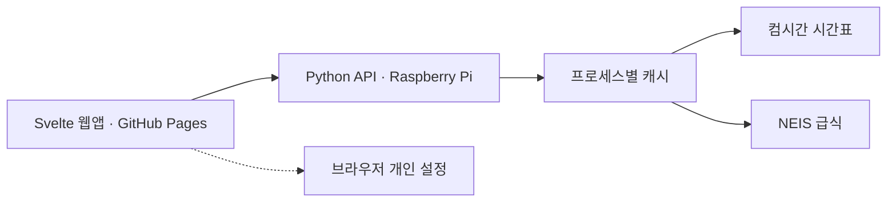

# Opencigan

Opencigan은 학교 시간표와 급식을 한곳에서 보는 웹앱입니다. 시간표는 컴시간, 급식은 NEIS 데이터를 사용합니다. 로그인 없이 학교와 학급을 선택할 수 있습니다.

[Opencigan 열기](https://opencigan.mcv.kr/) · [문제 제보](https://github.com/Transient-Onlooker/opencigan/issues) · [기여하기](CONTRIBUTING.md)

## 사용 방법

1. **학교 찾기**에서 학교 이름을 검색하고 학년과 반을 선택합니다. 현재 선택된 학교·학급을 확인한 뒤 시간표를 엽니다.
2. **시간표**에서 이번 주, 오늘, 학년 비교, 교사별 시간표를 확인합니다. **급식** 탭에서는 같은 학교의 하루 또는 주간 식단을 볼 수 있습니다. 이름이 같은 학교가 있으면 급식 탭에서 주소를 확인해 선택합니다.
3. **설정**에서 시간표 표시, 테마, 급식과 알레르기 항목을 바꿀 수 있습니다. 알레르기 설정은 브라우저에만 저장되며, NEIS에 알레르기가 표시되지 않았다고 해서 안전하다는 뜻은 아닙니다.

시간표는 PNG나 PDF로 저장할 수 있습니다. 화면 아래의 **학급 링크 복사**로 학급을 공유하거나, **캘린더 구독 링크**에서 하루 요약과 교시별 종일 일정 중 하나를 선택할 수 있습니다. 구독 주소는 캘린더 앱이 접근할 수 있어야 하며, 갱신 주기는 앱마다 다릅니다.

새로고침 후 **마지막 확인**은 서버 응답을 받은 시각, **마지막 수집**은 서버가 원본을 가져온 시각입니다. 서버가 캐시를 보냈다면 수집 시각은 그대로일 수 있습니다. 오프라인 조회는 연결이 끊기기 전에 불러온 마지막 시간표를 같은 학교·주차에서 보여 줍니다.

이전 개인 시간표·일정 편집 화면은 종료됐습니다. 기존 데이터는 이 브라우저에 남아 있으며, 데이터가 있다면 설정의 **기존 개인 데이터 내보내기**로 모든 학교·학급의 원본을 JSON 파일로 보관할 수 있습니다. 파일에는 개인 일정이 포함될 수 있으며, 현재 앱에서 파일을 다시 불러오는 기능은 없습니다.

## 서비스 구조

웹 화면과 API는 별도 배포 대상입니다. 알림·변경 이력 저장 등 일부 기능은 서버 설정에 따라 비활성일 수 있습니다. 자세한 내용은 [구조와 데이터 흐름](docs/architecture.md), 진행 방향은 [Mermaid 로드맵](docs/roadmap.md)을 참고하세요.

## 개발과 기여

문서 수정, 모바일에서 발견한 문제 제보, 합성 데이터로 재현할 수 있는 테스트도 도움이 됩니다. [기여 가이드](CONTRIBUTING.md)에서 제보와 PR 작성 방법을 확인하고, [개발 가이드](docs/development.md)에서 로컬 실행을 시작하세요.

| 문서 | 내용 |
| --- | --- |
| [로드맵·진행도](docs/roadmap.md) · [UI/UX 개선 목록](docs/roadmap/user-experience.md) · [알려진 문제](docs/known-issues.md) | 단계별 현황, 사용자 경험 개선, 잔여 검증 |
| [API 사용 가이드](docs/api-guide.md) · [OpenAPI](docs/openapi.yaml) | 요청 예시, 응답 형식, 캐시와 오류 |
| [구조와 데이터 흐름](docs/architecture.md) · [운영 가이드](docs/operations.md) | 서비스 구성과 배포 점검 |
| [이용 통계](docs/analytics.md) | 집계 항목과 데이터 보관 기준 |

시간표 연동에는 [pycomcigan](https://github.com/hegelty/pycomcigan)을 사용합니다.

## 라이선스

Opencigan 코드는 [AGPL-3.0-only](LICENSE)로 배포합니다. Copyright (c) 2026 Transient-Onlooker. 제3자 구성요소는 각자의 라이선스와 고지를 따릅니다.

이 저작물·수정본의 웹 푸터나 앱 정보 화면에는 제7조(b)에 따른 원작자·[원본 저장소](https://github.com/Transient-Onlooker/opencigan) 표시 조건이 적용됩니다. 코드 라이선스는 컴시간·NEIS 데이터 이용 허락을 부여하지 않습니다. 범위와 고지는 [라이선스 안내](docs/licensing.md) 및 [NOTICE](NOTICE)를 확인하세요.
