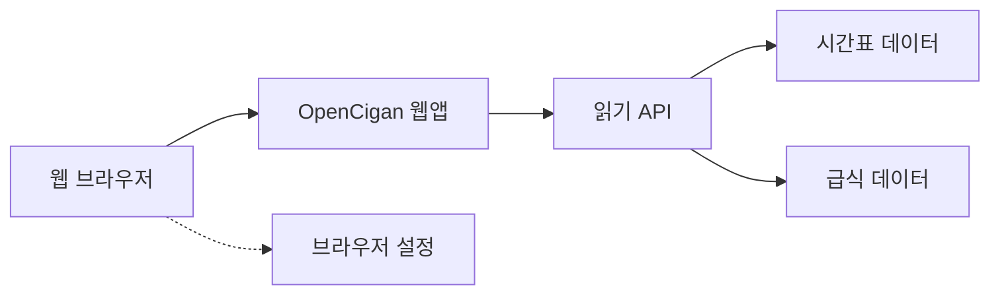

<p align="center">
  <picture>
    <source media="(prefers-color-scheme: dark)" srcset="docs/assets/opencigan-logo-dark.svg">
    <source media="(prefers-color-scheme: light)" srcset="docs/assets/opencigan-logo-light.svg">
    
  </picture>
</p>

<p align="center"><strong>학교 시간표와 급식을 한곳에서 확인하는 오픈소스 웹앱</strong></p>

<p align="center">
  <a href="LICENSE"></a>
  <a href="https://opencigan.mcv.kr/"></a>
  <a href="docs/api-guide.md"></a>
</p>

<p align="center">
  <a href="https://opencigan.mcv.kr/"><picture><source media="(prefers-color-scheme: dark)" srcset="docs/assets/links/primary-dark.svg"><source media="(prefers-color-scheme: light)" srcset="docs/assets/links/primary-light.svg"></picture></a>
  <a href="https://opencigan.pages.dev/"><picture><source media="(prefers-color-scheme: dark)" srcset="docs/assets/links/pages-dark.svg"><source media="(prefers-color-scheme: light)" srcset="docs/assets/links/pages-light.svg"></picture></a>
  <a href="https://xn--s39a564b8jcxrw.xn--hk3b17f.xn--3e0b707e/"><picture><source media="(prefers-color-scheme: dark)" srcset="docs/assets/links/korean-dark.svg"><source media="(prefers-color-scheme: light)" srcset="docs/assets/links/korean-light.svg"></picture></a>
</p>

<p align="center">
  <a href="docs/api-guide.md"><picture><source media="(prefers-color-scheme: dark)" srcset="docs/assets/links/api-dark.svg"><source media="(prefers-color-scheme: light)" srcset="docs/assets/links/api-light.svg"></picture></a>
  <a href="docs/roadmap/README.md"><picture><source media="(prefers-color-scheme: dark)" srcset="docs/assets/links/roadmap-dark.svg"><source media="(prefers-color-scheme: light)" srcset="docs/assets/links/roadmap-light.svg"></picture></a>
  <a href="https://github.com/Transient-Onlooker/opencigan/issues"><picture><source media="(prefers-color-scheme: dark)" srcset="docs/assets/links/issues-dark.svg"><source media="(prefers-color-scheme: light)" srcset="docs/assets/links/issues-light.svg"></picture></a>
</p>

---

학교 **시간표와 급식**을 한곳에서 확인하는 웹앱입니다. 학교·학년·반을 선택해 시간표를 조회하고, NEIS 급식 정보와 캘린더 구독 기능을 사용할 수 있습니다. 기본 조회에는 로그인이 필요하지 않습니다.

## 주요 기능

- **시간표:** 오늘·주간·학년 비교·교사별 보기, 변경 표시와 수집 시각
- **급식:** NEIS 기반 일간·주간 식단, 메뉴 검색, 알레르기 표시 설정
- **개인화:** 과목 색상/표시 이름, 교사 별칭, 교시 시각, 테마 및 브라우저 설정 백업
- **공유·내보내기:** 학급 링크, 시간표 PNG/PDF, iCalendar(ICS) 구독
- **연동:** 읽기 API, OpenAPI 명세, API Playground, 웹사이트 삽입용 `iframe` 위젯

알림·변경 이력 저장·일부 개발자 기능은 **서버 설정에 따라 비활성화**될 수 있습니다. 원본에 접근할 수 없는 경우 마지막으로 확인한 캐시 데이터가 표시될 수 있으며, 화면의 수집 시각과 오류 안내를 확인하세요.

## 사용 방법

1. **학교 찾기**에서 학교 이름을 검색한 다음 학년·반을 선택합니다.
2. **시간표**와 **급식**을 확인합니다. 같은 이름의 학교가 여럿이면 급식용 NEIS 학교 선택 시 주소를 비교합니다.
3. **설정**에서 개인화, 교시 시각, 알레르기 표시, 백업·복원을 관리합니다.
4. 시간표의 **이미지 저장·공유**, **PDF 저장**, **학급 링크 복사** 또는 **캘린더 구독 링크**를 이용합니다.

**데이터 시각:** '마지막 확인'은 API 응답을 받은 시점, '마지막 수집'은 백엔드가 원본을 가져온 시점입니다. 캐시 응답의 수집 시각은 바뀌지 않을 수 있습니다. 오프라인에는 같은 학교·주차에서 미리 가져온 마지막 시간표만 복원합니다.

**알레르기 주의:** 필터는 화면 표시를 돕는 기능입니다. NEIS 식단에 알레르기 항목이 없다고 해서 안전하다는 뜻은 아닙니다. 알레르기 설정은 브라우저에 보관합니다.

**오프라인 사용:** 홈 화면에 추가하거나 설치한 앱에서 최근 시간표를 오프라인으로 다시 볼 수 있습니다. 같은 기기에서 미리 조회한 학교·주차에 한하며, 화면에서 저장된 데이터임을 확인할 수 있습니다. 급식과 새 시간표 조회에는 연결이 필요합니다.

**이전 개인 일정:** 개인 시간표·시험 일정 편집 화면은 종료됐지만 기존 브라우저 데이터는 삭제하지 않았습니다. 해당 데이터가 있으면 설정에서 원본 JSON을 내보낼 수 있으며, 현재 앱에서 그 파일을 다시 불러오는 기능은 없습니다.

## 서비스 구조

OpenCigan은 [opencigan.mcv.kr](https://opencigan.mcv.kr/)에서 이용할 수 있습니다. [opencigan.pages.dev](https://opencigan.pages.dev/)와 [오픈시간.서버.한국](https://xn--s39a564b8jcxrw.xn--hk3b17f.xn--3e0b707e/)에서도 접속할 수 있습니다.



API는 `/api/v1/*`에서 제공됩니다.

[상세 아키텍처](docs/architecture.md) · [API 가이드](docs/api-guide.md)

## 문서 및 개발

### 로컬에서 시작하기

Python 3.13, Node.js 22 이상과 Git이 필요합니다. 저장소 루트에서 백엔드를 실행합니다.

Linux/macOS:

```bash
python -m venv .venv
.venv/bin/python -m pip install -r backend/requirements.txt
.venv/bin/python -m backend.app
```

Windows PowerShell:

```powershell
python -m venv .venv
.\.venv\Scripts\python -m pip install -r backend\requirements.txt
.\.venv\Scripts\python -m backend.app
```

다른 터미널에서 프런트엔드를 실행하고 표시된 주소를 엽니다.

```bash
cd frontend
npm ci
npm run dev
```

개발 서버는 API 요청을 로컬 백엔드로 전달합니다. 급식 조회에는 `NEIS_API_KEY` 환경 변수가 필요하며, 설정하지 않으면 급식 API는 사용할 수 없습니다. Windows 실행 경로, 환경 변수와 테스트 방법은 [개발 가이드](docs/development.md)를 참고하세요. 일반 테스트는 합성 데이터를 사용합니다.

| 목적 | 문서 |
| --- | --- |
| **문서 찾아보기** | [문서 안내](docs/README.md) |
| **로드맵** | [전체 진행 방향](docs/roadmap/README.md) · [2026-11-21 단기 실행 목록](docs/roadmap/short-term-2026-11-21.md) |
| **개발 시작** | [개발 가이드](docs/development.md) · [기여 가이드](CONTRIBUTING.md) |
| **API 연동** | [API 사용법](docs/api-guide.md) · [OpenAPI 3.1](docs/openapi.yaml) · [클라이언트 예제](docs/client-examples.md) |
| **서비스 품질** | [운영 절차](docs/operations/operations.md) · [알려진 문제](docs/qa/known-issues.md) · [접속 로그](docs/operations/access-logs.md) |

시간표 연동에는 [pycomcigan](https://github.com/hegelty/pycomcigan) 기반 [프로젝트 포크](https://github.com/Transient-Onlooker/pycomcigan)의 고정된 버전을 사용합니다. 원본 시간표·급식 데이터의 이용 조건은 코드 라이선스와 별개입니다.

## 라이선스

코드는 [AGPL-3.0-only](LICENSE)로 배포합니다. Copyright (c) 2026 Transient-Onlooker.

제7조(b)의 원작자·[원본 저장소](https://github.com/Transient-Onlooker/opencigan) 출처 표시 조건 및 제3자 구성요소 고지는 [라이선스 안내](docs/licensing.md)와 [NOTICE](NOTICE)를 참고하세요. 이 라이선스만으로 컴시간·NEIS 원본 데이터 재제공 허락을 받는 것은 아닙니다.
