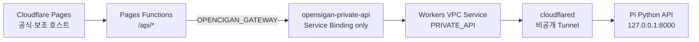

# OpenCigan Cloudflare 비공개 API 게이트웨이

> **현재 역할:** Cloudflare Pages의 `/api/v1/*` 요청을 Raspberry Pi Python API로 전달하는 **비공개 Worker** 소스입니다. 2026-11-18~19에 Worker/Pi 운영 배포가 기록돼 있으므로 이 디렉터리를 '아직 운영 전인 스테이징만의 스캐폴드'로 해석하지 마세요. 실제 실행 버전·남은 운영 QA는 [배포 기록](../docs/cloudflare-tunnel-rollout.md)을 확인하세요.

## 요청 흐름



- 공식 주소: [`opencigan.mcv.kr`](https://opencigan.mcv.kr/) · 보조 주소: [`opencigan.pages.dev`](https://opencigan.pages.dev/). 두 주소는 **동일 API 구성**을 사용합니다.
- Worker의 공개 `workers.dev` 엔드포인트는 비활성화합니다(`workers_dev: false`). Worker는 Pages Service Binding을 통해서만 호출합니다.
- 백엔드의 데이터 제공처 연결 설정은 운영자 내부 구성으로 관리합니다.

## Worker 동작과 보안 경계

| 항목 | 적용 방식 |
| --- | --- |
| 라우팅 | `cloudflare-gateway/src/index.mjs`의 허용된 API 경로와 메서드만 전달 |
| 원본 IP | Cloudflare 제공 IP를 검증해 HMAC 서명 후 Pi에 전달. 사용자가 전송한 `X-Forwarded-For` 등은 신뢰하지 않음 |
| 요청 제한 | 일반·검색·시간표·ICS·급식·관리자·Webhook의 **7개 Rate Limit binding**. `OPTIONS`는 별도 처리 |
| 오류 응답 | Worker 연결/설정·429 등은 JSON 오류와 허용 출처 CORS 계약을 따름 |
| 관리자·Webhook | 관리자 인증은 보존; **Webhook 백엔드는 운영 기본 비활성** |

Rate Limit binding은 PoP별로 제한을 근사하므로 전 세계 단일 IP에 대한 엄밀한 전역 쿼터가 아닙니다. 설정 코드/격리 테스트 통과가 실운영 429·`Retry-After`·공유 IP의 제한 분리 검증까지 뜻하지는 않습니다.

## 배포 설정과 확인

1. Cloudflare Pages 프로젝트의 루트는 `frontend`이며 빌드 명령은 `npm ci && npm run build`, 결과는 `dist`입니다. 같은 출처의 Pages Functions를 사용하도록 `VITE_API_BASE_URL`을 비웁니다.
2. Pages의 Service Binding `OPENCIGAN_GATEWAY`는 Worker `opensigan-private-api`를 가리킵니다. Worker의 VPC binding `PRIVATE_API`는 Pi의 `127.0.0.1:8000`으로 향하는 private service를 참조합니다.
3. `wrangler.example.jsonc`는 **예시**입니다. 실제 `wrangler.jsonc`와 비밀값은 저장소에 올리지 않습니다. 운영 설정을 예시값으로 덮어쓰지 않고, 일곱 binding·VPC·허용 Origin·서명 키를 확인합니다.
4. 서명 IP는 Worker secret `PROXY_IP_SIGNING_KEY`와 Pi 환경의 `OPENCIGAN_PROXY_IP_SIGNING_KEY`가 일치해야 합니다. 실비밀값·전체 토큰·사용자 IP를 로그/PR에 남기지 않습니다.
5. 실행 전 로컬/격리 환경에서 연결 장애, API/ICS GET·HEAD·OPTIONS, ETag/304, 인증, 제한/`Retry-After`, 스푸핑, 변경된 기능을 검증합니다. 운영 환경의 의도적 요청 폭주나 실제 롤백은 별도 승인·절차를 따릅니다.

```bash
# 저장소 루트
node --test cloudflare-gateway/test/*.test.mjs

# frontend 디렉터리
npm test
```

**기존 사용자 경로 보존:** 공식 사이트 전환 기록이 있으므로 예전 문서의 'GitHub Pages + Funnel이 현재 프로덕션'이라는 설명은 적용되지 않습니다. GitHub Pages는 별도 배포, Funnel 공개 노출은 중지된 상태이며 Pi의 Tailscale 사설 연결은 유지합니다.

[운영 절차](../docs/operations.md) · [IP 서명 계약](../docs/proxy-client-ip.md) · [P0 검증 게이트](../docs/roadmap/core-quality.md) · [Cloudflare Workers VPC](https://developers.cloudflare.com/workers-vpc/)
