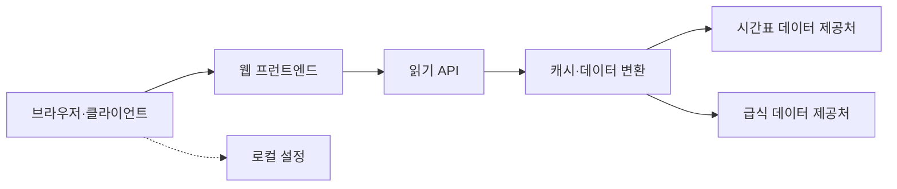

# OpenCigan 아키텍처와 데이터 흐름

> **구분:** 이 문서는 공개할 수 있는 일반화된 구성을 설명합니다. 실제 운영 상태·배포 버전·미검증 항목은 [운영 배포 기록](operations/cloudflare-tunnel-rollout.md)과 [P0 로드맵](roadmap/core-quality.md)을 기준으로 확인합니다. 마지막 문서 정리: 2026-11-21.

## 공개 서비스 구성

- 공개 웹과 읽기 API는 연결되지만 동일한 장애 원인을 공유할 수 있습니다. 보조 주소는 독립된 백업 API가 아닙니다.
- 프런트엔드·API·캐시·데이터 제공처 계층을 분리합니다. **실서비스 네트워크 방식·장비 식별자·접속 경로·관리용 설정값은 공개하지 않습니다.**
- 공개 URL: [공식 웹](https://opencigan.mcv.kr/) · [보조 웹](https://opencigan.pages.dev/).

## 주요 코드와 책임

| 경계 | 대표 파일·위치 | 책임 |
| --- | --- | --- |
| 프런트엔드 | `frontend/src/`, `frontend/functions/` | 선택 상태, 시간표·급식·설정 UI, Pages API 라우팅 |
| Python API | `backend/app.py` 및 `backend/`의 라우트 모듈 | 요청 검증, 캐시·JSON/ICS, 관리자 인증과 관측 |
| 시간표·캐시 | `backend/timetable.py`, `backend/cache.py` | 컴시간 조회, 정규화, 프로세스 캐시와 실패 복구 |
| 급식 | `backend/neis.py` | NEIS 학교 매칭과 식단 조회 |
| 변경 이력 | `backend/history.py` | 관측 스냅샷 비교, 선택적 SQLite 이력 저장 |

## 시간표·급식 처리

1. 브라우저가 선택한 컴시간 학교 ID와 이번 주 또는 다음 주를 요청합니다. 한 번의 서버 조회는 해당 학교의 주간 수업 데이터를 반환하며, 화면은 학년·반·교사 기준으로 재구성합니다.
2. 서버는 `(school, week)` 키의 캐시를 확인합니다. TTL은 기본 1,800초이고 같은 키의 중복 갱신은 프로세스 내에서 병합합니다. 원본 장애 시 일부 요청은 이전 캐시를 반환할 수 있습니다.
3. 시간표의 `cacheStatus`는 `hit`/`miss`/`stale`입니다. `stale`은 최신 원본을 보장하지 않으며, 서버의 원본 수집 시각과 브라우저의 수신 시각도 서로 다릅니다.
4. 컴시간 학교 ID와 NEIS 학교 ID는 다릅니다. 이름·지역으로 후보를 찾되 동명이교는 주소를 비교해 선택합니다. 급식은 NEIS ID와 기간별 캐시를 사용하고 요청당 조회 기간 제한이 있습니다.
5. NEIS API 키 등 비밀값은 백엔드 환경에서만 읽으며, 공개 JavaScript 번들에 넣지 않습니다.

## 캘린더·설정·관측 데이터

- **ICS:** `/api/v1/timetable.ics`에서 학급별 구독 URL을 제공합니다. GET/HEAD·ETag/304는 공개 호스트에서 일부 검증됐지만 실제 Apple/Google Calendar의 자동 갱신은 별도 게이트입니다. 실제 교시 시각을 사용하는 모드는 관련 교시 설정이 유효하고 서버가 지원할 때만 제공됩니다.
- **로컬 설정:** 과목 색상·표시 이름·교시 시각·알레르기 표시와 백업은 기본적으로 사용자 브라우저에 보관합니다. 선택적 클라우드 설정 동기화는 **아직 미구현**입니다.
- **이력:** `isChanged`는 컴시간 원본의 변경 표시입니다. `/api/v1/timetable/history`의 SQLite 비교 이력은 서비스가 *관측한 시점 사이*의 차이이며 모든 실제 변경을 뜻하지 않습니다. 이력 DB가 설정되지 않으면 기록하지 않습니다. 사용자용 과거 이력 보기 UI는 제거됐습니다.
- **접속 로그·운영 통계:** 별도의 관리자 인증과 보관·비활성 설정을 사용합니다. 개인정보 처리·원본 재제공 허락 판단은 운영자가 별도로 수행해야 합니다.

[운영 가이드](operations/operations.md) · [클라우드 배포 기록](operations/cloudflare-tunnel-rollout.md) · [API 문서](api-guide.md) · [현재 단기 로드맵](roadmap/short-term-2026-11-21.md)
