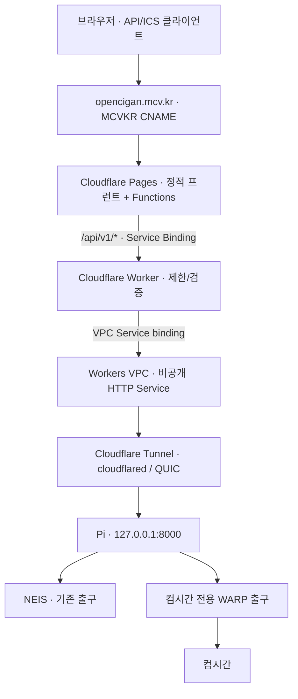

# Cloudflare Pages + Workers VPC + Tunnel — P0 실행 로드맵

> 2026-11-16 수정: **MCVKR은 타사 서브도메인 제공자**이며, `mcv.kr`의 네임서버와 Cloudflare zone을 사용자가 소유하거나 변경할 수 없다. **DNS zone 이전 없이 가능한 방식**으로 변경한다. 아직 Cloudflare 배포·관리 권한·Pi cloudflared 설치는 확인되지 않았다. [P0 로드맵](roadmap/core-quality.md) · [운영 가이드](operations.md) · [프록시 IP 신뢰 정책](proxy-client-ip.md) · [QA](qa-2026-11-16.md).

## 목표 아키텍처 — 사용자 제안 방식



**핵심:** 공개 도메인 없이 먼저 `<project>.pages.dev`에서 Pages/Functions·Worker·Workers VPC·Pi Tunnel을 검증하고, **마지막 단계에서만** MCVKR의 `opencigan.mcv.kr` CNAME을 Pages에 연결한다. 도메인 구매/네임서버 이전/별도 `opencigan-api.mcv.kr` 생성은 이 경로의 필수 조건이 아니다.

- Cloudflare의 **일반 Tunnel Published Application**은 Cloudflare zone에서 관리되는 CNAME이 필요하므로 여기서는 사용하지 않는다. 외부 MCVKR DNS의 CNAME을 `<UUID>.cfargotunnel.com`에 단순 연결하는 방식도 동작한다고 가정하지 않는다.
- **Workers VPC**는 Cloudflare Tunnel을 비공개 원본 연결로 이용하는 별도 기능이다. 2026-11-16 기준 Free 플랜에서 이용 가능한 **베타** 기능이며 변경 가능성이 있으므로 먼저 계정에서 지원 여부 확인.
- Cloudflare Pages Function은 Worker의 **Service Binding**을 호출하고, Worker는 **VPC Service binding**을 호출한다. Pages Functions가 VPC binding을 직접 제공한다고 가정하지 않는다.
- **보안 범위:** 타사 DNS의 `mcv.kr` zone-wide Cloudflare WAF Rules는 이 계정에서 적용 불가. 대신 Worker의 Rate Limiting binding과 요청 검증/봇 남용 탐지, 기존 Pi의 429/셔터를 조합한다. 정식 WAF zone 정책이 필요해지면 소유 도메인 또는 DNS 위임을 별도 검토.

## Phase 0 — 기존 자산 보존 및 계정 확인

- [x] **2026-11-16 23:02 KST 읽기 전용 기록(PR #43):** 공용 DNS 확인 기준 `mcv.kr`의 NS는 `japan.linode.dns.mcv.kr`, `singapore.linode.dns.mcv.kr`; `opencigan.mcv.kr`은 `transient-onlooker.github.io`를 가리키는 CNAME. 이는 Cloudflare가 해당 zone을 관리한다는 뜻이 아니다.
- [x] **PR #43 읽기 전용 Pi 점검:** 로컬·기존 Funnel 상태 API 정상, WARP 전용 브리지 컴시간 1회 응답 200, 운영 Pi는 `release-warp-20261116` 기반 `54f89b9`(수정·미추적 운영 파일 포함). `cloudflared` 미설치/미발견; sudo 인증·계정 플랜은 미확인.
- [ ] **잘못 추가한 `mcv.kr` Cloudflare zone은 변경하지 말고 계정에서 정리**. DNS 40개 복사본 편집이나 NS 변경 시도 중단. MCVKR 제공 도메인 전체를 소유한 것이 아님.
- [ ] Cloudflare Workers & Pages 및 **Workers VPC** 메뉴 접근, Free 플랜/Connectivity Directory 권한 확인. VPC Beta를 계정에서 사용할 수 없으면 여기서 중단하고 기존 Funnel 유지.
- [ ] 기존 GitHub Pages 배포 설정(`API_BASE_URL`), MCVKR CNAME, Pi 앱·WARP systemd drop-in 및 Tailscale Funnel의 롤백 경로 기록. 토큰·관리 키는 저장소나 채팅에 공유하지 않음.

## Phase 1 — Cloudflare Pages를 기본 주소에서 시험

- [ ] GitHub 저장소의 Svelte 프런트엔드를 Cloudflare Pages 프로젝트로 빌드·배포하고 `<project>.pages.dev`에서 자산, SPA 경로, 오프라인/PWA, 캐싱·아이콘·OG 미리보기를 확인. **기존 GitHub Pages는 유지**.
- [ ] 프런트 API base를 같은 출처(`''` 또는 검증된 설정)로 변경해 `/api/v1/*`에 요청하도록 하고, Pages Functions의 경로 매칭/응답·정적 자산 충돌을 확인.
- [ ] Pages Functions의 `/api/v1/*` 요청을 **Service Binding**으로 API Worker에 전달하도록 설계. 인증 헤더·메서드·URL·쿼리·본문·HEAD/OPTIONS·ETag/304가 손실되지 않는지 테스트.

## Phase 2 — Pi Tunnel과 Workers VPC Service 연결

- [ ] Pi에서 `systemctl --user status opensigan`, `systemctl --user cat opensigan`, `curl http://127.0.0.1:8000/api/v1/status`로 원본 상태 확인. WARP 출구는 그대로 둔다.
- [ ] **Workers VPC → Tunnels**에서 전용 Tunnel 생성. 공식 ARM64용 `cloudflared`를 Pi에 설치하고, 토큰은 비밀로 유지. Workers VPC용 tunnel은 QUIC 연결이 필요하고 UDP 7844 접근 및 cloudflared 2025.7.0 이상을 확인.
- [ ] **Workers VPC → VPC Services**에 Pi의 비공개 HTTP 원본 `127.0.0.1:8000`을 등록(호스트·IPv4 및 HTTP 포트 8000 지정). Service ID를 기록하되 비밀 토큰과 혼동하지 않는다.
- [ ] API Worker에서 해당 VPC Service를 `vpc_services` binding으로 연결하고 `env.PRIVATE_API.fetch(...)`로 보낸다. 원본 대상은 공개 MCVKR 주소가 아니라 터널 뒤의 Pi 로컬 HTTP 주소.
- [ ] 먼저 Worker 로컬/배포 스모크 테스트로 `/api/v1/status` 200, JSON 오류 400, HEAD/OPTIONS를 검증. Pages Functions → Worker Service Binding으로 같은 경로가 정상 작동하는지 확인.

```bash
systemctl --user status opensigan --no-pager
systemctl --user cat opensigan
curl --fail --silent --show-error http://127.0.0.1:8000/api/v1/status
command -v cloudflared && cloudflared --version
```

참고: Workers VPC는 Zero Trust 일반 Published Application의 DNS 라우팅과 다르다. Pi에서 프록시를 열거나 `mcv.kr` NS를 바꿀 필요가 없다.

## Phase 3 — API/봇 방어·실제 IP 검증

- [ ] **Worker 경계에서 허용 경로·HTTP 메서드·요청 크기 검증**, API 경로 외 URL 포워딩 금지. 관리/웹훅 경로는 기존 인증을 유지하고 필요한 경우 외부 접근을 별도 제한. 임의 URL을 받아 요청하는 범용 오픈 프록시로 만들지 않기.
- [ ] **Workers Rate Limiting binding**으로 검색·시간표·ICS별 가중치/요청률 제한을 구현. 값은 관측 후 설정, 제한 초과 시 JSON 429 및 재시도 안내. 이 제한은 대략적·PoP별이며 엄밀한 전역 방어가 아니라 기존 Pi 제한과 함께 사용한다.
- [ ] ICS·공개 API에는 JS/Managed Challenge·Cloudflare Access 로그인 강제 적용 금지. 봇 차단이 정상 학생·캘린더/외부 클라이언트를 차단하지 않는지 검증.
- [ ] **IP 신뢰 경계:** Pages/Worker의 사용자가 보낸 `X-Forwarded-For`/`Forwarded`를 그대로 Pi에 전달하지 않는다. 실제 엣지 IP 정보 전달 방식을 명확히 설계하고 Worker→Pi 헤더 위변조·프록시 홉·`OPENCIGAN_TRUSTED_PROXIES`를 테스트. 현재 백엔드는 `CF-Connecting-IP`를 직접 사용하지 않음. 다른 외부망 2곳에서 IP별 로그·429 제한을 실측.
- [ ] **원본 API의 캐시·CORS·ETag·304·HEAD·웹훅 서명·관리자 인증 유지**, Worker 429와 Pi `429 rate_limited`, `503 service_overloaded`, `503 upstream_unavailable` 구분.
- [ ] Cloudflare Pages의 사용자 지정 도메인에 적용되는 zone WAF는 `mcv.kr` zone의 소유자/운영자가 관리함. Workers 레벨 제한으로 가능한 것과 WAF 보호 범위의 차이를 문서화.

## Phase 4 — 마지막에 MCVKR CNAME 연결

- [ ] **MCVKR CNAME을 아직 변경하지 않고** Pages 기본 주소 `<project>.pages.dev`에서 홈페이지 및 `/api/v1/status`, 급식·시간표·학교 검색·공유·PNG/PDF, 관리자/알림, `.ics`를 검증.
- [ ] Cloudflare Pages 프로젝트의 **Custom domains → Set up a domain**에 `opencigan.mcv.kr` 등록. MCVKR에서 CNAME 대상을 `<project>.pages.dev`로 변경(기존 `transient-onlooker.github.io` 값은 기록/백업). 수동 CNAME만 먼저 바꾸는 것이 아니라 Pages에도 도메인을 등록해야 함.
- [ ] HTTPS 인증서 활성화·커스텀 도메인 Pages 라우팅·기존 공유 링크·OG 미리보기·리다이렉트·PWA/Service Worker 캐시를 확인.
- [ ] **API와 ICS를 같은 도메인 `https://opencigan.mcv.kr/api/v1/...`로 제공**. 새 ICS 구독·ETag/304·실제 캘린더 앱 자동 갱신을 테스트. 기존 Tailscale `.ts.net` 구독은 자동 이전되지 않으므로 재등록 안내 또는 한시적 유지.
- [ ] GitHub Pages/Tailscale Funnel을 즉시 제거하지 않는다. GitHub/Cloudflare Pages 자동 배포 충돌을 막고, 실측 결과에 따라 종료 여부 결정.

## Phase 5 — 롤백 및 완료 게이트

- [ ] Worker 문제가 생기면 Pages Function의 API 경로를 기존 Funnel API로 되돌릴 수 있는 스테이징/배포 복구 방안 확보. CNAME 전환 실패 시 MCVKR CNAME을 기존 GitHub Pages로 되돌리고 이전 호스트 인증서/전파 상태 확인.
- [ ] Pi 문제는 기존 `release-warp-20261116` 및 구 릴리스의 백업·systemd 복구 절차를 따르되, **컴시간 전용 WARP 프록시는 제거하지 않기**.
- [ ] 평균/중앙값/p95 응답 시간, 오류·429·503, Worker 제한, Workers VPC 연결·QUIC 재연결, 외부망 2곳 실제 IP와 CORS/ICS 로그를 기록. Private VPC Beta의 버전/제한을 운영 위험으로 남기기.

| 게이트 | 통과 조건 |
| --- | --- |
| Pages | `pages.dev`에서 프런트·API 경로 정상, custom domain 등록 후 CNAME/TLS 정상 |
| Workers VPC | cloudflared QUIC 안정, Worker→Pi 비공개 HTTP fetch 정상, Pi 외부 포트 개방 없음 |
| 보안 | Worker 경로·인증·대략적 Rate Limiting + Pi 자체 제한, 위조 IP 차단 검증 |
| 데이터 | 학교/시간표/급식 정상, 기존 WARP와 NEIS 동작 보존 |
| ICS | 실제 캘린더 구독·갱신 및 ETag 304, 기존 링크 재등록 방안 |
| 운영 | DNS·Pages·Worker·Pi 각각 독립 롤백, 적용 SHA와 증거 기록 |

## 공식 근거 (2026-11-16 검증)

- [Pages 외부 DNS 서브도메인 CNAME](https://developers.cloudflare.com/pages/configuration/custom-domains/)
- [Workers VPC 개요 (Free/Beta)](https://developers.cloudflare.com/workers-vpc/) · [Workers VPC 시작](https://developers.cloudflare.com/workers-vpc/get-started/) · [Pi Private API 예제](https://developers.cloudflare.com/workers-vpc/examples/private-api/)
- [Pages Functions → Worker Service Binding](https://developers.cloudflare.com/pages/functions/bindings/)
- [Worker Rate Limiting binding](https://developers.cloudflare.com/workers/runtime-apis/bindings/rate-limit/)
- [일반 Tunnel의 DNS 제한](https://developers.cloudflare.com/cloudflare-one/networks/connectors/cloudflare-tunnel/routing-to-tunnel/dns/)
