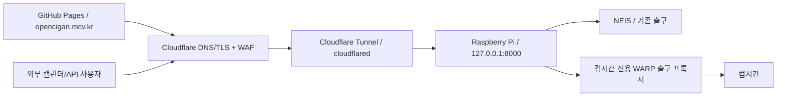

# Cloudflare Tunnel + WAF — P0 실전 구축 로드맵

> 2026-11-16 사전 작성. **Cloudflare 전환은 미배포·미검증**이며, 각 단계의 선행 조건과 롤백 경로를 확인한 후 진행한다. [P0 상세 로드맵](roadmap/core-quality.md) · [운영 가이드](operations.md) · [프록시 클라이언트 IP 정책](proxy-client-ip.md) · [통합 QA](qa-2026-11-16.md).

## 목표 구조



Cloudflare Tunnel + WAF는 **외부 사용자 → Pi API 수신 경로**만 담당한다. 이미 적용된 컴시간 전용 WARP 프록시는 **Pi → 컴시간 송신 경로**이며 서로 대체하지 않는다. Pages 웹사이트와 백엔드는 별개로 배포한다.

## 현재 확인된 기준

- [x] GitHub `main`에서 PR #41까지 병합, 최신 CI 성공 확인(2026-11-16 저녁). 이 체크는 **코드/CI 상태**만 뜻한다.
- [ ] Pi의 현재 실행 상태 재확인. 운영 문서의 마지막 기록은 `release-warp-20261116`(기반 `54f89b9`)이며 최신 main 배포가 아님. 실제 배포 SHA와 systemd drop-in, 이전 릴리스 복귀 지점을 별도 기록.
- [ ] 기존 Tailscale Funnel 공개 주소와 GitHub Pages의 현재 `API_BASE_URL` 값을 변경 전에 기록. DNS·백엔드·터널 변경은 단계별로 나누기.

## Phase 0 — 도메인·권한·인증서 결정

- [ ] `mcv.kr`의 Cloudflare zone 관리 권한, DNS setup(Full/Partial), 기존 `opencigan.mcv.kr` GitHub Pages CNAME, Cloudflare 플랜을 확인한다. **웹사이트 DNS는 손대지 않는다.**
- [ ] **우선 API 호스트 후보: `opencigan-api.mcv.kr`**. `mcv.kr`가 Full DNS zone이면 Cloudflare Universal SSL의 루트·1단계 서브도메인 적용 범위에 맞다. 이전 제안 `api.opencigan.mcv.kr`은 Full zone의 2단계 하위 호스트여서 기본 인증서 범위 밖일 수 있다. 실제 zone 또는 인증서 방식에 따라 최종 선택.
- [ ] 최종 호스트에 대한 DNS/TLS 적용 가능 여부 확인 후에만 Pages의 API 주소를 바꾼다. 새 DNS가 아직 없으면 이름은 **제안**이지 확정이 아니다.

### 2026-11-16 23:02 KST 읽기 전용 점검

- 공용 DNS `1.1.1.1` 기준 `mcv.kr`의 NS는 `japan.linode.dns.mcv.kr`과 `singapore.linode.dns.mcv.kr`이며, `opencigan.mcv.kr`은 `transient-onlooker.github.io`의 CNAME이다. 이는 현재 위임 상태이며 Cloudflare 계정의 zone 존재·플랜·Partial 구성 여부까지 증명하지는 않는다.
- 후보 `opencigan-api.mcv.kr`은 NXDOMAIN이다. `mcv.kr`의 CAA 질의는 NOERROR·답변 없음이었으나 새 호스트의 실제 Cloudflare 인증서 발급 가능 여부는 미검증이다.
- GitHub `API_BASE_URL`은 `https://rpi.tail9802be.ts.net`이고 기존 Funnel은 해당 호스트의 `/api`를 `127.0.0.1:8000/api`로 전달한다. Pages main의 최근 배포 워크플로는 성공했다.
- Pi `opensigan.service`는 `release-warp-20261116`에서 실행 중이며 Git 기준은 `54f89b935491a404dc251713ca652ad048b0599e`다. `backend/timetable.py` 수정과 `backend/comcigan_proxy.py` 등 미추적 파일이 있으므로 이 SHA만으로 실행 코드가 main과 동일하다고 판단하지 않는다. 미리보기 서비스도 실행 중이다.
- 로컬 및 기존 Funnel `/api/v1/status`는 프로세스 생존을 응답했고, WARP 서비스는 active이며 컴시간 전용 HTTP 브리지 경유 단일 요청은 200이었다. 이 검사는 다른 외부 의존성 전체의 정상 여부를 보장하지 않는다.
- Pi에서 `cloudflared` 명령과 시스템 서비스는 발견되지 않았고, 일반 사용자 `~/.cloudflared`도 없다. 루트의 인증 설정은 비대화형 sudo가 허용되지 않아 확인하지 못했다. Cloudflare zone 권한·플랜·인증서 설정은 확인되지 않았다.

## Phase 1 — Pi 기준선 및 Tunnel 생성

- [ ] Pi에서 기존 앱 및 프록시 설정을 **조회만** 하고 복구 정보를 보존. WARP는 건드리지 않으며 전역 `http_proxy`/라우팅 변경을 하지 않는다.
- [ ] Cloudflare 대시보드 **Networking → Tunnels → Create Tunnel**에서 새 터널 생성. 토큰·관리자 키는 대화/Issue/커밋에 기록하지 않는다.
- [ ] 공식 ARM64용 `cloudflared` 설치 후 터널을 systemd 서비스로 실행. OpenCigan의 사용자 서비스(`systemctl --user`)와 `cloudflared`의 시스템 서비스를 혼동하지 않는다.
- [ ] Published application hostname → `http://127.0.0.1:8000`으로 지정. 터널 Healthy, Pi 로컬 상태 API, 외부 공개 TLS 인증서, DNS 연결을 각각 확인. **기존 Funnel은 유지**.

```bash
systemctl --user status opensigan opensigan-preview --no-pager
systemctl --user cat opensigan
curl --fail --silent --show-error http://127.0.0.1:8000/api/v1/status
command -v cloudflared && cloudflared --version
sudo systemctl status cloudflared --no-pager
```

마지막 두 명령은 아직 미설치라면 실패할 수 있다. `GET /api/v1/status`의 200은 **프로세스 생존**만 뜻하며 컴시간/NEIS 원본 정상 여부는 보여주지 않는다.

## Phase 2 — 신규 공개 API 호스트의 기능·보안 검증

- [ ] **프런트 배포 변경 전에** 새 호스트의 GET `/api/v1/status` 200, 잘못된 입력 시 JSON 400, OPTIONS/CORS, HEAD, HTTPS를 확인. 응답 503은 원인 코드와 백엔드 예외 로그를 따로 해석한다.
- [ ] `ALLOWED_ORIGIN`에 정확한 `https://opencigan.mcv.kr`를 허용하고 기존 필요한 Origin은 유지. 브라우저의 CORS 및 미리보기·외부 API·Playground 호환성을 확인한다.
- [ ] **실제 IP 주의:** 현재 `backend/app.py`의 `resolve_client_ip()`는 신뢰된 직접 피어에서 `X-Forwarded-For`/`Forwarded`를 처리하지만 `CF-Connecting-IP`를 직접 사용하지 않는다. cloudflared가 실제 제공하는 헤더, Waitress `REMOTE_ADDR`, `OPENCIGAN_TRUSTED_PROXIES` 설정을 확인하고 헤더 위조 방지 테스트를 통과한 방식만 적용. 모든 IP 대역을 신뢰하도록 설정하면 안 된다.
- [ ] 서로 다른 외부망 2곳에서 클라이언트별 IP 로그와 기존 Python 60회/60초 제한의 분리 확인. 기존 셔터 및 Cloudflare 제한이 충돌하지 않게 검증.
- [ ] 컴시간에 부담을 주는 반복 실측 호출은 삼가고, 모의 원본·캐시된 응답을 우선 사용한다.

```bash
# 아래 호스트는 DNS/TLS 확인 후 사용하는 후보 주소
curl -i --max-time 10 https://opencigan-api.mcv.kr/api/v1/status
curl -i --max-time 10 -H 'Origin: https://opencigan.mcv.kr' https://opencigan-api.mcv.kr/api/v1/status
curl -i --max-time 10 -X OPTIONS -H 'Origin: https://opencigan.mcv.kr' -H 'Access-Control-Request-Method: GET' https://opencigan-api.mcv.kr/api/v1/schools
```

## Phase 3 — Cloudflare WAF·봇 차단

- [ ] Cloudflare 계정 플랜에서 실제 제공되는 WAF Custom Rules 및 Rate Limiting 규칙 수·작업 방식 확인. 처음에는 Security Events·기존 서버 429/503 및 정상 요청량을 관측하고 임의의 높은 차단 강도를 정하지 않는다.
- [ ] **새 API 호스트에만** 경로별 정책 적용: 학교 검색 `/api/v1/schools` 우선, 일반 시간표·급식·ICS, 상태/OPTIONS, 관리자·Webhook을 구분. 고비용 원본 요청과 캐시 적중 요청을 같은 기준으로 무조건 제한하지 않기.
- [ ] **JSON API·ICS·외부 클라이언트 경로에 JS/Managed Challenge, Cloudflare Access 로그인 강제 적용 금지.** API 클라이언트와 캘린더는 브라우저 챌린지를 풀 수 없다. 차단/제한도 정상 요청·갱신·CORS preflight 오탐 검증 후 적용.
- [ ] Cloudflare Free Bot Fight Mode는 zone 전체에서 작동하며 WAF Skip 규칙으로 제외할 수 없으므로 기본적으로 **활성화하지 않는다**. Super Bot Fight Mode 또는 bot score 같은 기능은 플랜이 지원할 때만 검토한다.
- [ ] 운영 로그에서 Cloudflare가 차단한 요청과 백엔드 `429 rate_limited`, `503 service_overloaded`, `503 upstream_unavailable`을 구분한다. 문제 규칙은 개별 해제 가능하도록 기록한다.

## Phase 4 — Pages·ICS 공개 주소 변경

- [ ] Tunnel/TLS/CORS/외부 API 게이트 통과 후에만 GitHub 저장소 변수 `API_BASE_URL`을 **확정된 공개 API 호스트**로 변경. `.github/workflows/ci.yml`은 이를 `VITE_API_BASE_URL`에 전달하고, `frontend/src/api.ts`의 ICS 생성 URL도 API base를 따른다.
- [ ] Pages 새 빌드를 배포해 브라우저 Network 패널에서 실제 요청 도메인 확인. 정적 웹 도메인 `opencigan.mcv.kr`은 계속 Pages에 유지한다.
- [ ] ICS 외부 캘린더 앱의 200/ETag, `If-None-Match` 304, HEAD·시간대·새로고침 검증. **과거 Tailscale 구독 URL은 새 URL로 자동 이전되지 않으므로** 이전 주소 유지 기간 또는 사용자 재등록 안내가 필요하다.
- [ ] 학교 검색·이번 주/다음 주·급식·공유·PNG/PDF·Playground·관리자 인증·Webhook 기본 비활성 계약이 바뀌지 않았는지 확인. 가능한 범위에서 모바일 실기기와 독립 외부망 재검증.
- [ ] 기존 Funnel과 새 Tunnel의 정상 캐시 응답 TTFB·총 지연·중앙값·p95와 오류/차단 비율을 같은 조건에서 측정하고, 안정성 판단 후 기존 주소 정리 여부 결정.

## Phase 5 — 롤백·완료 판정

- [ ] **WAF 오탐:** 해당 규칙만 비활성화 → API/ICS 재시험. **Pages 장애:** 보존한 이전 `API_BASE_URL`로 복원 → 재배포. **터널 장애:** 기존 Tailscale Funnel로 우회 → DNS/TLS/CORS·구독 URL 확인.
- [ ] **Pi API 버전 문제**는 Tunnel 문제와 별도로 운영 가이드의 이전 릴리스·DB 백업 절차로 복구. 컴시간 전용 WARP drop-in은 임의로 제거하지 않기.
- [ ] 완료 기록에 Tunnel 설정/호스트(비밀 토큰 제외), 실제 Pi SHA, Pages SHA, WAF 규칙·플랜, 외부망 2곳의 IP 분리, JSON/CORS/ICS 200·304, 원본 프록시 분리, 구독 마이그레이션, 측정/롤백 근거를 남기기.

### P0 완료 기준

| 검증 범주 | 완료 요건 |
| --- | --- |
| DNS/TLS/Tunnel | 공개 API 전용 HTTPS 인증서 유효, cloudflared 연결 안정 |
| API·Pages | 외부 JSON API·브라우저 호출·CORS·기존 오류 코드 유지 |
| 캘린더 | 비브라우저 ICS 구독/갱신, ETag·304 정상, 기존 링크 대응 |
| WAF·남용 방어 | 실제 보안 규칙 작동, 정상 API/ICS 호출을 오탐 차단하지 않음 |
| 클라이언트 IP | 두 외부망에서 IP/요청 제한 분리, XFF 스푸핑 거부 |
| 운영 | WARP 독립 유지, 이전 Funnel/Pages 설정으로 되돌리기 가능 |

**모든 항목은 미완료로 시작한다.** 한 항목의 통과가 Cloudflare 전환 전체의 완료를 뜻하지 않는다.

## 공식 참고 자료 (2026-11-16 확인)

- [Cloudflare Tunnel 구축](https://developers.cloudflare.com/tunnel/get-started/) · [Tunnel 라우팅](https://developers.cloudflare.com/tunnel/concepts/routing/) · [ARM64 다운로드](https://developers.cloudflare.com/tunnel/downloads/)
- [Universal SSL 호스트 적용 범위](https://developers.cloudflare.com/ssl/edge-certificates/universal-ssl/limitations/) · [WAF Rate Limiting](https://developers.cloudflare.com/waf/rate-limiting-rules/)
- [Bot Fight Mode와 API 오탐 제한](https://developers.cloudflare.com/bots/get-started/bot-fight-mode/) · [Skip 규칙 한계](https://developers.cloudflare.com/waf/custom-rules/skip/options/)
