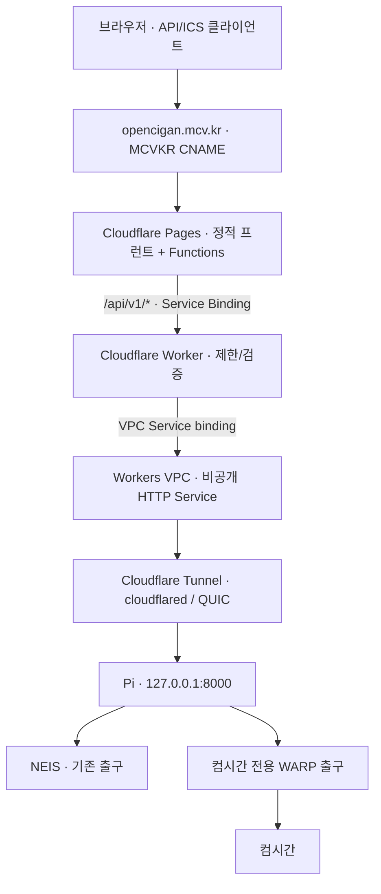

# Cloudflare Pages + Workers VPC + Tunnel — P0 실행 로드맵

> **2026-11-17 사용자 업데이트:** `opencigan.mcv.kr`의 **Cloudflare Pages 이전은 완료됐다고 보고**됐다. 이미 기록된 Pages→Worker→VPC→Pi 기본 연결과 별개로, 현재 DNS/TLS·실제 IP·전체 API·ICS 및 캘린더 실기기 QA는 추후 검증해야 한다. MCVKR은 타사 서브도메인 제공자이며 `mcv.kr` zone 전체를 소유하지 않는다. [P0 로드맵](roadmap/core-quality.md) · [운영 가이드](operations.md) · [프록시 IP 신뢰 정책](proxy-client-ip.md) · [QA](qa-2026-11-16.md).

## 목표 아키텍처 — 사용자 제안 방식



**핵심:** Pages/Functions → Worker → Workers VPC → Pi Tunnel의 기본 연결이 구성되어 있고, 사용자에 따르면 공식 `opencigan.mcv.kr`도 Cloudflare Pages로 이전됐다. **ICS/공개 API의 기존 `.ts.net` 구독 URL은 사이트 이전만으로 자동 변경되지 않는다.** 신규 구독 호스트와 기존 구독자를 구분해 확인하고, `mcv.kr` zone 네임서버/별도 API 도메인은 변경하지 않는다.

- Cloudflare의 **일반 Tunnel Published Application**은 Cloudflare zone에서 관리되는 CNAME이 필요하므로 여기서는 사용하지 않는다. 외부 MCVKR DNS의 CNAME을 `<UUID>.cfargotunnel.com`에 단순 연결하는 방식도 동작한다고 가정하지 않는다.
- **Workers VPC**는 Cloudflare Tunnel을 비공개 원본 연결로 이용하는 별도 기능이다. 2026-11-16 기준 Free 플랜에서 이용 가능한 **베타** 기능이며 변경 가능성이 있으므로 먼저 계정에서 지원 여부 확인.
- Cloudflare Pages Function은 Worker의 **Service Binding**을 호출하고, Worker는 **VPC Service binding**을 호출한다. Pages Functions가 VPC binding을 직접 제공한다고 가정하지 않는다.
- **보안 범위:** 타사 DNS의 `mcv.kr` zone-wide Cloudflare WAF Rules는 이 계정에서 적용 불가. 대신 Worker의 Rate Limiting binding과 요청 검증/봇 남용 탐지, 기존 Pi의 429/셔터를 조합한다. 정식 WAF zone 정책이 필요해지면 소유 도메인 또는 DNS 위임을 별도 검토.

## Phase 0 — 기존 자산 보존 및 계정 확인

- [x] **2026-11-16 23:02 KST 읽기 전용 기록(PR #43):** 공용 DNS 확인 기준 `mcv.kr`의 NS는 `japan.linode.dns.mcv.kr`, `singapore.linode.dns.mcv.kr`; `opencigan.mcv.kr`은 `transient-onlooker.github.io`를 가리키는 CNAME. 이는 Cloudflare가 해당 zone을 관리한다는 뜻이 아니다.
- [x] **PR #43 읽기 전용 Pi 점검:** 로컬·기존 Funnel 상태 API 정상, WARP 전용 브리지 컴시간 1회 응답 200, 운영 Pi는 `release-warp-20261116` 기반 `54f89b9`(수정·미추적 운영 파일 포함). `cloudflared` 미설치/미발견; sudo 인증·계정 플랜은 미확인.
- [ ] **잘못 추가한 `mcv.kr` Cloudflare zone은 변경하지 말고 계정에서 정리**. DNS 40개 복사본 편집이나 NS 변경 시도 중단. MCVKR 제공 도메인 전체를 소유한 것이 아님.
- [ ] Cloudflare Workers & Pages 및 **Workers VPC** 메뉴 접근, Free 플랜/Connectivity Directory 권한 확인. VPC Beta를 계정에서 사용할 수 없으면 여기서 중단하고 기존 Funnel 유지.
- [ ] 기존 GitHub Pages 배포 설정(`API_BASE_URL`), MCVKR CNAME, Pi 앱·WARP systemd drop-in 및 Tailscale Funnel의 롤백 경로 기록. 토큰·관리 키는 저장소나 채팅에 공유하지 않음.

## Phase 1 — Cloudflare Pages를 기본 주소에서 시험

- [x] Svelte 프런트엔드 Cloudflare Pages 배포 구성 및 기본 주소 접근 기록. GitHub CI/Pages 배포 성공 및 상태 API 확인 기록에 근거하며, 캐시·SPA·PWA·아이콘·OG의 사후 실사용 QA는 Phase 4로 분리. 기존 GitHub Pages를 즉시 삭제하지 않음.
- [x] Pages 출처에서 `/api/v1/*` 같은 출처 라우팅을 사용하도록 구성·수정(PR #94 포함). 기본 상태 응답은 확인했고, 전체 라우트/정적 자산 충돌은 Phase 4 QA 대상으로 둠.
- [x] Pages Functions의 `/api/v1/*` → Service Binding → API Worker → VPC 연결 구성. 상태 200·입력 오류 400·HEAD/OPTIONS 기본 동작은 기록됨. 인증 헤더·쿼리·본문·ETag/304 등 전체 계약은 Phase 4 QA에 남김.

## Phase 2 — Pi Tunnel과 Workers VPC Service 연결

- [x] Pi에서 서비스 설정과 로컬 상태 API를 확인했다. 기존 컴시간 전용 WARP 설정은 유지했다.
- [x] 전용 터널과 Pi 사용자 서비스를 생성했다. `cloudflared` 2026.11.0, QUIC·UDP 연결 및 Cloudflare 터널 healthy 상태를 확인했다.
- [x] 비공개 HTTP 원본 `127.0.0.1:8000`을 VPC Service `opencigan-pi`로 등록했다. Service ID: `01a1e508-9473-7c43-b9ab-1b76b0600696`.
- [x] API Worker `opensigan-private-api`에 VPC Service를 `PRIVATE_API`로 연결했다. 공개 `workers.dev` 경로는 사용하지 않는다.
- [x] Pages Functions → Worker → VPC → Pi 경로에서 상태 API 200, 입력 오류 JSON 400, HEAD 200, OPTIONS 204를 확인했다. Pages 미리보기와 운영 환경에 서비스 바인딩을 설정했으며 `opencigan.pages.dev` 상태 API도 200을 반환했다.

2026-11-17 **초기 연결 기록(이전 시점의 기록)**: Pi의 사용자 서비스는 `opencigan-cloudflared.service`이고 터널 토큰은 Pi에 별도 보관한다. 당시 기존 Funnel/WARP를 유지하고 공식 CNAME을 바꾸지 않았으나, **이후 사용자가 `opencigan.mcv.kr`의 Pages 이전 완료를 보고**했다. 상태 API 응답은 프로세스 생존만 의미하므로 실제 클라이언트 IP·인증·ICS 및 전체 데이터 검증은 여전히 남는다.

```bash
systemctl --user status opensigan --no-pager
systemctl --user cat opensigan
curl --fail --silent --show-error http://127.0.0.1:8000/api/v1/status
command -v cloudflared && cloudflared --version
```

참고: Workers VPC는 Zero Trust 일반 Published Application의 DNS 라우팅과 다르다. Pi에서 프록시를 열거나 `mcv.kr` NS를 바꿀 필요가 없다.

## Phase 3 — API/봇 방어·실제 IP 검증

- [x] **Worker 경계에서 허용 경로·HTTP 메서드·요청 크기 검증** 구현. 알려진 API 경로와 메서드만 Pi로 전달하고 본문은 원본과 같은 4,096바이트로 제한한다. 관리/웹훅 인증은 원본에서 유지하며 범용 URL 프록시는 제공하지 않는다. 단위 테스트 완료; Worker 운영 배포와 실제 인증 경로 검증은 별도로 필요하다.
- [ ] **Workers Rate Limiting binding**으로 검색·시간표·급식·ICS·관리·웹훅별 요청률 제한을 구현. 코드에는 일반 요청 상한과 별도 범주별 상한, JSON 429 및 `Retry-After`를 추가했다. 신규 `MEAL_RATE`·`ADMIN_RATE`·`WEBHOOK_RATE` 바인딩이 없으면 해당 경로가 503이므로 배포 전에 실제 Worker 구성에 반드시 추가하고 스테이징에서 먼저 검증한다. 예시 값은 테스트용이며 실제 트래픽을 관측한 뒤 정한다. 배포·관측은 미완료이며 웹훅 백엔드는 별도 활성화하지 않는다. 이 제한은 대략적·PoP별이며 엄밀한 전역 방어가 아니라 기존 Pi 제한과 함께 사용한다.
- [ ] ICS·공개 API에는 JS/Managed Challenge·Cloudflare Access 로그인 강제 적용 금지. 봇 차단이 정상 학생·캘린더/외부 클라이언트를 차단하지 않는지 검증.
- [ ] **IP 신뢰 경계:** Pages/Worker의 사용자가 보낸 `X-Forwarded-For`/`Forwarded`를 그대로 Pi에 전달하지 않는다. 실제 엣지 IP 정보 전달 방식을 명확히 설계하고 Worker→Pi 헤더 위변조·프록시 홉·`OPENCIGAN_TRUSTED_PROXIES`를 테스트. 현재 백엔드는 `CF-Connecting-IP`를 직접 사용하지 않음. 다른 외부망 2곳에서 IP별 로그·429 제한을 실측.
- [ ] **원본 API의 캐시·CORS·ETag·304·HEAD·웹훅 서명·관리자 인증 유지**, Worker 429와 Pi `429 rate_limited`, `503 service_overloaded`, `503 upstream_unavailable` 구분. Worker 자체 오류의 CORS와 `Retry-After` 노출은 허용 출처에 한해 구현·단위 테스트했다. Worker의 `ALLOWED_ORIGINS`를 Pi의 `ALLOWED_ORIGIN`과 맞춰 배포하고 실제 경로를 검증해야 한다.
- [x] Cloudflare Pages 사용자 지정 도메인의 zone WAF와 Worker 수준 방어의 차이 및 현재 경로별 제한을 아래에 문서화했다. WAF 활성 여부와 운영 임계치의 적정성은 별도로 검증해야 한다.

### 공개 경로 방어 범위 (2026-11-18 확인)

`mcv.kr` zone은 외부 제공자가 운영하므로 이 프로젝트 계정에서 해당 zone의 WAF 규칙이나 Challenge를 설정·확인할 수 있다고 가정하지 않는다. 아래 Worker 검사는 Pages의 `/api/*` 요청이 Service Binding을 통해 게이트웨이에 도달한 뒤 적용된다. Pages 정적 파일이나 Worker에 도달하기 전 요청에는 Worker 제한이 적용되지 않으며, Worker의 경로·메서드·크기 검사는 zone WAF의 공격 탐지나 네트워크 차단 전체를 대체하지 않는다. 실제 적용된 zone WAF 정책은 미확인이다.

활성 Worker 버전 `62d0377b-ceae-4550-a012-33e582f90f0c`의 Rate Limiting binding은 아래와 같다. 한도는 60초 기준이며 Cloudflare의 지점별 대략적인 제한이어서 전역으로 정확한 요청 수를 보장하지 않는다. IP가 없거나 유효하지 않으면 `unidentified` 키를 공유한다.

| 요청 경로 | Worker에서 적용하는 제한 |
| --- | --- |
| 학교·NEIS 학교 검색 | 검색 20회 |
| 시간표 | 일반 60회 및 시간표 40회 |
| ICS·변경 RSS | 일반 60회 및 캘린더 20회 |
| 급식·상태·변경 이력·관리·웹훅·분석 | 일반 60회 공유 |

OPTIONS 사전 요청은 Worker 요청량 제한을 건너뛰어 원본에 전달한다. 허용되지 않은 경로·메서드는 거절하고 요청 본문은 최대 4,096바이트로 제한한다. Worker 한도 초과는 `429 edge_rate_limited`와 `Retry-After`를 반환하며, Pi의 IP별 제한과 전체 셔터는 별도 계층이다. Worker에서 정상 캘린더·API 요청에 JS Challenge를 적용하지 않는다. 관리·웹훅의 인증은 Pi의 기존 정책이 담당하며, 웹훅 활성화나 인증 통과를 이 문서에서 보장하지 않는다.

**후속 코드 변경 (운영 배포·실측 전):** 사전 요청에 기존 일반 제한 바인딩을 `preflight:`가 붙은 별도 IP 키로 적용해 정상 API 요청의 카운터와 분리한다. 제한 초과는 Pi에 전달하지 않고 429를 반환하며, 정상 preflight는 기존처럼 원본의 CORS 응답을 사용한다. 기존 바인딩의 60회/60초를 사용하므로 새 바인딩은 필요하지 않다. 공유 IP와 `unidentified` 사용자의 영향 및 실제 Cloudflare 환경의 동작을 확인하기 전에는 운영 적정성을 확정하지 않는다.

**서명 IP 활성화 이후 관측 (2026-11-18 KST):** 2026-11-17 20:21 KST부터 2026-11-18 08:28 KST까지 Pi 접속 로그 95건 중 비루프백은 89건(GET 74, POST 14, OPTIONS 1), 루프백은 6건(GET 6)이다. 로그에는 서명 검증 여부와 진입 호스트가 기록되지 않으므로 주소만으로 경로를 증명할 수 없다. 운영자 확인에 따르면 비루프백 89건은 서명된 Cloudflare 경로, 루프백 6건은 로컬 확인 4건과 서명 없는 Funnel 2건이며, 20:18~20:21 외부 요청으로 종단 확인을 마쳤다. 활성화 이전 사전 요청 27건은 현재 경로의 미확인 비율에 포함하지 않는다.

위 구간에서 기록된 IP별 60초 이동 창 최대치는 비루프백 일반 요청 24건·OPTIONS 1건, 루프백 일반 요청 4건이었다. 이는 소량의 관측치이며 공유망 피크나 Worker `unidentified` 비율을 보증하지 않는다. **Pi 배포 전 코드 변경:** 서명 모드에서 검증된 IP별 일반 요청을 제한하고, 서명 없는 요청은 원격 주소별 `unsigned` 별도 버킷을 사용한다. Funnel의 여러 사용자는 루프백 버킷을 공유할 수 있다. Pi의 OPTIONS는 IP 제한과 셔터 모두에서 제외된다. Worker 운영 버전도 OPTIONS를 제한하지 않으며, 후속 코드의 별도 `preflight:` 카운터는 아직 배포 전이다. Worker는 Pi의 서명 검증 이전에 Cloudflare 제공 IP를 기준으로 기존 제한을 적용하므로 이를 Pi에서 검증된 서명 IP와 혼동하지 않는다. 새 OPTIONS 제한의 운영 배포는 공유망 영향 확인 전까지 보류한다.

**기존 Worker 정리 (2026-11-18 KST):** `opensigan-workers-api`는 운영·미리보기 Pages 바인딩의 대상이 아니고 최근 7일 관측 요청이 없었다. 사용자 요청에 따라 연결된 `opensigan-cache` D1을 SQL로 백업해 복원·무결성과 11행을 확인한 후 해당 Worker와 D1을 삭제했다. 백업에는 Worker 비밀키가 포함되지 않는다. 현재 Pages가 사용하는 `opensigan-private-api`와 VPC는 유지했고, 작업 후 공식 상태 API는 200이었다.

현재 급식·관리·웹훅은 각각 독립된 Worker 한도를 갖지 않는다. 원본 IP 전달과 서로 다른 외부망의 실측, 실제 요청량에 따른 한도 적정성, WAF 적용 여부 및 정상 클라이언트에 대한 영향은 미검증이다. 운영 트래픽 측정과 검증 없이 별도 한도나 Challenge를 추가하지 않는다.

## Phase 4 — 공식 사이트 이전 완료 보고 및 실사용 QA

- [x] **`opencigan.mcv.kr`의 Cloudflare Pages 공식 사이트 이전**: 사용자가 작업 완료를 확인했다. 실제 CNAME 대상과 Pages Custom domains/TLS 설정값은 외부에서 독립 확인하지 못했으므로 아래 QA의 사후 검증 대상으로 둔다.

**2026-11-17 예정 QA (실행 전, 미완료)**

- [ ] Pages 기본 주소와 `opencigan.mcv.kr`의 DNS·TLS·정적 자산·SPA/PWA·캐시·공유·PNG/PDF 및 `/api/v1/status`·학교 검색·시간표·급식·관리자/알림·ICS가 각 호스트에서 정상인지 검증. 기존 GitHub Pages를 제거하지 않는다.
- [ ] 인증 헤더·쿼리·본문, CORS·HEAD/OPTIONS·ETag/304, 429/503 오류 계약과 Pages Functions의 정적 자산 충돌 여부를 실제 엔드포인트에서 확인한다.
- [ ] **공식 호스트 이전 사후 QA:** HTTPS 인증서·커스텀 도메인 Pages 라우팅, 기존 공유 링크·OG 미리보기·리다이렉트·PWA/Service Worker 캐시를 확인한다. **사이트 이전 완료**와 **QA 통과**를 혼동하지 않는다.
- [ ] **선택한 공개 ICS 호스트로 구독 제공:** `opencigan.pages.dev` 또는 기존 Tailscale `.ts.net`의 `/api/v1/timetable.ics`를 이용하며 `opencigan.mcv.kr` 동일 출처는 필수가 아님. 클라이언트 직접 접근·TLS·정상 VCALENDAR·ETag/304·Apple/Google Calendar 실제 구독·갱신·장애 시 대체 경로를 검증. 기존 구독 URL은 자동으로 다른 호스트로 이전되지 않으므로 변경 시 재등록 안내 또는 한시적 병행 운영.
- [x] **2026-11-18 공개 ICS HTTP 확인:** 단일 네트워크에서 Pages 기본 주소와 공식 주소 모두 동일 학교·학급의 HTTPS GET 200, VCALENDAR 시작·종료, ETag와 동일 ETag를 이용한 304, HEAD 200 `text/calendar`를 확인했다. 운영 코드 SHA는 확인하지 못했으며 실제 캘린더 앱·자동 갱신·다른 외부망·지속성은 검증하지 않았다.
- [ ] **Tailscale Funnel 단계적 종료·관측:** 2026-11-17 사용자가 기존 `.ts.net` 캘린더 구독자가 없다고 확인한 뒤 Funnel을 중지했다. Pages 기본 주소의 상태·검색·시간표·급식·ICS는 200으로 확인했다. 공식 `opencigan.mcv.kr`은 같은 시각 공개 DNS에서 일시적으로 SERVFAIL이었으나 23:16 KST 재확인 시 CNAME 조회와 상태 API 200으로 복구됐다. 원인 및 장기 안정성, 외부 자동화 의존 여부는 미확인이다. 사설 Tailscale·Cloudflare Tunnel은 유지하며 WARP는 변경하지 않았다. 중지 전 설정과 확인 범위는 [운영 기록](operations.md#tailscale-funnel-단계적-퇴역)을 따른다.

## Phase 5 — 롤백 및 완료 게이트

- [ ] Worker 문제가 생기면 Pages Function의 API 경로를 기존 Funnel API로 되돌릴 수 있는 스테이징/배포 복구 방안 확보. CNAME 전환 실패 시 MCVKR CNAME을 기존 GitHub Pages로 되돌리고 이전 호스트 인증서/전파 상태 확인.
- [ ] Pi 문제는 기존 `release-warp-20261116` 및 구 릴리스의 백업·systemd 복구 절차를 따르되, **컴시간 전용 WARP 프록시는 제거하지 않기**.
- [ ] 평균/중앙값/p95 응답 시간, 오류·429·503, Worker 제한, Workers VPC 연결·QUIC 재연결, 외부망 2곳 실제 IP와 CORS/ICS 로그를 기록. Private VPC Beta의 버전/제한을 운영 위험으로 남기기.

| 게이트 | 통과 조건 |
| --- | --- |
| Pages | `pages.dev`에서 프런트·API 경로 정상, TLS·캐시 확인. 공식 웹사이트 이전을 선택했을 때만 custom domain/CNAME 검사 |
| Workers VPC | cloudflared QUIC 안정, Worker→Pi 비공개 HTTP fetch 정상, Pi 외부 포트 개방 없음 |
| 보안 | Worker 경로·인증·대략적 Rate Limiting + Pi 자체 제한, 위조 IP 차단 검증 |
| 데이터 | 학교/시간표/급식 정상, 기존 WARP와 NEIS 동작 보존 |
| ICS | 선택된 `pages.dev` 또는 `.ts.net`에서 실제 구독·갱신 및 ETag 304·TLS, 호스트 변경 시 기존 링크 재등록/병행 운영 방안 (동일 출처 강제 없음) |
| 운영 | DNS·Pages·Worker·Pi 각각 독립 롤백, 적용 SHA와 증거 기록 |

## 공식 근거 (2026-11-16 검증)

- [Pages 외부 DNS 서브도메인 CNAME](https://developers.cloudflare.com/pages/configuration/custom-domains/)
- [Workers VPC 개요 (Free/Beta)](https://developers.cloudflare.com/workers-vpc/) · [Workers VPC 시작](https://developers.cloudflare.com/workers-vpc/get-started/) · [Pi Private API 예제](https://developers.cloudflare.com/workers-vpc/examples/private-api/)
- [Pages Functions → Worker Service Binding](https://developers.cloudflare.com/pages/functions/bindings/)
- [Worker Rate Limiting binding](https://developers.cloudflare.com/workers/runtime-apis/bindings/rate-limit/)
- [일반 Tunnel의 DNS 제한](https://developers.cloudflare.com/cloudflare-one/networks/connectors/cloudflare-tunnel/routing-to-tunnel/dns/)
