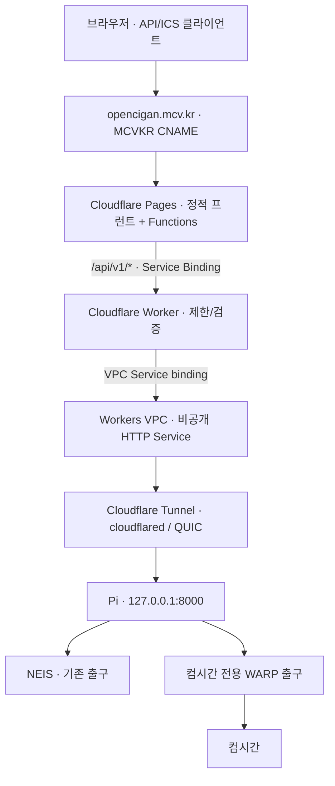

# Cloudflare Pages + Workers VPC + Tunnel — P0 실행 로드맵

> **2026-11-17 사용자 업데이트:** `opencigan.mcv.kr`의 **Cloudflare Pages 이전은 완료됐다고 보고**됐다. 이미 기록된 Pages→Worker→VPC→Pi 기본 연결과 별개로, 현재 DNS/TLS·실제 IP·전체 API·ICS 및 캘린더 실기기 QA는 추후 검증해야 한다. MCVKR은 타사 서브도메인 제공자이며 `mcv.kr` zone 전체를 소유하지 않는다. [P0 로드맵](roadmap/core-quality.md) · [운영 가이드](operations.md) · [프록시 IP 신뢰 정책](proxy-client-ip.md) · [QA](qa-2026-11-16.md).

## 목표 아키텍처 — 사용자 제안 방식



**핵심:** Pages/Functions → Worker → Workers VPC → Pi Tunnel의 기본 연결이 구성되어 있고, 사용자에 따르면 공식 `opencigan.mcv.kr`도 Cloudflare Pages로 이전됐다. **ICS/공개 API의 기존 `.ts.net` 구독 URL은 사이트 이전만으로 자동 변경되지 않는다.** 신규 구독 호스트와 기존 구독자를 구분해 확인하고, `mcv.kr` zone 네임서버/별도 API 도메인은 변경하지 않는다.

- Cloudflare의 **일반 Tunnel Published Application**은 Cloudflare zone에서 관리되는 CNAME이 필요하므로 여기서는 사용하지 않는다. 외부 MCVKR DNS의 CNAME을 `<UUID>.cfargotunnel.com`에 단순 연결하는 방식도 동작한다고 가정하지 않는다.
- **Workers VPC**는 Cloudflare Tunnel을 비공개 원본 연결로 이용하는 별도 기능이다. 2026-11-16 기준 Free 플랜에서 이용 가능한 **베타** 기능이며 변경 가능성이 있으므로 먼저 계정에서 지원 여부 확인.
- Cloudflare Pages Function은 Worker의 **Service Binding**을 호출하고, Worker는 **VPC Service binding**을 호출한다. Pages Functions가 VPC binding을 직접 제공한다고 가정하지 않는다.
- **보안 범위:** 타사 DNS의 `mcv.kr` zone-wide Cloudflare WAF Rules는 이 계정에서 적용 불가. 대신 Worker의 Rate Limiting binding과 요청 검증/봇 남용 탐지, 기존 Pi의 429/셔터를 조합한다. 정식 WAF zone 정책이 필요해지면 소유 도메인 또는 DNS 위임을 별도 검토.

## Phase 0 — 기존 자산 보존 및 계정 확인

- [x] **2026-11-16 23:02 KST 읽기 전용 기록(PR #43):** 공용 DNS 확인 기준 `mcv.kr`의 NS는 `japan.linode.dns.mcv.kr`, `singapore.linode.dns.mcv.kr`; `opencigan.mcv.kr`은 `transient-onlooker.github.io`를 가리키는 CNAME. 이는 Cloudflare가 해당 zone을 관리한다는 뜻이 아니다.
- [x] **PR #43 읽기 전용 Pi 점검:** 로컬·기존 Funnel 상태 API 정상, WARP 전용 브리지 컴시간 1회 응답 200, 운영 Pi는 `release-warp-20261116` 기반 `54f89b9`(수정·미추적 운영 파일 포함). `cloudflared` 미설치/미발견; sudo 인증·계정 플랜은 미확인.
- [ ] **잘못 추가한 `mcv.kr` Cloudflare zone은 변경하지 말고 계정에서 정리**. DNS 40개 복사본 편집이나 NS 변경 시도 중단. MCVKR 제공 도메인 전체를 소유한 것이 아님.
- [ ] Cloudflare Workers & Pages 및 **Workers VPC** 메뉴 접근, Free 플랜/Connectivity Directory 권한 확인. VPC Beta를 계정에서 사용할 수 없으면 여기서 중단하고 기존 Funnel 유지.
- [ ] 기존 GitHub Pages 배포 설정(`API_BASE_URL`), MCVKR CNAME, Pi 앱·WARP systemd drop-in 및 Tailscale Funnel의 롤백 경로 기록. 토큰·관리 키는 저장소나 채팅에 공유하지 않음.

## Phase 1 — Cloudflare Pages를 기본 주소에서 시험

- [x] Svelte 프런트엔드 Cloudflare Pages 배포 구성 및 기본 주소 접근 기록. GitHub CI/Pages 배포 성공 및 상태 API 확인 기록에 근거하며, 캐시·SPA·PWA·아이콘·OG의 사후 실사용 QA는 Phase 4로 분리. 기존 GitHub Pages를 즉시 삭제하지 않음.
- [x] Pages 출처에서 `/api/v1/*` 같은 출처 라우팅을 사용하도록 구성·수정(PR #94 포함). 기본 상태 응답은 확인했고, 전체 라우트/정적 자산 충돌은 Phase 4 QA 대상으로 둠.
- [x] Pages Functions의 `/api/v1/*` → Service Binding → API Worker → VPC 연결 구성. 상태 200·입력 오류 400·HEAD/OPTIONS 기본 동작은 기록됨. 인증 헤더·쿼리·본문·ETag/304 등 전체 계약은 Phase 4 QA에 남김.

## Phase 2 — Pi Tunnel과 Workers VPC Service 연결

- [x] Pi에서 서비스 설정과 로컬 상태 API를 확인했다. 기존 컴시간 전용 WARP 설정은 유지했다.
- [x] 전용 터널과 Pi 사용자 서비스를 생성했다. `cloudflared` 2026.11.0, QUIC·UDP 연결 및 Cloudflare 터널 healthy 상태를 확인했다.
- [x] 비공개 HTTP 원본 `127.0.0.1:8000`을 VPC Service `opencigan-pi`로 등록했다. Service ID: `01a1e508-9473-7c43-b9ab-1b76b0600696`.
- [x] API Worker `opensigan-private-api`에 VPC Service를 `PRIVATE_API`로 연결했다. 공개 `workers.dev` 경로는 사용하지 않는다.
- [x] Pages Functions → Worker → VPC → Pi 경로에서 상태 API 200, 입력 오류 JSON 400, HEAD 200, OPTIONS 204를 확인했다. Pages 미리보기와 운영 환경에 서비스 바인딩을 설정했으며 `opencigan.pages.dev` 상태 API도 200을 반환했다.

2026-11-17 **초기 연결 기록(이전 시점의 기록)**: Pi의 사용자 서비스는 `opencigan-cloudflared.service`이고 터널 토큰은 Pi에 별도 보관한다. 당시 기존 Funnel/WARP를 유지하고 공식 CNAME을 바꾸지 않았으나, **이후 사용자가 `opencigan.mcv.kr`의 Pages 이전 완료를 보고**했다. 상태 API 응답은 프로세스 생존만 의미하므로 실제 클라이언트 IP·인증·ICS 및 전체 데이터 검증은 여전히 남는다.

```bash
systemctl --user status opensigan --no-pager
systemctl --user cat opensigan
curl --fail --silent --show-error http://127.0.0.1:8000/api/v1/status
command -v cloudflared && cloudflared --version
```

참고: Workers VPC는 Zero Trust 일반 Published Application의 DNS 라우팅과 다르다. Pi에서 프록시를 열거나 `mcv.kr` NS를 바꿀 필요가 없다.

## Phase 3 — API/봇 방어·실제 IP 검증

- [x] **Worker 경계에서 허용 경로·HTTP 메서드·요청 크기 검증** 구현 및 운영 배포. 알려진 API 경로와 메서드만 Pi로 전달하고 본문은 원본과 같은 4,096바이트로 제한한다. 관리/웹훅 인증은 원본에서 유지하며 범용 URL 프록시는 제공하지 않는다. 관리자 미인증 응답을 확인했으며 실제 인증 경로 검증은 별도로 필요하다.
- [ ] **Workers Rate Limiting binding**으로 검색·시간표·급식·ICS·관리·웹훅별 요청률 제한을 구현. 일반 요청 상한과 별도 범주별 상한, JSON 429 및 `Retry-After`를 구현하고 2026-11-18 운영 배포에 필요한 일곱 binding을 모두 연결했다. 단위 테스트와 정상 요청은 확인했으나 실제 429와 공유망 영향·한도 적정성 관측은 남았다. 웹훅 백엔드는 활성화하지 않았다. 이 제한은 대략적·PoP별이며 엄밀한 전역 방어가 아니라 기존 Pi 제한과 함께 사용한다.
- [ ] ICS·공개 API에는 JS/Managed Challenge·Cloudflare Access 로그인 강제 적용 금지. 봇 차단이 정상 학생·캘린더/외부 클라이언트를 차단하지 않는지 검증.
- [ ] **IP 신뢰 경계:** Pages/Worker의 사용자가 보낸 `X-Forwarded-For`/`Forwarded`를 그대로 Pi에 전달하지 않는다. 실제 엣지 IP 정보 전달 방식을 명확히 설계하고 Worker→Pi 헤더 위변조·프록시 홉·`OPENCIGAN_TRUSTED_PROXIES`를 테스트. 현재 백엔드는 `CF-Connecting-IP`를 직접 사용하지 않음. 다른 외부망 2곳에서 IP별 로그·429 제한을 실측.
- [ ] **원본 API의 캐시·CORS·ETag·304·HEAD·웹훅 서명·관리자 인증 유지**, Worker 429와 Pi `429 rate_limited`, `503 service_overloaded`, `503 upstream_unavailable` 구분. Worker 자체 오류의 CORS와 `Retry-After` 노출은 허용 출처에 한해 구현·단위 테스트했다. Worker의 `ALLOWED_ORIGINS`를 Pi의 `ALLOWED_ORIGIN`과 맞춰 배포하고 실제 경로를 검증해야 한다.
  - Pages Function에서 서비스 바인딩이 없거나 호출이 실패하면 내부 예외를 노출하지 않는 503을 반환하고 HEAD 본문은 비운다. 공식 사이트와 GitHub Pages의 정확한 출처에 한해 장애 중 CORS 사전 요청은 204로 처리해 뒤이은 실제 요청의 503을 브라우저에서 읽게 한다. 204는 CORS 정책 응답이며 API 정상 상태를 뜻하지 않는다. 허용 출처 목록과 메서드·헤더 정책은 Pi·Worker 설정과 함께 관리하고, 배포와 실제 CORS 검증은 별도로 남는다.
- [x] Cloudflare Pages 사용자 지정 도메인의 zone WAF와 Worker 수준 방어의 차이 및 현재 경로별 제한을 아래에 문서화했다. WAF 활성 여부와 운영 임계치의 적정성은 별도로 검증해야 한다.

### 공개 경로 방어 범위 (2026-11-18 확인)

`mcv.kr` zone은 외부 제공자가 운영하므로 이 프로젝트 계정에서 해당 zone의 WAF 규칙이나 Challenge를 설정·확인할 수 있다고 가정하지 않는다. 아래 Worker 검사는 Pages의 `/api/*` 요청이 Service Binding을 통해 게이트웨이에 도달한 뒤 적용된다. Pages 정적 파일이나 Worker에 도달하기 전 요청에는 Worker 제한이 적용되지 않으며, Worker의 경로·메서드·크기 검사는 zone WAF의 공격 탐지나 네트워크 차단 전체를 대체하지 않는다. 실제 적용된 zone WAF 정책은 미확인이다.

배포 전 Worker 버전 `62d0377b-ceae-4550-a012-33e582f90f0c`의 Rate Limiting binding은 아래와 같았다. 한도는 60초 기준이며 Cloudflare의 지점별 대략적인 제한이어서 전역으로 정확한 요청 수를 보장하지 않는다. IP가 없거나 유효하지 않으면 `unidentified` 키를 공유한다. 현재 구성은 아래 운영 반영 결과를 따른다.

| 요청 경로 | Worker에서 적용하는 제한 |
| --- | --- |
| 학교·NEIS 학교 검색 | 검색 20회 |
| 시간표 | 일반 60회 및 시간표 40회 |
| ICS·변경 RSS | 일반 60회 및 캘린더 20회 |
| 급식·상태·변경 이력·관리·웹훅·분석 | 일반 60회 공유 |

당시 OPTIONS 사전 요청은 Worker 요청량 제한을 건너뛰어 원본에 전달했다. 허용되지 않은 경로·메서드는 거절하고 요청 본문은 최대 4,096바이트로 제한한다. Worker 한도 초과는 `429 edge_rate_limited`와 `Retry-After`를 반환하며, Pi의 IP별 제한과 전체 셔터는 별도 계층이다. Worker에서 정상 캘린더·API 요청에 JS Challenge를 적용하지 않는다. 관리·웹훅의 인증은 Pi의 기존 정책이 담당하며, 웹훅 활성화나 인증 통과를 이 문서에서 보장하지 않는다.

**후속 코드 변경 (2026-11-18 운영 배포):** 사전 요청에 기존 일반 제한 바인딩을 `preflight:`가 붙은 별도 IP 키로 적용해 정상 API 요청의 카운터와 분리한다. 제한 초과는 Pi에 전달하지 않고 429를 반환하며, 정상 preflight는 기존처럼 원본의 CORS 응답을 사용한다. 기존 바인딩의 60회/60초를 사용하므로 새 바인딩은 필요하지 않다. 정상 preflight는 확인했으나 공유 IP와 `unidentified` 사용자의 영향 및 실제 제한 초과 동작은 미검증이다.

**서명 IP 활성화 이후 관측 (2026-11-18 KST):** 2026-11-17 20:21 KST부터 2026-11-18 08:28 KST까지 Pi 접속 로그 95건 중 비루프백은 89건(GET 74, POST 14, OPTIONS 1), 루프백은 6건(GET 6)이다. 로그에는 서명 검증 여부와 진입 호스트가 기록되지 않으므로 주소만으로 경로를 증명할 수 없다. 운영자 확인에 따르면 비루프백 89건은 서명된 Cloudflare 경로, 루프백 6건은 로컬 확인 4건과 서명 없는 Funnel 2건이며, 20:18~20:21 외부 요청으로 종단 확인을 마쳤다. 활성화 이전 사전 요청 27건은 현재 경로의 미확인 비율에 포함하지 않는다.

위 구간에서 기록된 IP별 60초 이동 창 최대치는 비루프백 일반 요청 24건·OPTIONS 1건, 루프백 일반 요청 4건이었다. 이는 소량의 관측치이며 공유망 피크나 Worker `unidentified` 비율을 보증하지 않는다. **2026-11-18 배포된 Pi 코드:** 서명 모드에서 검증된 IP별 일반 요청을 제한하고, 서명 없는 요청은 원격 주소별 `unsigned` 별도 버킷을 사용한다. Funnel의 여러 사용자는 루프백 버킷을 공유할 수 있다. Pi의 OPTIONS는 IP 제한과 셔터 모두에서 제외된다. Worker는 사전 요청을 별도 `preflight:` 카운터로 제한하며, Pi의 서명 검증 이전에 Cloudflare 제공 IP를 기준으로 제한하므로 이를 Pi에서 검증된 서명 IP와 혼동하지 않는다. 공유망 영향은 계속 관측한다.

**기존 Worker 정리 (2026-11-18 KST):** `opensigan-workers-api`는 운영·미리보기 Pages 바인딩의 대상이 아니고 최근 7일 관측 요청이 없었다. 사용자 요청에 따라 연결된 `opensigan-cache` D1을 SQL로 백업해 복원·무결성과 11행을 확인한 후 해당 Worker와 D1을 삭제했다. 백업에는 Worker 비밀키가 포함되지 않는다. 현재 Pages가 사용하는 `opensigan-private-api`와 VPC는 유지했고, 작업 후 공식 상태 API는 200이었다.

급식·관리·웹훅의 독립 Worker 한도는 2026-11-18 적용했다. 당시 한 외부 경로에서 IP 전달을 확인했으며 후속 독립 외부망 확인 결과는 아래에 기록했다. 실제 요청량에 따른 한도 적정성, WAF 적용 여부 및 정상 클라이언트에 대한 영향은 추가 검증이 필요하다.

## Phase 4 — 공식 사이트 이전 완료 보고 및 실사용 QA

- [x] **`opencigan.mcv.kr`의 Cloudflare Pages 공식 사이트 이전**: 사용자가 작업 완료를 확인했다. 실제 CNAME 대상과 Pages Custom domains/TLS 설정값은 외부에서 독립 확인하지 못했으므로 아래 QA의 사후 검증 대상으로 둔다.

**2026-11-17 예정 QA (실행 전, 미완료)**

- [x] **2026-11-18 공개 상태·CORS 부분 확인:** 13:35 KST 단일 네트워크에서 공식 주소와 Pages 기본 주소의 HTTPS 상태 API가 각각 200 및 `process liveness`를 반환했고, 공식 주소의 정적 루트 HEAD 200과 GitHub Pages 출처 OPTIONS 204 및 허용 출처 헤더를 확인했다. 운영 SHA·원본 데이터·다른 네트워크·실기기와 나머지 API 계약은 확인하지 않았으며 아래 전체 QA는 미완료다.
- [ ] Pages 기본 주소와 `opencigan.mcv.kr`의 DNS·TLS·정적 자산·SPA/PWA·캐시·공유·PNG/PDF 및 `/api/v1/status`·학교 검색·시간표·급식·관리자/알림·ICS가 각 호스트에서 정상인지 검증. 기존 GitHub Pages를 제거하지 않는다.
- [ ] 인증 헤더·쿼리·본문, CORS·HEAD/OPTIONS·ETag/304, 429/503 오류 계약과 Pages Functions의 정적 자산 충돌 여부를 실제 엔드포인트에서 확인한다.
- [ ] **공식 호스트 이전 사후 QA:** HTTPS 인증서·커스텀 도메인 Pages 라우팅, 기존 공유 링크·OG 미리보기·리다이렉트·PWA/Service Worker 캐시를 확인한다. **사이트 이전 완료**와 **QA 통과**를 혼동하지 않는다.
- [ ] **선택한 공개 ICS 호스트로 구독 제공:** `opencigan.pages.dev` 또는 기존 Tailscale `.ts.net`의 `/api/v1/timetable.ics`를 이용하며 `opencigan.mcv.kr` 동일 출처는 필수가 아님. 클라이언트 직접 접근·TLS·정상 VCALENDAR·ETag/304·Apple/Google Calendar 실제 구독·갱신·장애 시 대체 경로를 검증. 기존 구독 URL은 자동으로 다른 호스트로 이전되지 않으므로 변경 시 재등록 안내 또는 한시적 병행 운영.
- [x] **2026-11-18 공개 ICS HTTP 확인:** 단일 네트워크에서 Pages 기본 주소와 공식 주소 모두 동일 학교·학급의 HTTPS GET 200, VCALENDAR 시작·종료, ETag와 동일 ETag를 이용한 304, HEAD 200 `text/calendar`를 확인했다. 운영 코드 SHA는 확인하지 못했으며 실제 캘린더 앱·자동 갱신·다른 외부망·지속성은 검증하지 않았다.
- [ ] **Tailscale Funnel 단계적 종료·관측:** 2026-11-17 사용자가 기존 `.ts.net` 캘린더 구독자가 없다고 확인한 뒤 Funnel을 중지했다. Pages 기본 주소의 상태·검색·시간표·급식·ICS는 200으로 확인했다. 공식 `opencigan.mcv.kr`은 같은 시각 공개 DNS에서 일시적으로 SERVFAIL이었으나 23:16 KST 재확인 시 CNAME 조회와 상태 API 200으로 복구됐다. 원인 및 장기 안정성, 외부 자동화 의존 여부는 미확인이다. 사설 Tailscale·Cloudflare Tunnel은 유지하며 WARP는 변경하지 않았다. 중지 전 설정과 확인 범위는 [운영 기록](operations.md#tailscale-funnel-단계적-퇴역)을 따른다.

## Phase 5 — 롤백 및 완료 게이트

- [ ] Worker 문제가 생기면 Pages Function의 API 경로를 기존 Funnel API로 되돌릴 수 있는 스테이징/배포 복구 방안 확보. CNAME 전환 실패 시 MCVKR CNAME을 기존 GitHub Pages로 되돌리고 이전 호스트 인증서/전파 상태 확인.
- [ ] Pi 문제는 기존 `release-warp-20261116` 및 구 릴리스의 백업·systemd 복구 절차를 따르되, **컴시간 전용 WARP 프록시는 제거하지 않기**.
- [ ] 평균/중앙값/p95 응답 시간, 오류·429·503, Worker 제한, Workers VPC 연결·QUIC 재연결, 외부망 2곳 실제 IP와 CORS/ICS 로그를 기록. Private VPC Beta의 버전/제한을 운영 위험으로 남기기.

| 게이트 | 통과 조건 |
| --- | --- |
| Pages | `pages.dev`에서 프런트·API 경로 정상, TLS·캐시 확인. 공식 웹사이트 이전을 선택했을 때만 custom domain/CNAME 검사 |
| Workers VPC | cloudflared QUIC 안정, Worker→Pi 비공개 HTTP fetch 정상, Pi 외부 포트 개방 없음 |
| 보안 | Worker 경로·인증·대략적 Rate Limiting + Pi 자체 제한, 위조 IP 차단 검증 |
| 데이터 | 학교/시간표/급식 정상, 기존 WARP와 NEIS 동작 보존 |
| ICS | 선택된 `pages.dev` 또는 `.ts.net`에서 실제 구독·갱신 및 ETag 304·TLS, 호스트 변경 시 기존 링크 재등록/병행 운영 방안 (동일 출처 강제 없음) |
| 운영 | DNS·Pages·Worker·Pi 각각 독립 롤백, 적용 SHA와 증거 기록 |

## 공식 근거 (2026-11-16 검증)

- [Pages 외부 DNS 서브도메인 CNAME](https://developers.cloudflare.com/pages/configuration/custom-domains/)
- [Workers VPC 개요 (Free/Beta)](https://developers.cloudflare.com/workers-vpc/) · [Workers VPC 시작](https://developers.cloudflare.com/workers-vpc/get-started/) · [Pi Private API 예제](https://developers.cloudflare.com/workers-vpc/examples/private-api/)
- [Pages Functions → Worker Service Binding](https://developers.cloudflare.com/pages/functions/bindings/)
- [Worker Rate Limiting binding](https://developers.cloudflare.com/workers/runtime-apis/bindings/rate-limit/)
- [일반 Tunnel의 DNS 제한](https://developers.cloudflare.com/cloudflare-one/networks/connectors/cloudflare-tunnel/routing-to-tunnel/dns/)


## 2026-11-18 운영 배포 인수인계 — Worker + Raspberry Pi

> **목적:** 저장소의 최신 구현을 실제 운영 Cloudflare Worker와 Raspberry Pi에 안전하게 반영하고, P0 운영 검증을 마무리한다. 이 절은 실행 담당 에이전트를 위한 작업 가이드다. 특정 명령·도구·배포 순서를 고정하지 않으며, 실행 시점의 `main`과 실제 운영 상태를 다시 확인해 가장 적절한 방법을 선택한다. 이 기록을 작성한 시점에는 **배포나 운영 설정 변경이 수행되지 않았다.**

### 1. 확인된 운영 기준선

#### Cloudflare Worker

- Worker 이름: `opensigan-private-api`
- 확인한 활성 deployment: `3d215ebd-dd6d-4393-b127-d7d577ed305f`
- 확인한 활성 version: `62d0377b-ceae-4550-a012-33e582f90f0c` (version number 4), 트래픽 100%
- 해당 버전 생성 시각: 2026-11-17 11:17:19 UTC (KST 20:17)
- `PRIVATE_API` VPC Service ID: `01a1e508-9473-7c43-b9ab-1b76b0600696`
- `PROXY_IP_SIGNING_KEY`는 `secret_text` binding으로 존재한다. **Secret 원문은 읽거나 출력·복사·저장소 반영하지 말고 binding 존재와 연결만 확인한다.**
- 당시 확인한 기존 Rate Limit binding:
  | Binding | Namespace ID | Limit / period |
  | --- | ---: | ---: |
  | `GENERAL_RATE` | `961302` | 60 / 60초 |
  | `SEARCH_RATE` | `961301` | 20 / 60초 |
  | `TIMETABLE_RATE` | `961303` | 40 / 60초 |
  | `CALENDAR_RATE` | `961304` | 20 / 60초 |
- 같은 활성 버전에서 `MEAL_RATE`, `ADMIN_RATE`, `WEBHOOK_RATE`는 확인되지 않았다. 현재 `main`의 `cloudflare-gateway/src/index.mjs`는 급식·관리·웹훅 경로를 각각 해당 binding으로 제한하며, 테스트도 각 카테고리의 독립 제한과 binding 누락 시 동작을 다룬다.
- 현재 `main`의 `cloudflare-gateway/wrangler.example.jsonc`에는 신규 binding 예시가 다음과 같이 기재되어 있다: `MEAL_RATE` 40/60초, `ADMIN_RATE` 20/60초, `WEBHOOK_RATE` 10/60초 및 예시 namespace ID `961305`·`961306`·`961307`. 이는 **예시 설정**이므로 실제 계정의 namespace 사용 여부와 생성·할당 방법을 확인한 뒤 적용한다. 기존 네 개의 namespace ID와 제한값은 유지한다. 임의 숫자를 무작위 생성해 실제 namespace로 간주하거나 기존 namespace와 충돌시키지 않는다.
- 당시 `ALLOWED_ORIGINS` binding은 `plain_text`로 존재했다. 이전 조회 출력에는 `https://opencigan.mcv.kr,http://opencigan.mcv.kr,https://transient-onlooker.github.io`가 표시됐다. 다만 이후 배포 스크립트가 이 문자열과의 동등성 검사에서 중단됐다. 해당 실행은 실제 운영 값을 다시 출력하지 않았으므로 불일치 원인은 확정하지 않는다. **실행 시점의 활성 버전에서 실제 값을 다시 읽고**, Pages·공식 사이트·GitHub Pages의 현재 출처와 비교해 보존 또는 조정 근거를 남긴다. 문서/예시 문자열을 무조건 덮어쓰지 않는다.
- `main` 기준 Worker 코드 SHA는 당시 `e8e2406c54b660a9e5e2a9c1202a6308ae6f5fb8`였다. 실제 작업 시에는 이 SHA를 고정해서 그대로 배포하기보다 최신 `main`을 다시 확인하고 해당 소스·테스트·설정을 같은 커밋 기준으로 맞춘다.

#### 배포 시도 결과 — 변경 없음

- 2026-11-18 PowerShell 배포 스크립트는 계정 인증, 활성 버전, VPC Service ID, Secret binding 존재를 확인한 뒤 `ALLOWED_ORIGINS` 비교에서 중단됐다.
- 출력: `DEPLOYMENT_ERROR=Existing allowed origins differ from expected production configuration.` 및 `No production deployment was confirmed.`
- 중단 지점은 신규 Rate Limit namespace 생성과 Worker 소스 업로드·배포보다 앞이다. 따라서 이 시도에서 신규 namespace 생성, Worker 배포, 롤백은 실행되지 않았다.
- 이전 스크립트를 그대로 반복하기보다, 실제 운영값을 읽어 설정을 구성하는 방식으로 바꾼다. 운영 설정을 문서의 예상값과 일치시키기 위해 불필요하게 변경하지 않는다.

#### Raspberry Pi

- SSH 접속 대상은 사용자가 쓰는 Tailscale 주소 `admin@100.66.182.87`이며 키는 `%USERPROFILE%\\.ssh\\rpi5_ed25519`다. 배포 담당 에이전트는 이미 Pi 접근 권한이 있다.
- 현재 API 서비스: `opensigan.service`, `systemd --user`에서 active/running, 당시 MainPID `1463`
- 실행 작업 디렉터리: `/home/admin/opensigan-releases/release-fdea474`
- Git 비교 기준 `fdea4745d0eb7a7079790568a9cc9fa87c8c8ce6` → 당시 `main` `e8e2406c54b660a9e5e2a9c1202a6308ae6f5fb8`: `main`이 37개 커밋 앞서 있었다. 이는 비교 당시 기준이며 실행 시점의 현재 HEAD·Pi working tree를 다시 확인한다.
- `opensigan.service`는 다음 환경 파일을 사용한다.
  - `/home/admin/.config/opensigan/neis.env` (ignore_errors=yes)
  - `/home/admin/.config/opensigan/analytics.env`
  - `/home/admin/.local/share/opencigan/access-logs/service.env`
- 프로세스 환경에서 다음 키가 존재하는 것을 확인했다: `OPENCIGAN_PROXY_IP_SIGNING_KEY`, `OPENCIGAN_TRUSTED_PROXIES`, `OPENCIGAN_ACCESS_LOG_DB`, `OPENCIGAN_ACCESS_LOG_ADMIN_TOKEN`, `OPENCIGAN_ANALYTICS_DB`, `OPENCIGAN_COMCIGAN_PROXY`. **값은 비밀이므로 출력·로그·PR에 기록하지 않는다.**
- `OPENCIGAN_HISTORY_DB`는 프로세스 환경에서 확인되지 않았다. 최신 코드가 이를 실제로 필요로 하는지와 이력 기능의 운영 정책을 확인하고, 단순히 누락처럼 보인다는 이유로 임의 경로를 설정하지 않는다.
- 접속 로그 DB 파일은 존재했고 읽기 전용 조회 결과 641건, 최신 기록 `2026-11-18T16:59:46.745548+09:00`, 서로 다른 client IP 19개였다. 최근 route/status 집계에서 시간표·급식·학교 검색·페이지뷰 요청이 확인됐다. 기존 로그 데이터는 유지하고, 배포 후 새 요청이 추가되는지 확인한다.
- 로컬 API `http://127.0.0.1:8000/api/v1/status`는 HTTP 200, 포트 8000은 `127.0.0.1`에만 LISTEN 중이었다. 외부 인터페이스에 직접 바인딩하지 않는 현재 경계를 보존한다.
- `opencigan-cloudflared.service`는 active/running, 실행 파일 `/home/admin/.local/bin/cloudflared`, 버전 `2026.11.0`이다. PATH에서 `cloudflared` 명령이 검색되지 않았던 것은 실행 파일 부재를 뜻하지 않는다.
- `opensigan-preview.service`도 active/running으로 관측됐다. 운영 API 서비스와 LAN preview의 작업 디렉터리·빌드 산출물·역할을 구분해 필요 범위만 갱신한다.
- `tailscale funnel status --json`은 `{}`를 반환했다. Funnel 공개 중지 상태를 유지하고, 사설 Tailscale·Cloudflare Tunnel·컴시간 전용 WARP 출구는 서로 다른 기능이므로 함께 끄거나 제거하지 않는다.

#### 공개 경로에서 확인한 응답

| 요청 | 결과 | 해석 |
| --- | --- | --- |
| `https://opencigan.mcv.kr/api/v1/status` | HTTP 200, `process liveness` | 공개 경로에서 프로세스 생존 응답 |
| `https://opencigan.pages.dev/api/v1/status` | HTTP 200, `process liveness` | Pages 경로에서 프로세스 생존 응답 |
| 공식 도메인 `/api/v1/meals` (필수 학교 파라미터 없이 호출) | HTTP 400 `invalid_request` | 입력 검증 응답이며 장애로 판정하지 않음. 유효한 학교 파라미터로 다시 검사 |
| 공식 도메인 `/api/v1/admin/access-logs` (인증 없이 호출) | HTTP 401 `unauthorized` | 비인증 관리자 접근 거부가 기대대로 동작 |

상태 API의 200만으로 시간표·급식 데이터 정확성이나 모든 API 경로의 정상성을 보장하지 않는다.

### 2. 실행 담당 에이전트 작업 가이드

#### A. 배포 전 최신 상태 확인과 보존

1. 저장소 최신 `main`, GitHub Actions, Worker 코드·테스트·`wrangler.example.jsonc`를 다시 확인한다. 이전 SHA는 비교 기준으로만 사용한다.
2. Worker의 현재 활성 deployment/version과 모든 binding을 다시 조회한다. 작업 중 다른 배포가 있었다면 새 기준으로 비교한다.
3. 기존 `PRIVATE_API` VPC Service ID, `PROXY_IP_SIGNING_KEY` secret binding, 기존 네 Rate Limit namespace/limit/period, 실제 `ALLOWED_ORIGINS`를 보존하는 방향으로 구성한다. Secret 원문은 읽지 않는다.
4. 허용 출처가 현재 Pages Function·공식 사이트·GitHub Pages의 실제 요청 출처와 다른 경우 원인을 확인하고, 현재 필요한 출처를 기준으로 조정 여부를 판단한다. 기존 출처를 설명 없이 삭제하거나 예시 문자열로 덮어쓰지 않는다.
5. 신규 세 Rate Limit namespace는 Cloudflare 계정에서 유효하고 고유한 값인지 확인하고 적절한 방식으로 생성·연결한다. 예시 설정의 값은 참고하되 실제 운영 할당 여부를 확인한다. 기존 namespace를 재사용하거나 무작위 숫자를 임의 생성하지 않는다.
6. Pi의 현재 실행 SHA·작업 트리·릴리스 구조·systemd unit/drop-in·환경 파일·포트·WARP 및 cloudflared 상태를 읽기 전용으로 재확인한다. 운영 비밀값은 출력하지 않는다.
7. SQLite 접속 로그·분석 및 실제 사용 중인 이력 DB가 있다면 DB별 경로와 WAL 여부를 확인하고 일관성 있는 백업을 준비한다. WAL 사용 DB는 DB 파일 하나만 복사하는 방식으로 백업하지 않는다. 기존 로그 641건을 포함한 운영 데이터는 유지한다.

#### B. Cloudflare Worker 반영

- 최신 `cloudflare-gateway/src/index.mjs`와 테스트를 같은 `main` SHA에서 가져와 사용한다. 배포 전 Worker 단위 테스트와 Wrangler dry-run/build를 확인한다.
- 현재 코드가 요구하는 `SEARCH_RATE`, `GENERAL_RATE`, `TIMETABLE_RATE`, `CALENDAR_RATE`, `MEAL_RATE`, `ADMIN_RATE`, `WEBHOOK_RATE`가 모두 연결되도록 한다. 예시 제한은 60초 기준 검색 20, 일반 60, 시간표 40, 캘린더 20, 급식 40, 관리자 20, 웹훅 10이다. 실제 트래픽·기존 Pi 제한·공유망 영향을 고려해 합리적으로 조정할 수 있으며, 변경 근거를 남긴다.
- OPTIONS/preflight는 일반 API 요청과 분리된 `preflight:` 키를 사용한다. 정상 브라우저 사전 요청이 일반 요청 예산을 소모하지 않는지, 과도한 preflight는 적절히 제한되는지 확인한다.
- 실제 배포 구성은 활성 운영값을 기반으로 만든다. VPC Service ID와 기존 Secret binding을 보존하고, 대시보드에만 설정된 일반 변수가 있을 수 있으므로 변수 유지 옵션도 검토한다. Secret 원문을 재등록하거나 PR·로그에 남기지 않는다.
- 가능하면 staging/preview에서 먼저 검증하고, 운영 적용은 가역적인 배포 버전 전환을 활용한다. 운영 적용 직후 활성 version과 트래픽 비율, 모든 binding을 다시 조회한다.
- 배포 후 status, 학교 검색, 시간표, **유효한 school 값이 포함된 급식**, ICS GET/HEAD/OPTIONS 및 ETag/304, 관리자 미인증 401, 웹훅 인증/본문 전달을 확인한다. Rate Limit 429와 `Retry-After`는 실제 사용자 트래픽을 과도하게 발생시키지 않는 테스트 키·안전한 시험 방법으로 검증한다.
- Worker 오류 503, Pi 제한 429, 상류 장애 503을 구분하고 CORS 허용 출처·응답 헤더가 정상인지 확인한다. 문제가 있으면 이전 Worker version으로 되돌릴 수 있도록 이전 version ID와 절차를 기록한다.

#### C. Raspberry Pi 최신 릴리스 적용

- 당시 Pi는 `release-fdea474`에서 실행됐고 최신 `main`보다 37개 커밋 뒤처져 있었다. 실제 적용 전 다시 비교해 어떤 backend·설정·프런트 preview 변경이 필요한지 살펴본다.
- 새 릴리스 디렉터리와 해당 버전의 가상환경/의존성을 준비하고, 가능한 테스트를 새 릴리스에서 먼저 실행한 뒤 서비스 전환한다. 기존 릴리스와 롤백 가능한 경로는 남긴다. 현재 작업 디렉터리를 직접 덮어쓰거나 구버전 복구 수단을 먼저 삭제하지 않는다.
- 기존 환경 파일 세 개의 위치·권한·systemd 참조를 보존한다. 환경 파일을 저장소의 기본값으로 덮어쓰지 않는다. IP 서명 키, trusted proxy 목록, 접속 로그 DB/관리자 토큰, 분석 DB, NEIS 설정 및 컴시간 프록시 설정을 새 릴리스에서도 사용할 수 있는지 확인한다.
- `OPENCIGAN_HISTORY_DB`는 최신 코드의 실제 요구사항과 기존 데이터 정책을 확인한 뒤 필요할 때만 설정한다. 운영 이력 DB를 새로 만들거나 기존 DB 경로를 바꾸는 경우 별도 백업·마이그레이션·복구 확인을 거친다.
- `opensigan.service`의 `127.0.0.1:8000` 바인딩을 유지한다. `opencigan-cloudflared.service`와 실행 파일 `/home/admin/.local/bin/cloudflared`를 보존한다. LAN preview는 별도 서비스이므로 동일 릴리스가 필요한지 확인하고 API 서비스와 혼동하지 않는다.
- **컴시간 전용 `OPENCIGAN_COMCIGAN_PROXY`/WARP 출구는 유지한다.** Funnel을 재활성화하거나 Tailscale 클라이언트·사설 tailnet·WARP를 제거하는 방식으로 배포하지 않는다.
- 서비스 전환 후 systemd 상태, 로컬 status 200, loopback-only port, cloudflared 연결, 컴시간 WARP 경유 요청, 기존 DB 무결성 및 새 접속 로그 추가를 확인한다.

#### D. 종단 QA 및 완료 판정

- Worker와 Pi의 코드/설정이 서로 호환되는 배포 순서를 선택한다. Pi 코드가 먼저 필요한 변경인지, Worker가 먼저 적용 가능한 하위 호환 변경인지 확인해 서비스 중단을 최소화한다.
- 서로 다른 외부망 두 곳에서 요청해 서명된 IP가 Pi 로그와 IP별 제한에 동일하게 반영되는지 확인한다. 사용자가 보낸 `X-Forwarded-For`·`Forwarded` 위조 값이 실제 client IP로 채택되지 않는지 확인한다.
- 기존 접속 로그 데이터가 유지되고 신규 로그가 쌓이는지, 로그에 Secret·관리자 토큰·민감한 헤더/본문이 남지 않는지 확인한다.
- 학교 검색·시간표·급식·ICS·관리자·웹훅·분석 등 실제 공개 기능을 검사한다. 단일 `/status` 200만으로 전체 완료 처리하지 않는다.
- 장애 복구 시 Worker 이전 version 전환과 Pi 이전 release 복귀가 가능한지 확인한다. 실제 롤백 시험이 부담되면 최소한 절차·필요 정보·복구 가능성을 검증하고 미실행 사실을 기록한다.
- 최종 결과에는 적용한 Git SHA, Worker version/deployment ID, binding 이름과 비밀값이 아닌 namespace/limit 정보, Pi release/commit, 서비스 상태, QA 결과, 롤백 기준을 남긴다. 확인하지 않은 항목은 미완료로 유지한다.

### 3. 코드 수정이 필요한 경우

이 작업의 주목적은 **이미 `main`에 구현된 Worker/Pi 변경을 운영에 안전하게 반영하는 것**이다. 배포 과정에서 실제 코드 결함·누락·호환성 문제가 발견되면 해당 에이전트가 이 문서에서 임의로 구현 범위를 넓히지 말고, 필요한 코드 변경과 이유·영향·테스트를 별도 후속 작업으로 로드맵에 기록한다. 코드 수정이 배포에 반드시 필요한 경우에는 수정 대상과 근거를 명확히 분리해 사용자에게 보고하고 별도 승인/작업으로 처리한다.

**완료 조건:** Worker 최신 코드와 세 신규 Rate Limit binding이 실제 운영에 반영되고, Pi의 호환 릴리스가 환경·데이터·WARP·Tunnel을 보존하며 적용되며, 외부망 IP·로그·핵심 API·ICS·인증·429/503 및 복구 경로 검증 결과가 기록된 뒤에만 P0 운영 배포 항목을 완료 처리한다.

### 2026-11-18 운영 반영 결과

- Worker와 Pi 런타임은 `6c903b718ed3e1f1ed55ca80f1743949e8df423e` 소스로 배포했다. 배포 중 `main`이 `8f27983`으로 갱신됐지만 해당 변경은 로드맵 문서뿐이며 Worker·백엔드 소스는 동일하다. 배포 전 Worker 단위 테스트 18개와 Pi의 관련 테스트 47개를 통과했다.
- Worker는 17:51 KST에 버전 `261ca1c6-6e00-4b34-b4f2-9e110c875356`을 100% 배포했다. deployment ID는 `202bffdd-39be-4377-a63d-adf6dfee3cbf`다. 기존 VPC, 서명 키 binding, 허용 출처 및 네 한도를 보존하고 급식 `961305` 40회, 관리 `961306` 20회, 웹훅 `961307` 10회(각 60초)를 추가했다. 기존 설정과 최근 관측을 참고한 초기값이며 실제 피크·공유망 적정성은 미확정이다.
- Pi는 `/home/admin/opensigan-releases/release-6c903b7`로 전환했다. 기존 릴리스 `release-fdea474`와 환경 파일을 보존했고, 서비스는 루프백에만 수신한다. Cloudflare Tunnel과 기존 프리뷰 서비스는 실행 중이며 Funnel과 웹훅 백엔드는 비활성 상태를 유지했다. 컴시간 WARP 프록시 설정을 유지하고 SOCKS 경유 상류 응답 200을 확인했다. NEIS는 기존 직접 연결 설정을 유지했다.
- 전환 전 SQLite 온라인 백업을 `/home/admin/opensigan-backups/pre-6c903b7-20261118/`에 보관했다. 접근 로그 641건과 분석 API 요청 1,030건·페이지 조회 140건의 백업 무결성을 확인했고 복사본으로 새 코드의 읽기도 확인했다. 배포 후 운영 접근 로그의 추가 기록을 확인했다.
- 공개 경로에서 상태·학교 검색·시간표·유효 학교 급식·ICS GET/HEAD 및 ETag 304, GitHub Pages 출처의 OPTIONS 204, 관리자 미인증 401을 확인했다. 웹훅은 활성화하지 않은 상태에서 `webhooks_disabled` 503을 확인했다. 한 외부 경로에서 클라이언트 IP 기록과 위조 전달 헤더 무시를 확인했다. API의 실제 오류 상황 전반을 검증한 것은 아니다.
- 롤백용 이전 Worker 버전 `62d0377b-ceae-4550-a012-33e582f90f0c`의 버전 전환 dry-run을 확인했다. Pi는 `/home/admin/.config/systemd/user/opensigan.service.d/zzzzzz-opencigan-6c903b7.conf`를 비활성화하고 user systemd 설정을 다시 읽은 뒤 서비스를 재시작하면 기존 릴리스로 돌아갈 수 있다. 실제 롤백은 실행하지 않았다. 백업을 운영 DB에 덮어쓰면 이후 기록이 사라질 수 있으므로 복구 시점과 손실 범위를 먼저 확인한다.
- **남은 검증:** 서로 다른 외부망에서 실제 IP와 제한 분리, 안전한 방법으로 실제 Worker 429·`Retry-After`와 Pi의 오류 계약, 인증된 관리자 경로 및 실제 캘린더 앱 동기화, 공유망에서의 제한 영향을 확인해야 한다. 공개 Python 기본 `urllib` 사용자 에이전트가 Cloudflare에서 403 `error code: 1010`을 받은 별도 호환성 문제도 [API 로드맵](roadmap/api-operations.md)에 기록했다. 따라서 위 완료 조건과 Phase 3·4 전체 QA는 아직 완료로 표시하지 않는다.

### 2026-11-18 후속 Pi 릴리스 및 재점검

**2026-11-19 갱신 소요 시간 관측 배포:** Pi `release-1f9a23f`에 관리자 갱신 소요 시간 관측을 적용하고 공개 관리자 페이지의 새 표 헤더와 인증된 관리자 API 응답을 확인했다. 학교 검색의 단일 갱신 소요는 558ms였다. 접속 로그·분석 DB는 `/home/admin/opensigan-backups/pre-1f9a23f-20261119/`에 SQLite 온라인 백업하고 무결성을 확인했다. WARP·서비스는 정상이고 Funnel은 비활성 상태다. 롤백은 `zzzzzzzzz-opencigan-1f9a23f.conf` drop-in을 비활성화하고 user systemd 설정을 다시 읽은 뒤 서비스를 재시작해 `release-c2f1614`와 로컬 상태 API를 확인한다. 실제 롤백은 실행하지 않았다.

**2026-11-19 추가 배포:** 컴시간 403·429 상태를 민감한 요청 정보 없이 기록하는 `c2f1614` 릴리스를 Pi에 적용했다. 접속 로그·분석 DB는 `/home/admin/opensigan-backups/pre-c2f1614-20261119/`에 SQLite 온라인 백업하고 무결성을 확인했다. 배포 후 서비스·WARP·공개 학교 검색·시간표·급식·ICS가 정상 응답했고 Funnel은 비활성 상태다. 롤백은 `zzzzzzzz-opencigan-c2f1614.conf` drop-in을 비활성화하고 user systemd 설정을 다시 읽은 뒤 서비스를 재시작해 `release-929c963` 복귀와 상태 API를 확인한다. 실제 롤백은 수행하지 않았다.

**추가 배포:** 상류 HTTP 오류의 상태 코드만 기록하는 `929c963` 백엔드를 Pi에 적용했다. 운영 접속 로그와 분석 DB는 `/home/admin/opensigan-backups/pre-929c963-20261118/`에 SQLite 온라인 백업했고 무결성을 확인했다. 배포 후 핵심 공개 API·ICS와 WARP 상태 200, 서비스 및 루프백 수신을 확인했다. 롤백은 `zzzzzzz-opencigan-929c963.conf` drop-in을 비활성화하고 user systemd를 다시 읽은 뒤 서비스를 재시작해 `release-d425a0c` 복귀와 상태 API를 확인한다. 실제 롤백은 수행하지 않았다.

- 이전 Pi 운영 서비스는 `/home/admin/opensigan-releases/release-d425a0c`에서 실행됐다. 당시 `opensigan`, `opensigan-preview`, `opencigan-cloudflared`는 active였으며 API는 `127.0.0.1:8000`에 수신하고 Funnel 설정은 없었다. 이 릴리스는 Python 클라이언트 식별 수정이며 API 처리 로직은 이전 릴리스와 같다.
- 현재 Pi 롤백은 `/home/admin/.config/systemd/user/opensigan.service.d/zzzzzz-opencigan-d425a0c.conf`를 `.conf`가 아닌 이름으로 비활성화하고 user systemd daemon-reload 및 서비스 재시작 후 `release-6c903b7`과 로컬 상태 응답을 확인한다. 이전 `6c903b7` drop-in을 함께 비활성화하면 `release-fdea474`로 돌아가므로 대상 릴리스를 확인한다. 실제 롤백은 실행하지 않았다.
- 재점검에서 시간표 공개 요청 하나가 20초 내 완료되지 않았고 WARP 경유 컴시간 상태 요청도 10초 제한에 걸렸다. 직후 WARP·HTTP 브리지의 일반 연결과 컴시간 상태는 200이었으며 재시도한 공개 시간표·유효 학교 급식·ICS GET/304/HEAD도 정상 응답했다. 일시 지연의 위치는 확정하지 않는다. 서비스 로그에는 학교 검색 `HTTPError` 시 오래된 캐시 사용 기록이 있었으며, 이전 503의 원인을 증명하지 않는다.
- Worker 격리 테스트 18개와 백엔드 API·공개 API·WSGI·서명 IP 테스트 56개가 통과했다. 운영 제한 초과, 실기기 및 실제 캘린더 앱 검증을 대체하지 않는다.
- 같은 Pi에서 직접 출구와 WARP SOCKS 출구로 각각 공개 상태 API를 한 번 호출해 서로 다른 공인 출구 IP가 접속 로그에 기록되는 것을 확인했다. 두 요청 모두 위조된 `X-Forwarded-For`·`Forwarded`·서명 IP 헤더를 사용했으나 로그에는 실제 출구 IP가 기록됐다. 이 검사는 실제 IP 값을 기록하지 않았으며, 같은 Pi와 내부망을 공유하므로 독립 실물 네트워크 두 곳의 검증이나 운영 제한 초과 검증을 대체하지 않는다.
- 공식 호스트의 접속 로그 관리자 API는 인증 없이 401, 기존 관리자 토큰으로 인증 시 200과 JSON 객체를 반환했다. 토큰과 응답 내용은 출력·기록하지 않았다. 다른 관리자 API나 활성화하지 않은 웹훅 인증을 검증한 결과는 아니다.
- 독립 외부망인 GitHub Actions 러너에서 2026-11-18 14:49 UTC 공개 상태 요청에 위조 전달 헤더를 넣어 200을 받았다. 러너의 공인 출구 IP 해시를 Pi 접근 로그의 해당 시간대 기록과 대조해 일치하는 기록 1건을 확인했다. 같은 Pi에서 수행한 직접/WARP 출구 검사와 함께 외부망 간 IP 전달 및 헤더 위조 무시를 확인했으며, 실제 운영 한도 초과·분리 검증과 모바일 네트워크 검증은 남는다. 반복 확인은 수동 실행용 `External IP probe` 워크플로를 사용한다.
- 같은 워크플로의 Chromium에서 실제 공식 사이트의 학교 검색과 시간표 조회·표시를 390px 및 1280px 화면으로 통과했다. 모의 API는 사용하지 않았다. 브라우저 화면 크기 검증이 실제 iOS·Android 기기나 PWA·캘린더 앱의 검증을 뜻하지는 않는다.
