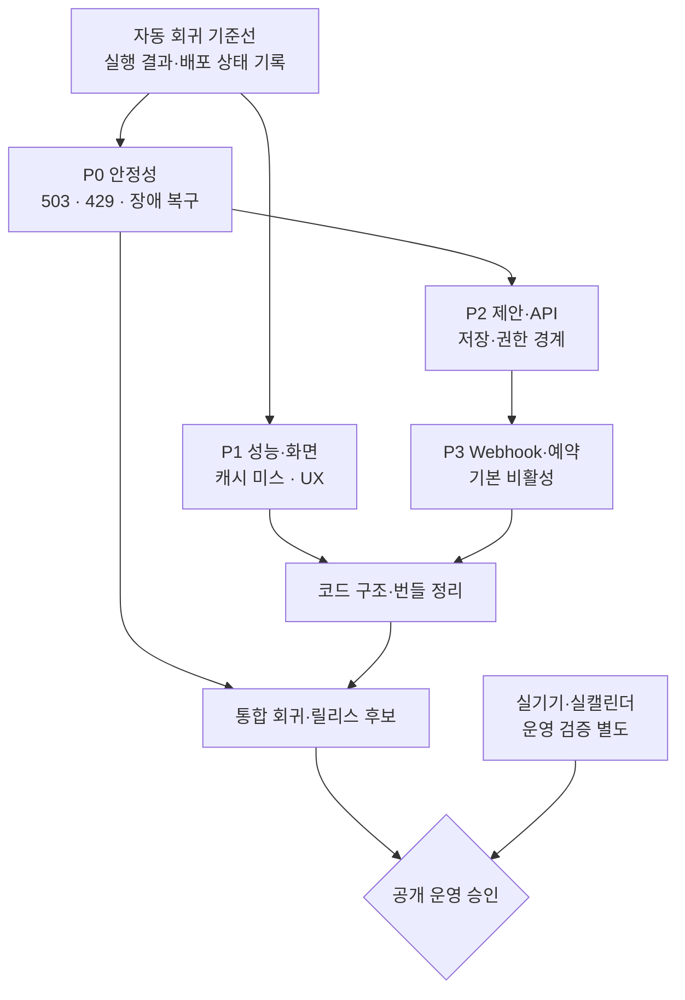
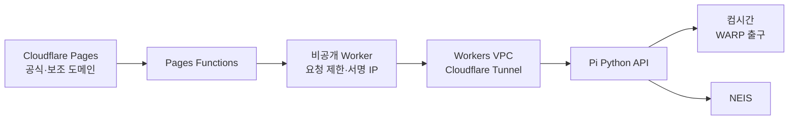

# OpenCigan 개발 로드맵

> **최신 실행 진입점:** [2026-11-21 단기 집중 개발 로드맵](roadmap/short-term-2026-11-21.md) · **전체 백로그:** 아래 P0~P4 상세 문서
>
> 정리 기준: 2026-11-21. `[x]`는 **구현 또는 명시된 부분 검증의 완료**이고, 실제 운영 배포·실기기 QA·외부 허락을 의미하지 않습니다. 정확한 진행률이나 완료 예정일은 체크박스만으로 추정하지 않습니다.

## 단계별 현황

| 단계 | 이미 확인된 내용 | 다음 완료 조건 |
| --- | --- | --- |
| **P0 · 안정성·운영** | Cloudflare Pages/Worker/VPC/Pi 기본 경로 운영 반영, 주요 API·ICS HTTP와 일부 IP 전달 확인 | 반복 503 원인 분리, 실제 429/제한 분리, 캘린더·실기기, 복구 QA |
| **P1 · 사용성·속도** | 시간표·급식·개인화, 공유·PNG/PDF, 다수 모바일 회귀 구현 | [#140 캐시 미스 최적화](https://github.com/Transient-Onlooker/opencigan/issues/140), 화면 정렬과 실제 기기·파일 확인 |
| **P2 · API·연동** | 읽기 API·ICS·OpenAPI·클라이언트·관리자 관측 기반 | 하위 호환 정책, 설정 클라우드 저장 설계, 익명 제안 기능 |
| **P3 · 알림·자동화** | 일부 Webhook/RSS 코드와 로컬 테스트 | 사용자 구독 보안, 발송 이력·템플릿, 예약 스케줄러, 비활성 상태 검증 |
| **P4 · 장기 확장** | 급식 검색·알레르기 필터 구현 | 시간표 통계와 운영 대시보드, 나머지는 기능별 결정 필요 |
| **품질·리팩터링** | UI 컴포넌트·CSS·백엔드 라우팅 일부 분리 | 비동기 상태/저장 책임 정리, 번들 최적화, 전체 자동·실기기 회귀 |

[상세 P0](roadmap/core-quality.md) · [P1 UI/UX](roadmap/user-experience.md) · [P2 API/운영](roadmap/api-operations.md) · [P3/P4 자동화](roadmap/automation-and-future.md) · [리팩터링·릴리스](roadmap/refactoring-and-release.md)

## 구현 작업의 의존 관계

개발과 검증은 병행할 수 있습니다. **코드 구현 완료**, **자동 테스트 합격**, **운영 배포**, **실기기·정책 승인**은 각각 다른 상태입니다. 현재 집중 작업은 [ST-00~ST-14](roadmap/short-term-2026-11-21.md) 순서를 사용합니다.

## 공개 서비스 구조와 남은 게이트

- **공식 주소:** [opencigan.mcv.kr](https://opencigan.mcv.kr/) · **보조 주소:** [opencigan.pages.dev](https://opencigan.pages.dev/) — 두 주소의 API 경로는 동일한 서버 측 구성에 의존합니다.
- **이미 완료된 전환 기록:** 공식 Cloudflare Pages 전환, Worker/Pi 주요 배포, 공개 Tailscale Funnel 중지. 기존 GitHub Pages는 별도 유지합니다.
- **아직 남은 증명:** 일부 네트워크 오류·원본 지연의 실제 원인, 운영 429, 장기 안정성, Apple/Google Calendar 실제 갱신, 모바일 PWA·PNG/PDF·공유 실기기 QA, 데이터·보관·원본 재제공 정책.
- **운영 안정성 원칙:** WARP 출구와 Cloudflare Tunnel은 다른 경로입니다. 남은 P0를 통과하지 않은 상태에서 보안 정책을 임의 완화하거나 Funnel을 재개하지 않습니다.

[실제 배포 증거](cloudflare-tunnel-rollout.md) · [서비스 아키텍처](architecture.md) · [운영·롤백](operations.md) · [알려진 문제](known-issues.md)

## 결정 사항과 보류 항목

- **학교 시간표 성능:** [Issue #140](https://github.com/Transient-Onlooker/opencigan/issues/140)의 상류 요청 3→1회 개선이 목표입니다. TTL 1,800초·캐시 용량 256개/16MB를 유지하고 stale-while-revalidate는 도입하지 않습니다.
- **기능 제안 ‘만들어주세요’:** UI(P1), 접수·승인 API(P2), 공감/상태·GitHub 연동(P3)을 분리합니다. 백엔드 검증·운영 정책 전에는 제출 UI를 공개하지 않습니다.
- **Webhook·체육 수업 알리미:** 구독 보안·스케줄러·멱등성 검증 전에는 운영 발송을 활성화하지 않습니다. 예약 시각과 실제 발송 성공 시각은 구별합니다.
- **선택적 클라우드 설정:** 인증·복구 방식, 서버 보관 범위와 삭제·보존 정책은 별도 결정이 필요합니다. 기존 로컬 JSON 백업은 유지합니다.
- **의도적 제외:** 개인 시간표·시험 오버레이의 신규 개발 중단, Jev 급식 개인화 아이디어 보관. 보류된 아이디어를 완료 대상에 자동 포함하지 않습니다.

## 라이선스·저작자 표시

- [x] `AGPL-3.0-only` [LICENSE](../LICENSE) 및 저작권자 `Transient-Onlooker` 고지.
- [x] [NOTICE](../NOTICE)와 [라이선스 안내](licensing.md)에 제7조(b) 출처 표시 조건·제3자 자료 이용 조건 기재.
- [ ] 추가 출처 표시 조건의 법적 적합성과 파생 서비스 노출 위치에 대한 최종 검토. 문서에 규칙을 적었다고 법률 검토나 제3자 원본 허락이 완료되는 것은 아닙니다.

## 문서 운영 원칙

1. P0~P4의 **상세 체크리스트는 각각의 원본 파일**에서 관리하며, 이 페이지에는 진행 방향과 선행 조건만 유지합니다.
2. 오늘 진행하는 PR은 [단기 실행 로드맵](roadmap/short-term-2026-11-21.md)에 근거를 남기고, 검증 완료된 항목만 해당 원본 로드맵에 반영합니다.
3. 과거 QA/이슈 보고서는 역사적 증거로 보존합니다. 후속 PR의 구현 완료 여부와 혼동하지 않습니다.
4. API 계약의 기준은 [OpenAPI](openapi.yaml)와 테스트 및 실제 구현입니다. 원본 데이터 재제공 조건은 코드 라이선스와 별개입니다.

[문서 인덱스](README.md) · [기여 가이드](../CONTRIBUTING.md)
