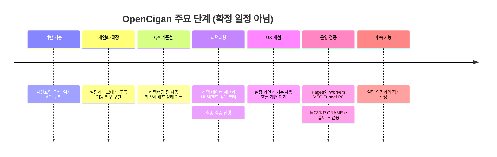
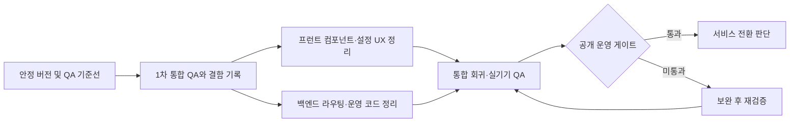

# OpenCigan 개발 로드맵

> **한눈에 보는 진행 방향** · 2026-11-16 문서 재정리. 이 도표는 목표 순서와 남은 게이트를 나타내며 **일정·완료율을 추정하지 않습니다**. 실제 구현 완료와 운영 배포/QA 통과는 별도로 판단합니다.

## 개발 단계

메인 개발과 QA는 일부 병행할 수 있습니다. '구현'이라고 표시된 기능에도 기기·운영 검증이 남아 있을 수 있습니다.

## 지금의 작업 의존관계

## 우선순위별 상세 작업

**2026-11-16 전면 통합 QA 결과: 조건부 보류.** 신규 사용자 학교 검색·다음 주 조회가 31분간 `503 upstream_unavailable`로 차단되었으나 실제 원인은 백엔드 로그 대조 전 미확정입니다. 릴리스 전에 **가용성 복구/안내, 날짜 입력 오류, 공개 ICS 도메인**과 실기기·파일 복원/PDF 검증을 끝내야 합니다. [QA 원문·NEW-01~09·재검증 계획](qa-2026-11-16.md)에서 상세 내용과 증거 한계를 확인하세요.

| 영역 | 현재 판단 | 세부 작업 |
| --- | --- | --- |
| **P0 · 핵심 기능·보안·공개 인프라** | **Pages + Workers VPC 비공개 Tunnel·Worker 요청 제한 우선**, 공개 API/ICS·가용성 검증 잔여 | [P0 공개 전 필수 작업](roadmap/core-quality.md) |
| **P1 · 사용자 경험** | 기존 기능 구현, UI/UX 개선 다수 대기 | [학교·시간표·설정·급식 UX](roadmap/user-experience.md) |
| **P2 · 외부 개발자 연동** | API·ICS·관리 도구 일부 구현, 외부 운영 검증 대기 | [API·캘린더·로그](roadmap/api-operations.md) |
| **P3–P4 · 자동화와 확장** | 부분 구현 또는 아이디어·운영 검증 대기 | [알림·장기 확장·아이디어](roadmap/automation-and-future.md) |
| **코드 품질·배포** | 상태·화면·백엔드 경계 분리, 최종 회귀·운영 검증 잔여 | [리팩터링·릴리스 검증](roadmap/refactoring-and-release.md) |

### 최근 사용자 제보와 UX 작업

확정된 개선 방향은 [P1 UX 상세 목록](roadmap/user-experience.md)에 체크박스로 관리합니다. 즐겨찾기와 ‘이 반의 수업 찾기’ 제거, 학교/학년 변경, 설정 카테고리·항목 단위 검색, 교시 시각 규칙 입력과 예외 편집, 알레르기 설정 통합, 여러 교사 별칭 관리, 독립 알림 페이지 테마·복귀 UI, 학년 비교의 불필요한 반 선택 제거를 포함합니다. **아직 체크되지 않은 항목을 완료로 간주하지 않습니다.**

### 배치 7 착수 조건과 리팩터링 순서

[상세 배치와 검증 조건](roadmap/refactoring-and-release.md#배치-7-착수-조건과-리팩터링-순서) · [코드 수준 실행 설계](refactoring-plan.md) · [리팩터링 전 QA 기준선](refactoring-baseline-2026-11-15.md)

### 오늘의 P0 Cloudflare Tunnel 작업

**[Cloudflare Pages + Workers VPC + Tunnel 구축 체크리스트](cloudflare-tunnel-rollout.md)**를 따릅니다. 먼저 Pages의 `pages.dev` → Worker Service Binding → VPC Tunnel → Pi API를 검증하고, 마지막에만 MCVKR CNAME을 Pages로 변경합니다. `mcv.kr` 전체 DNS와 기존 WARP/Funnel은 유지합니다.

### 공개 서비스 전 주요 검증 게이트

- **실기기:** iOS Safari·Android Chrome, PWA, 모바일 캘린더 앱의 실제 동작
- **네트워크·봇 방어(P0):** Pages + Workers VPC 비공개 Tunnel API/ICS 연결, Worker 레벨 봇·Rate Limiting, 외부 API/캘린더 구독 보호, 실제 IP·요청 제한과 접속 로그 검증
- **데이터·정책:** 실측된 교시 시각과 캘린더 동기화, 원본 데이터 재제공·관측 이력 운영 정책
- **회귀·운영:** 변경 영역별 테스트, Chromium/WebKit, RPi 배포 SHA/롤백 경로와 UI UX 검사

[검증 기록](verification-2026-11-15.md) · [이전 브라우저 QA](browser-qa-2026-11-14.md) · [알려진 문제](known-issues.md) · [운영 가이드](operations.md)

## 라이선스 및 원작자 표시 (적용 예정)

- [x] 코드 라이선스로 `AGPL-3.0-only` 채택 및 정식 `LICENSE` 추가. 저작권자는 활동명 `Transient-Onlooker`로 표시.
- [ ] AGPL-3.0 제7조(b)의 범위에서 합리적인 원작자 출처 표시 추가 조건 검토·명문화. 파생 웹서비스의 메인 랜딩 페이지 하단 등 이용자가 쉽게 확인할 수 있는 공개 위치에 원작자와 [원본 GitHub 저장소](https://github.com/Transient-Onlooker/opencigan)로 연결되는 클릭 가능한 링크를 유지하는 방안. 웹사이트가 아닌 앱은 동등한 확인 위치 고려.
- [x] README에 라이선스·원작자·원본 저장소 안내, 주요 의존성 고지와 코드/원본 데이터 권한 구분. [근거 및 검증 범위](licensing.md).

## 원칙

1. **학생용 MVP 품질을 우선**하고, 공개 API/이력 저장/알림 기능은 허용 범위·운영 안전성 검증 뒤 확장한다.
2. 기존 API 응답 계약을 유지하고 원본 서버 요청을 최소화한다.
3. 공개 API와 웹 UI는 가능하면 같은 정규화·캐시 계층을 쓴다.
4. 실제 데이터 재제공 허가·보안·변경 이력 저장과 운영 인프라 확대를 서로 독립적으로 판단한다.
5. API 문서와 구현이 충돌할 때는 테스트·실제 코드를 확인하고 문서 또는 코드를 함께 수정한다.

[API 가이드](api-guide.md) · [구조](architecture.md) · [기여](../CONTRIBUTING.md)

> **문서 관리 규칙:** 세부 항목은 각 상세 문서의 체크박스에서 수정합니다. 여기서는 흐름·우선순위·게이트만 유지합니다. 체크 [x] = 구현 기록, [ ] = 미완료 또는 검증 대기. 상태가 바뀌면 도표와 요약도 함께 갱신합니다.
