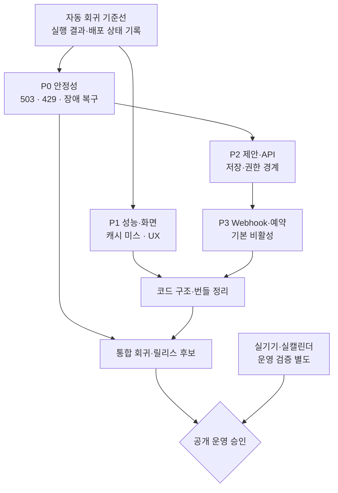

# OpenCigan 개발 로드맵

> **현재 백로그:** 아래 P0~P4 상세 문서 · **실행 큐 및 최신 작업 현황:** [단기 집중 개발](short-term-2026-11-21.md)
>
> 단계별 표는 2026-11-25 최신 병합 근거를 반영하며 이후 배포와 남은 검증은 [리팩터링·릴리스](refactoring-and-release.md)를 참고합니다. `[x]`는 **구현 또는 명시된 부분 검증의 완료**이고, 실제 운영 배포·실기기 QA·외부 허락을 의미하지 않습니다. 정확한 진행률이나 완료 예정일은 체크박스만으로 추정하지 않습니다.

## 단계별 현황

| 단계 | 이미 확인된 내용 | 다음 완료 조건 |
| --- | --- | --- |
| **P0 · 안정성·운영** | 공개 경로 운영 반영, 내부 시간표 API·검증된 컴포넌트 배포, 주요 API·ICS HTTP와 일부 IP 전달 확인, 장애·경계 자동검증 | 반복 503 원인 분리, 실제 429/제한 분리, 캘린더·실기기, 운영 복구 QA |
| **P1 · 사용성·속도** | 시간표·급식·개인화, 공유·PNG/PDF, 모바일 회귀, 캐시 미스 상류 3→1회 격리 실측, 원본 교시 시각 제안 구현 | 다양한 학교의 성능·원본 형식 검증, 원본 교시 시작 시각 기본 적용·수동 재정의, 화면 정렬과 실제 기기·파일 확인 |
| **P2 · API·연동** | 읽기 API·ICS·OpenAPI·클라이언트, 제안 API/UI, API 버전 정책, 일부 오류 계약·관리자 이상조회 구현 | 설정 전용 DB 설계·구현, 제안 운영 연결·보존 정책, 통합 관리자 페이지·그래프·학교별 집계, 남은 계약·운영 관측 |
| **P3 · 알림·자동화** | Webhook 관리 링크·필터·템플릿, 예약/지정 과목 알림 작업자 격리 구현 | 남은 구독 보안·필터/관리 UX 검증, 운영 발송 승인·실제 검증(기본 OFF) |
| **P4 · 장기 확장** | 급식 검색·알레르기 필터, 관측 과목별 학급 교시 수·교사 이름 겹침 및 관측일별 변경·원본 갱신 간격·이상조회 UI 구현 | 운영 임계치·알림·실환경 검증, Jev 등 후속 기능 |
| **품질·리팩터링** | UI 컴포넌트·CSS·백엔드 라우팅 분리, 늦은 시간표 응답·학교/학년 복원 검증, 번들 기준선 | 남은 상태/저장 책임 정리, 번들 경량화, 최종 통합·실기기 회귀 |

[상세 P0](core-quality.md) · [P1 UI/UX](user-experience.md) · [P2 API/운영](api-operations.md) · [P3/P4 자동화](automation-and-future.md) · [리팩터링·릴리스](refactoring-and-release.md)

**단기 큐:** 구현·자동검증 완료 7/16개, 부분 진행 9개, 세부 체크 25/43. 운영 완료율이나 공수 추정이 아니다. [최신 단기 로드맵](short-term-2026-11-21.md#현황-요약-2026-11-25-갱신).

**최신 운영 QA (2026-11-25):** [3차 QA 후속](qa3-followup-2026-11-25.md) — 조건부 통과, QA2-003 및 QA3-001~005 수정 병합 완료. 운영 재검증·실기기/복원/캘린더 잔여.

## 구현 작업의 의존 관계

개발과 검증은 병행할 수 있습니다. **코드 구현 완료**, **자동 테스트 합격**, **운영 배포**, **실기기·정책 승인**은 각각 다른 상태입니다. 남은 작업은 상세 로드맵과 [기존 실행 기록](short-term-2026-11-21.md)을 함께 확인합니다.

## 공개 서비스의 남은 검증

> 2026-11-25 사용자 검증 범위 조정: 모바일은 현재 사용상 문제 제보 없음으로 취급하고 추가 수동 실기기 QA를 사용자에게 요구하지 않는다. PWA는 자동 브라우저 검사로 확인한다. 설정 JSON 백업/가져오기 왕복과 실제 Apple/Google Calendar 구독·갱신의 사용자 수동 검증은 이번 실행 범위에서 제외한다. 기존 기능과 자동 회귀 검사는 유지하며 미실행 검증을 통과로 표시하지 않는다. 새 결함이나 운영 필요가 생기면 별도 재검토한다.

- **공식 주소:** [opencigan.mcv.kr](https://opencigan.mcv.kr/) · **보조 주소:** [opencigan.pages.dev](https://opencigan.pages.dev/) — 동일한 읽기 API를 이용합니다.
- **완료된 작업:** 웹·API 기본 배포 및 주요 HTTP 응답 점검, 외부 접속 경로 일부 검증.
- **미완료:** 반복 오류 원인·실제 요청 제한·장기 안정성·캘린더 갱신·모바일 실기기·원본 데이터 정책 검토.
- 서비스 내부 네트워크·장비·접속·비밀 설정은 공개 문서에 기록하지 않습니다.

[운영 요약](../operations/cloudflare-tunnel-rollout.md) · [API 문서](../api-guide.md) · [알려진 문제](../qa/known-issues.md)

## 결정 사항과 보류 항목

- **학교 시간표 성능:** [#213](https://github.com/Transient-Onlooker/opencigan/pull/213)에서 검증된 학교와 프로토콜을 재사용합니다. 한 학교의 비교에서 상류 요청 3→1회, 768→236ms였으며 다른 학교와 운영 배포 후 성능은 별도 확인이 필요합니다. TTL 1,800초·캐시 용량 256개/16MB를 유지하고 stale-while-revalidate는 도입하지 않습니다.
- **기능 제안 ‘만들어주세요’:** UI·접수/관리 API·격리 SQLite 저장소의 코드는 준비됐고 게이트웨이 경로·전용 제한은 PR #186에서 병합했습니다. Pi 영구 DB 경로·관리자 토큰·Rate Limit 운영 설정과 보존/삭제·검토 절차를 확인하기 전까지 공개 접수는 비활성 상태로 둡니다. 제안 DB는 사용자 설정 DB 및 접속 로그 DB와 분리합니다.
- **Webhook·지정 과목 알림:** 템플릿 및 서버 예약 작업자는 [#180](https://github.com/Transient-Onlooker/opencigan/pull/180)·[#182](https://github.com/Transient-Onlooker/opencigan/pull/182)에서 격리 구현·검증했다. 남은 ST-07 보안/관리 검증, 운영 승인 및 발송 검증 전까지 운영 기능은 기본 OFF를 유지한다. 예약 시각과 실제 발송 성공 시각은 구별한다. 체육복 준비는 지정 과목 알림의 대표 활용 사례이며, 임의 과목·요일·시각·메시지와 복수 과목 설정 지원 범위를 검토한다.
- **선택적 클라우드 설정:** 현재 개인화 설정은 브라우저에 저장되고 JSON 백업·복원을 지원합니다. 사용자 설정 전용 DB는 아직 미구현이며, 제안 DB·접속 로그 DB와 별도 저장소로 설계합니다. 인증·복구 방식, 서버 보관 범위와 삭제·보존 정책을 결정하고 기존 로컬 저장·JSON 백업은 유지합니다. 2026-11-25 사용자 요청으로 기존 P1/P2 요구를 후속 개발 대상으로 유지하고 선행 설계부터 진행합니다.
- **의도적 제외:** 개인 시간표·시험 오버레이의 신규 개발 중단, Jev 급식 개인화는 P4 정식 백로그(미착수). 보류된 아이디어를 완료 대상에 자동 포함하지 않습니다.

## 라이선스·저작자 표시

- [x] `AGPL-3.0-only` [LICENSE](../../LICENSE) 및 저작권자 `Transient-Onlooker` 고지.
- [x] [NOTICE](../../NOTICE)와 [라이선스 안내](../licensing.md)에 제7조(b) 출처 표시 조건·제3자 자료 이용 조건 기재.
- [ ] 추가 출처 표시 조건의 법적 적합성과 파생 서비스 노출 위치에 대한 최종 검토. 문서에 규칙을 적었다고 법률 검토나 제3자 원본 허락이 완료되는 것은 아닙니다.

## 문서 운영 원칙

1. P0~P4의 **상세 체크리스트는 각각의 원본 파일**에서 관리하며, 이 페이지에는 진행 방향과 선행 조건만 유지합니다.
2. 작업 근거는 해당 상세 로드맵에 남기고, 검증 완료된 항목만 완료로 표시합니다. 단기 실행 큐는 최신 현황을 별도로 표시하고 과거 집계는 날짜와 함께 보존합니다.
3. 과거 QA/이슈 보고서는 역사적 증거로 보존합니다. 후속 PR의 구현 완료 여부와 혼동하지 않습니다.
4. API 계약의 기준은 [OpenAPI](../openapi.yaml)와 테스트 및 실제 구현입니다. 원본 데이터 재제공 조건은 코드 라이선스와 별개입니다.

[문서 인덱스](../README.md) · [기여 가이드](../../CONTRIBUTING.md)
