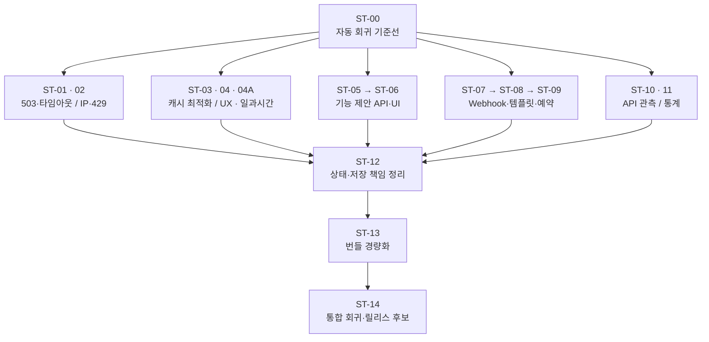

# OpenCigan 단기 집중 로드맵 — 2026-11-21

> **단기 실행 큐:** 작성 당시의 '오늘'과 과거 집계는 역사적 기록입니다. 이후 작업의 병합·검증 상태는 바로 아래 현황을 확인하세요. 체크박스는 전체 완료 조건을 충족한 경우에만 표시하며 운영 배포를 뜻하지 않습니다.

## 최근 작업 현황 (2026-11-25)

기준: `main`에 병합된 PR #222까지. PR 병합과 운영 배포는 별개이며, 실제 서비스의 적용 버전은 이 표에서 확인하지 않았습니다.

| 작업 | 최근 병합 및 확인 범위 | 남은 일 |
| --- | --- | --- |
| ST-01 장애 경계 | [#211](https://github.com/Transient-Onlooker/opencigan/pull/211) 상류 타임아웃 진단, [#212](https://github.com/Transient-Onlooker/opencigan/pull/212) 모의 프록시·백오프 회귀 | 실제 Worker/Pi 경계와 운영 503 원인 확인 |
| ST-03 성능 | [#213](https://github.com/Transient-Onlooker/opencigan/pull/213) 검증된 학교·프로토콜 재사용. 한 학교 실측 요청 3→1회, 768→236ms, 수업 데이터 일치 | 다른 학교·조건 및 운영 배포 후 확인. 단일 표본을 전체 성능으로 일반화하지 않음 |
| ST-04 UX | [#214](https://github.com/Transient-Onlooker/opencigan/pull/214)~[#218](https://github.com/Transient-Onlooker/opencigan/pull/218) 알레르기 상태, 교사 주차, 급식 날짜 안내, 초기화 설명 및 탭 대비 개선 | 남은 QA 항목과 실제 기기 확인 |
| ST-04A 교시 시각 | [#219](https://github.com/Transient-Onlooker/opencigan/pull/219) 원본 시각 제안 및 기존 설정 보호 구현 | 학교별 원본 제공 범위와 실제 운영·기기 검증 |
| ST-07 Webhook | [#220](https://github.com/Transient-Onlooker/opencigan/pull/220) 중복 이벤트 집계, [#223](https://github.com/Transient-Onlooker/opencigan/pull/223) 유휴 정리 검증, [#222](https://github.com/Transient-Onlooker/opencigan/pull/222) 인증된 목적지 수정 | 나머지 보안·운영 검증. 작업자와 실제 발송은 기본 OFF 유지 |

[#221](https://github.com/Transient-Onlooker/opencigan/pull/221)은 병합 전이며, [#224](https://github.com/Transient-Onlooker/opencigan/pull/224)는 병합됐다. 아래 2026-11-24 현황과 실행 결과 표는 해당 시점의 기록이다.

> **오늘 목표:** 기존 P0~P4에서 아직 **코드 구현·수정·자동검증이 필요한 일**만 모아, 에이전트가 의존성 순서대로 최대한 많이 완료한다. 기존 장기 로드맵을 삭제하거나 대체하지 않는 **오늘 전용 실행 큐**다.
>
> **작성 기준:** GitHub `main` = `4a5b1e4` (2026-11-21 확인), 현재 열린 PR 0개, 미구현 성능 이슈 [#140](https://github.com/Transient-Onlooker/opencigan/issues/140). 이 문서의 [ ]는 **오늘의 새 실행 목록에서 미착수/미검증**을 뜻하며, 기존 파일의 과거 완료 기록을 부정하지 않는다.

> **현황 갱신: 2026-11-24** — 확인 기준 `167e529`, [main CI 45353469338](https://github.com/Transient-Onlooker/opencigan/actions/runs/45353469338) check/deploy 성공(GitHub Actions 기록). Pi·Cloudflare Worker/Pages의 실제 적용 SHA 및 운영 검증은 이 확인에 포함하지 않는다. 아래 체크리스트는 구현·자동검증 기준이며 모든 미완료 항목의 작업량이 동일하지 않다.

## 실행 규칙

1. **구현 중심:** 오늘은 새로운 코드, 필요한 결함 수정, 자동 테스트·CI, 안전한 리팩터링을 진행한다. 실기기 수동 QA·외부 허락·운영자 정책 결정·이미 끝난 배포 기록은 작업량으로 세지 않는다.
2. **구현 전 확인:** 최신 `main`에서 관련 코드를 읽고 이미 구현된 기능은 **재구현하지 않는다**. 남은 차이만 처리하고 완료 항목과 건드리지 않은 항목을 명확히 기록한다.
3. **PR 단위:** 서로 독립적인 작업은 작은 PR로 나눈다. 관련 여러 파일을 바꾸면 Git Data API로 **하나의 원자적 커밋**에 묶는다. 최신 HEAD 확인 → 테스트 → CI → PR 검토 → 병합. 강제 푸시 금지. 같은 파일을 만지는 병렬 작업은 피한다.
4. **운영 안전:** Funnel·실제 Webhook 발송 백엔드는 **비활성 유지**. 기존 API 연결 및 외부 데이터 조회 경로, 기존 환경·서명 키·DB·레이트 리밋 바인딩·롤백 릴리스 보존. 신규 API/예약 전송/개인정보 저장은 **로컬·격리 구현 + 기본 OFF**로 시작한다.
5. **완료 근거:** PR/커밋, 변경 범위, 실제 실행한 테스트, 미실행 검증, 운영 반영 여부를 적는다. [x] = 구현·자동검증 완료이지 실기기·운영 최종 승인 의미가 아니다.
6. **진행 전략:** 먼저 장애·정확성, 그다음 체감 UX·성능, 그다음 신규 서비스 기능, 마지막에 리팩터링·번들·전체 회귀. 한 항목이 외부 조건 때문에 막히면 **다른 독립 항목을 계속 진행**한다. 단기 로드맵에 담았다고 오늘 전부 완료될 것을 보장하지 않는다.

## 작업 의존 관계

다른 책임 파일에서는 병렬 작업할 수 있으나, 같은 상태 관리·API 계약 파일을 고치는 브랜치는 순차 병합하고 후속 브랜치를 갱신한다. ST-12는 아래 **코드 경합·저장 책임 분리**이며 ST-13 전에 진행한다.

## A. P0 — 장애·보안 회귀를 코드로 완결

### ST-00 · 테스트 가능한 기준선 및 자동 QA

- [x] 최신 `main`의 Python/Worker/프런트 테스트, Svelte 검사, 빌드, Chromium/WebKit 필수 플로우 실행 결과를 남긴다. 실행하지 못한 것은 실행했다고 쓰지 않는다.
- [x] 누락된 자동 시나리오를 보강한다: 학교·학급·주차 변경 중 늦은 응답, 검색/캐시 장애와 복구, 급식 독립성, ICS 200/304, 공유 링크, 429/503 오류 표시. 모의 상류를 우선 사용한다.
- 기준선: `9ce1a34`의 [CI 실행 44908297694](https://github.com/Transient-Onlooker/opencigan/actions/runs/44908297694)에서 Python·Worker·프런트 단위/통합 검사, Svelte 검사, Chromium/WebKit 및 빌드 통과. 기존 테스트는 선택 변경·공유 링크·저장본 복구·급식 독립성·ICS 304·503 안내를 포함한다. 429 응답의 대기 시간·급식 독립성·복구 시나리오는 [PR #157](https://github.com/Transient-Onlooker/opencigan/pull/157)의 로컬 Chromium과 [원격 Chromium/WebKit CI](https://github.com/Transient-Onlooker/opencigan/actions/runs/44916120859)에서 통과했다.
- **완료 조건:** 재실행 가능한 테스트 또는 CI 워크플로가 저장소에 있고 회귀 결과가 기록됨.
- 원본: [P0](core-quality.md), [릴리스 기준선](refactoring-and-release.md).

### ST-01 · 503 / 요청 타임아웃 경계 개선

- 2026-11-25 12시경 KST 읽기 전용 Pi 확인: 공개·내부 API는 실행 중이었고 자동 릴리스 감시 타이머가 등록돼 있었다. 공개 API의 24시간 캐시 갱신 실패 로그 63건은 시간표 35건, 학교 검색 28건이며 이 중 27건은 이전 캐시로 대체했다. 06:18 이후에는 11건(시간표 6, 검색 5)이었다. 로그 건수는 방문자 수나 전체 503 건수가 아니다.
- 확인 당시 Pi의 `current`는 `release-e11839f-recovery`, GitHub main은 `c5f546c`였다. 모든 실패의 표면 예외는 `RuntimeError`이나, 당시 운영 pycomcigan은 상류 403·429도 `RuntimeError`로 변환하므로 이 집계로 원인이나 특정 HTTP 상태를 확정할 수 없다.
- 2026-11-25 후속 확인에서 설정된 검증 학교의 내부 조회 503을 재현했고, pycomcigan이 변경된 컴시간 POST 요청을 파싱하지 못함을 확인했다. 포크 [PR #2](https://github.com/Transient-Onlooker/pycomcigan/pull/2)의 `1.4.7+autofix.1`은 격리 실조회 및 회귀 검증 후 매니페스트·SHA 확인을 거쳐 컴포넌트 `c67a805`로 적용했다. GitHub 의존성 핀은 자동 동기화됐고, Pi 코드·venv는 `fa69fb3` 릴리스로 전환했다. 내부 API·Pi 로컬 공개 API·브라우저 헤더를 사용한 공식 공개 API에서 같은 검증 학교의 시간표 826건을 확인했다. 이는 해당 시점과 학교의 복구 증거이며 모든 과거 503의 원인을 뜻하지 않는다.
- [#240](https://github.com/Transient-Onlooker/opencigan/pull/240)의 명시적 예외 원인 분류도 운영 릴리스에 포함됐다. 15초/30초의 실제 Worker–Pi 경계 및 지연 예산은 계속 미확인이다.
- Pi의 격리된 루프백 모의 프록시에서 활성 pycomcigan POST 요청의 기본 소켓 제한을 실제로 기다려 30.095초에 타임아웃을 확인했다. 재현은 `OPENCIGAN_SLOW_NETWORK_TESTS=1 python -m unittest discover -s tests/integration -p test_real_proxy_timeout.py`로 선택 실행하며 기본 테스트에서는 건너뛴다. 실제 컴시간·Cloudflare 경계의 지연이나 취소 전파를 검증한 것은 아니다.

- 동일 캐시 키 갱신 대기가 끝난 시각과 대기 시간을 조회 종류별로 관측한다. 실제 갱신 시간과 다른 요청에서 수집될 수 있으며 학교명·키·요청 내용은 기록하지 않는다. 실제 운영 503 원인과 경로별 시간 예산은 아직 미확인이다.

- 3차 QA 사용자 보고(11/25, VM 프록시 경유): 시간표 MISS 2.54초, HIT 0.70~0.75초, 상태 API 0.89~1.19초. 직접 Pages 표본과 비교 금지. 동일 환경에서 직접/프록시 경로, DNS/TLS/TTFB/본문·파싱/잠금·캐시와 Worker/VPC/Pi/상류 단계별 계측 후 개선 목표 확정. 재구축 초기의 1.4.5 핀 불일치 503은 별도 해결 보고이며 모든 과거 503의 원인으로 간주하지 않는다.

- 프런트의 15초 제한이 상류 응답보다 먼저 끝나는 상황을 모의 재현했다. 컴시간 프록시에 서비스 페이지/기타 데이터 요청의 응답 헤더까지 소요 시간을 추가한다. 응답 본문 수신·파싱·잠금 대기는 포함하지 않으며, 학교명·URL·검색어는 기록하지 않는다. 실제 운영 지연의 원인과 전체 요청 예산은 아직 확인되지 않았다.
- [PR #164](https://github.com/Transient-Onlooker/opencigan/pull/164)에서 모의 403·429·지연에 대해 캐시 미보유 503과 재시도 안내, 다른 학교·주차 격리, 오래된 시간표 보존 후 복구 및 상태 API를 검증한다. 실제 장애의 근본 원인이나 시간 예산 조정은 확인하지 못해 ST-01은 계속 미완료다.
- 로컬 프런트 API 클라이언트와 백엔드를 연결한 모의 테스트에서 15초 제한값과 클라이언트 취소 후 서버 작업의 지속·같은 잠금 슬롯의 다른 캐시 키 처리·완료 결과의 캐시 재사용을 확인한다. 제한 신호는 시간을 기다리지 않고 직접 발생시키며, 실제 Worker 경계·상류 30초 소요 및 운영 503의 원인은 여전히 미확인이다.
- [PR #184](https://github.com/Transient-Onlooker/opencigan/pull/184): 모의 캐시에서 다른 키가 같은 잠금 슬롯에 배정되면 느린 요청에 막히는 상황을 재현하고, 키별 갱신 잠금으로 격리했다. 동일 키의 단일 갱신과 기존 TTL·백오프·캐시 상한도 검증한다. 운영 장애와의 인과관계는 확인되지 않았다.
- 게이트웨이 503 발생 시 제한기·서명·비공개 연결 단계와 연결 구간 경과 시간을 구분하는 진단을 추가한다. 학교명·IP·요청 경로·토큰·예외 메시지는 기록하지 않는다. 배포 및 실제 503 원인 확인은 별도다.
- 격리 Node 테스트에서 수신 요청 취소 후에도 게이트웨이가 생성한 모의 비공개 요청의 신호는 취소되지 않고 완료됨을 확인한다. 이는 Node의 모의 경로 결과이며 실제 Cloudflare 런타임·VPC/Pi의 취소 전파나 15초/30초 시간 경계를 검증하지 않는다.
- 프런트 API·게이트웨이 코드·로컬 백엔드를 연결한 모의 통합 테스트에서 프런트 15초 제한 신호를 직접 발생시킨 후 비공개 요청과 백엔드 작업이 계속되어 캐시에 반영되는지 확인한다. 게이트웨이의 서비스 바인딩과 클라이언트 취소는 테스트 어댑터로 모사하며 실제 Cloudflare·VPC와 30초 경계의 관측을 대신하지 않는다.
- 컴시간 프록시의 기존 헤더 대기 계측에 성공·HTTP 오류·타임아웃·네트워크 오류 분류와 전달된 연결 제한값을 추가한다. 로컬 모의 프록시가 응답 헤더를 보내지 않을 때 0.15초 제한으로 타임아웃되는 경계와 `URLError`로 감싼 오류 분류를 검사한다. 이는 실제 30초 경계나 본문 수신·파싱 시간, Cloudflare와 Pi 사이의 동작을 검증한 결과는 아니다.
- 로컬 모의 프록시의 실제 소켓 대기 제한을 백엔드 시간표 요청에 연결해, 상류 타임아웃 후 캐시가 없으면 503과 `Retry-After`, 기존 캐시가 있으면 stale 응답을 반환하며 백오프 중 같은 상류를 재요청하지 않는지 확인한다. 다른 학교 요청도 독립적으로 성공한다. 이 검사는 Worker·프런트·실제 30초 제한을 포함하지 않는다.
- 응답 헤더를 즉시 받은 뒤 본문 수신이 멈추는 로컬 모의 프록시에서도 소켓 제한 후 503 또는 stale 응답과 재요청 억제를 확인한다. 이 경우 헤더 계측의 `success`는 본문 수신 성공을 뜻하지 않는다. 실제 상류·Worker 경계 및 전체 요청 시간 예산은 여전히 미확인이다.
- 시간표 객체를 받은 뒤 공개 응답 형식으로 정규화하는 성공 구간을 별도로 계측한다. 학교·주차·수업 내용은 기록하지 않는다. 라이브러리 내부의 응답 수신·파싱은 이 구간에 포함되지 않으며 실패 시 계측값은 남기지 않는다.

- [ ] 프런트 요청 제한(15초), 컴시간 프록시 단일 연결 기본값(30초), Worker/Pi의 실제 요청 경계를 비교하는 재현 테스트와 경로별 계측을 구현한다.
- [ ] 오류가 **재현된 경우에만** 전체 요청 시간 예산·취소·재시도·캐시 대체와 `Retry-After`, 502/503/504 안내를 수정한다. 단순히 타임아웃 숫자를 바꾸지 않는다.
- [x] 상류 403/429/네트워크 지연·캐시 없음/오래됨·다음 주/타 학교 조회·급식 독립 동작을 모의 오류 복구 테스트로 확인한다. `/api/v1/status`의 process-liveness 의미는 유지한다. [#164](https://github.com/Transient-Onlooker/opencigan/pull/164)의 격리 검증 및 ST-01의 후속 모의 통합 검증에 한하며, 실제 운영 503 원인과 시간 예산은 미확정이다.
- **완료 조건:** 원인/재현/수정 전후 비교와 자동 회귀. 근본 원인이 확인되지 않으면 추측성 패치를 하지 않고 테스트·관측만 병합한 뒤 미완료 표시.
- 원본: [NEW-01](core-quality.md), [가용성 관측](api-operations.md).

### ST-02 · IP·Rate Limit·CORS 오류 계약 자동 검증

- [x] Worker의 경로별 제한/OPTIONS 처리, Pi의 서명 IP·무서명 버킷, 서로 다른 클라이언트 제한 분리, 위조 `X-Forwarded-For`/`Forwarded` 방어를 격리 테스트로 추가한다.
- [x] 테스트 전용 제한값에서 429 JSON·`Retry-After`·CORS, 관리자 API 제한, 정상 캘린더/API 요청과의 간섭 방지를 검사한다. **실서비스에 요청 폭주를 발생시키지 않는다.**
- [PR #159](https://github.com/Transient-Onlooker/opencigan/pull/159)의 Worker 테스트 19개, Pi WSGI 테스트 22개와 [전체 CI](https://github.com/Transient-Onlooker/opencigan/actions/runs/44916758406)가 통과했다. Worker에서 가상의 IP A의 시간표 제한이 IP B·캘린더·OPTIONS에 영향을 주지 않는지, 429의 CORS/재시도 및 위조 헤더 제거를 확인했다. 기존 Pi 격리 테스트는 서명된 IP별 제한·접속 로그, 무서명 버킷, 관리자 제한과 OPTIONS를 확인한다. 실제 운영 한도 초과 검증은 별도다.
- **완료 조건:** 독립 IP A/B의 제한·로그 계약 검증. 실제 운영 레이트 리밋 한도 초과는 별도 P0 게이트로 보존.
- 원본: [P0 보안 경계](core-quality.md), [운영 체크리스트](../operations/cloudflare-tunnel-rollout.md).

## B. P1 — 성능과 사용자 화면

### ST-03 · 시간표 캐시 미스 상류 요청 3회 → 1회 · [Issue #140](https://github.com/Transient-Onlooker/opencigan/issues/140)

- 2026-11-25 Pi에서 WARP HTTP 브리지와 기존 배포 검증 학교 한 곳을 사용한 격리 비교: 학교 검색 준비 2회 528ms, 기존 시간표 조회 3회 768ms, 검색 직후 최적화 조회 1회 236ms. 수집 시각을 제외한 전체 시간표 응답과 변경 전 수업 필드가 일치했다(826건). 운영 서비스 코드·설정은 변경하지 않았다. 단일 학교·단일 표본으로 전체 학교의 정확성, 장기 분포, 만료·장애 복구 또는 운영 적용을 증명하지 않는다.
- 같은 날 POST 복구 후 활성 Pi 코드 `fa69fb3`·컴포넌트 `c67a805`를 사용한 별도 프로세스의 검증 학교 한 곳 재측정: 검색을 먼저 수행한 뒤 재사용 조회는 상류 요청 1회·488ms, 검증 학교 캐시를 비운 기존 경로는 3회·1,596ms였다. 두 응답의 수업 배열은 826건으로 일치했다. 두 시간은 검색 준비 시간을 제외한 단일 연속 표본이며 운영 전체의 지연 분포나 다른 학교의 정확성을 대표하지 않는다.

- [ ] `backend/timetable.py`와 `pycomcigan`을 확인해 기존 서비스 페이지·학교 검색·시간표 조회의 직렬 요청을 계측하고, 프로토콜/필드 코드 캐시를 재사용한다.
- [ ] 학교 코드가 이미 확정된 경우 재검색 왕복을 생략한다. 프로토콜 불일치·403·인증 실패 때 캐시 무효화와 최대 한 번의 재시도를 유지한다.
- [ ] **유지할 계약:** TTL 1,800초, 캐시 256개/16MB, stale-while-revalidate 미도입, 갱신 시각·학교·수업 데이터 일치. 라이브러리 변경 시 패치 버전 +1.
- **완료 조건:** 정상 미스 경로 상류 요청 **1회** 테스트, 시간표/갱신 시각 전후 동등성, 성능 측정치 기록. 목표 0.3~0.5초는 **실측 목표**이지 보장값이 아니다. 운영 분포 비교는 배포 후 별도 게이트.
- 원본: [P1 성능](user-experience.md), Issue #140.

### ST-04 · 레이아웃·날짜 입력·오류 안내 잔여 보완

- 320px 격리 Chromium에서 다음 주 시간표의 이미지 공유·새로고침·이번 주로 버튼이 함께 표시될 때 화면 가로 넘침, 버튼 겹침 및 40px 미만 높이는 재현되지 않았다. 모의 API 기반 자동 검사를 추가했으며 다른 크기·테마와 실제 기기 검증은 별도다.

- 오늘·학년 비교의 날짜 입력이 선택한 주를 벗어나면 화면과 다른 날짜가 입력란에 남던 문제를 재현했다. 오류를 스크린리더에 알리고 편집을 마치면 기존 날짜로 복원한다. 실제 모바일 기기 검증은 별도다.

- **3차 QA 우선:** QA2-003 운영 미표시 보고를 fb9ed13에서 재현하고 급식 뷰/필터·설정 바로가기·안전 안내의 실제 DOM 및 E2E 조건을 대조한다. QA3-002~005는 독립 소규모 UX 수정 후보. [3차 QA 후속](qa3-followup-2026-11-25.md).
- 코드 대조에서 필터가 꺼진 기본 상태와 데스크톱 오늘 급식 영역에 상태·설정 바로가기·안전 안내가 빠진 것을 확인했다. 두 화면에서 동일한 안내를 표시하고 필터 상태·선택 수·주간 보기·설정 이동을 격리 Chromium 테스트로 확인한다. 실제 운영 DOM과 모바일 오늘 급식 레이아웃 검증은 별도다.
- 급식 카드 날짜 옆의 시간표 조회 제한 문구를 별도 안내로 옮겨 급식 날짜와 시간표 연결 범위를 구분한다. 시간표 범위 밖 날짜의 식단이 표시되고 시간표 연결만 제공되지 않는 경계를 격리 Chromium으로 확인했다. 운영 화면 검증은 별도다.
- 캘린더 탭 선택·호버 직후 글자와 배경이 동시에 전환되며 대비가 4.5:1 아래로 내려가는 현상을 격리 Chromium에서 재현했다. 탭의 글자·배경 전환을 즉시 적용하고 라이트·다크 및 390/1024px의 선택·호버 상태 대비를 검사한다. 운영·실기기 검증은 별도다.

- 급식 갱신 실패로 이전 식단을 보여줄 때 오류 안내와 오래된 데이터 안내가 중복되던 부분을 정리한다. 서버가 오래된 식단을 정상 응답한 경우의 별도 경고는 유지한다. 나머지 화면·실기기 검증은 미완료다.
- [ ] 메인 선택 폼·시간표 조작부·탭·설정의 기준선, 행 높이, 여백과 테마별 일관성을 보완한다. 320/390/700/960px 라이트·다크 전후 캡처 및 수평 넘침 검사.
- [ ] `NEW-03` 날짜 편집과 `NEW-09` 중복 오류 안내, 모바일 하단 메뉴 가림의 **현재 구현을 확인한 뒤** 실제 재현되는 차이만 수정한다. 이미 해결된 부분은 반복 작업하지 않는다.
- **완료 조건:** 실제 수정한 컴포넌트의 스크린샷·E2E·키보드 포커스 회귀. 사용자 디자인 승인·실기기 확인은 별도 게이트.
- 원본: [P1 UX](user-experience.md), [P0 모바일](core-quality.md).

### ST-04A · 컴시간 원본 '일과시간'을 이용한 학교별 교시 시작 시각 자동 입력

- 2026-11-25 Pi의 기존 검증 학교 한 곳에서 `day_time`이 8개의 `교시(HH:MM)` 문자열 배열이고 교시 표기가 배열 순서와 일치함을 확인했다. 학교명과 실제 시각은 기록하지 않았다. 단일 학교 표본이므로 다른 학교의 형식이나 종료 시각을 추정하지 않는다.
- 명시적인 교시 번호와 유효한 시작 시각만 선택적 API 필드로 전달하고, 사용자가 설정에서 적용한 빈 입력란에만 제안한다. 중복·형식 불명 자료는 제외하며 종료 시각·기존 입력·요일별 예외는 덮어쓰지 않는다. 격리 API/명세·캐시와 Chromium 검사를 진행했다. 실제 학교 전환 및 추가 원본 형식 검증은 남아 있다.

- [ ] **현재 구현부터 재확인:** `backend/timetable.py`의 `fetch_timetable()`은 수업·교사·`isChanged`·수집 시각을 반환하지만, OpenCigan이 사용하는 `pycomcigan.TimeTable.day_time`(원본 `일과시간`)은 아직 응답·설정에 사용하지 않는다. 별도 상류 요청이나 숫자로 고정한 `자료141` 파서를 만들기 전에 라이브러리의 기존 값을 활용할 수 있는지 확인한다. 실제 자료 필드 번호는 원본 프로토콜에 따라 달라질 수 있다.
- [ ] 실제 원본 응답 및 모의 데이터에서 `day_time` 형식(예: `1(09:10)`, `09:00`, 값 누락·빈 배열·불규칙 표기), 교시와 배열 인덱스의 대응 및 학교별 차이를 검증한 뒤 **확인된 시작 시각만** 정규화한다. 원본에서 종료 시각을 제공하지 않으면 임의로 확정하지 않는다.
- [ ] 기존 시간표 조회 경로·캐시를 재사용해 학교별 **교시 시작 시각 자동 입력 제안**을 설정 화면에 제공한다. 사용자의 직접 입력값·요일별 예외·`localStorage`·설정 백업은 우선 보존하며, 사용자 확인 없이 기존 저장값을 덮어쓰지 않는다. 원본 시각과 사용자 지정 시각을 구분하고 수동 편집·초기화 경로를 유지한다.
- [ ] 필요한 경우에만 하위 호환 가능한 선택적 API 필드를 추가하고, 기존 `records`/`sourceUpdatedAt`·ICS 동작과 캐시 TTL 1,800초 및 상류 조회 횟수를 유지한다. 원본에 시작 시각만 있으면 종료 시각은 공란으로 두거나 사용자 확인을 거쳐 입력하도록 한다. 자료가 없거나 잘못됐을 때는 기존 수동 설정을 계속 사용할 수 있어야 한다.
- **완료 조건:** 유효·누락·변형 자료 및 학교 전환, 사용자 설정 우선순위, 수동 저장·백업/복원, 캐시 응답 동등성을 자동 테스트로 검증한다. 실학교·실기기 시각 일치 여부는 별도 확인하고, 종료 시각을 추측해 정확한 값처럼 표시하지 않는다.
- **범위:** 현 단계는 로드맵에만 기록한다. 코드 수정·API 공개·배포는 별도 명시 요청과 PR 절차가 필요하다.

## C. P2 — 요청 접수·연동 기능 (미공개 구현)

### ST-05 · ‘만들어주세요’ 서버 접수·관리

- [x] 익명 기능 요청의 제목·설명·이용 상황을 **별도 저장소**에 저장하는 API, 공개 승인 제안만 검색하는 API, 중복·길이·본문·HTML·스팸 제한을 구현한다.
- [x] 관리자 승인/거절/삭제/중복 병합, 권한 확인, 기존 접근 로그·설정·시간표 이력과의 데이터 경계 및 복구 테스트를 구현한다.
- [PR #167](https://github.com/Transient-Onlooker/opencigan/pull/167): 별도 SQLite 저장소와 기본 OFF API, 승인된 내용만 공개하는 검색, 토큰 인증과 복원 회귀를 구현했다. 제안은 일반 텍스트로 저장하며 표시 계층은 HTML로 해석하지 않아야 한다. [통합 CI](https://github.com/Transient-Onlooker/opencigan/actions/runs/44929089685)가 통과했고 운영 접수는 열지 않았다.
- **완료 조건:** 미승인 내용 비공개, XSS/권한 우회/입력 오류·중복 검사, 관리자 상태 전이 테스트. **기능 플래그 OFF로 병합하고 공개 접수/보존 정책은 확정하지 않는다.**
- 원본: [P2 익명 제안·관리](api-operations.md).

### ST-06 · ‘만들어주세요’ 제출 UI · ST-05 이후

- [x] 별도 진입점에서 제안 작성, 공개 제안 검색, 중복 안내, 제출/오류/완료 상태, 접근성·모바일 동작 구현. 기존 시간표·급식 기본 경로는 변경하지 않는다.
- [x] ST-05 API와 연결하되 플래그가 OFF이거나 백엔드가 없을 때 **동작하지 않는 제출 폼을 사용자에게 노출하지 않는다**.
- [PR #172](https://github.com/Transient-Onlooker/opencigan/pull/172): 설정 화면 진입점은 별도 빌드 플래그와 API 가용성을 모두 확인한다. [통합 CI](https://github.com/Transient-Onlooker/opencigan/actions/runs/44931921238)에서 모의 API로 검색·중복·제출·비활성·모바일 동작을 Chromium/WebKit으로 확인했다. 공개 접수와 실기기 검증은 별도다.
- **완료 조건:** 모의/격리 API를 사용하는 E2E·입력 검증, 미승인 제안 비노출, 실패 안내 검증. 공개 활성화는 사용자 결정 후.
- 원본: [P1 기능 제안 UI](user-experience.md).

### ST-07 · Webhook 기반·비밀 관리 링크·관리 UI

- 관리 정보 편집 중 이전 구독의 늦은 응답이 관리 화면에 나타나지 않도록 요청을 취소한다. 서버에서 이미 처리했을 수 있는 변경은 결과 확인이 필요하다.
- [PR #179](https://github.com/Transient-Onlooker/opencigan/pull/179): 관리 링크 교체와 응답 유실 시 복구 안내를 추가하고 자동 검사를 통과했다. 운영 Webhook API와 발송 작업자는 별도 활성화하지 않았다.
- 대기열이 가득 찬 상태에서 이미 큐에 있는 동일 관측을 다시 처리하면 실제 누락이 없는데 `dropped_events`가 증가하던 문제를 수정한다. 중복 관측과 신규 관측을 구분하는 격리 회귀를 추가하며 운영 발송은 비활성 상태를 유지한다.
- [ ] 이미 있는 기본 비활성 API/큐/이력에서 빠진 구독 CRUD, 높은 엔트로피 관리 링크 인증·폐기, HMAC, 실패 재시도·멱등성·저장/큐 상한을 보강한다.
- [ ] 학급/과목/교사/요일/교시/변경 유형 필터·방해 금지 시간, 테스트 발송, 최근 성공/실패/재시도 조회를 API·UI 양쪽에서 연결한다.
- **완료 조건:** 타 구독 접근 불가·토큰 유출 방지·중복/재시도·필터 회귀. 실제 Discord/Google Chat 발송 백엔드는 계속 OFF.
- 원본: [P3 Webhook](automation-and-future.md), [Webhook 문서](../operations/webhooks.md).

### ST-08 · Webhook 템플릿 + 개발자 메뉴 · ST-07 이후

- [x] 구독별 허용 변수 기반 커스텀 메시지, Discord Embed·Google Chat 포맷, 샘플 미리보기·초기화·템플릿 검증을 구현한다. 멘션·HTML/URL·이스케이프·길이·미정 변수 방어.
- [x] Webhook 관리 화면이 준비되면 `설정 → 개발자용/연동`에 Webhook·API 문서·웹사이트 삽입용 iframe 생성기를 통합한다. 기존 `embed-builder.html` 접근과 iframe 호환성을 보존한다.
- [PR #180](https://github.com/Transient-Onlooker/opencigan/pull/180): 모의 API와 합성 데이터로 템플릿·기존 관리 링크·모바일 화면을 검증했다. 운영 배포와 실제 Webhook 발송은 수행하지 않았다.
- **완료 조건:** 실전 발송 없는 템플릿 테스트, 기존 링크 회귀, 화면·모바일 검증. 메뉴 단독 선행 이전 금지.
- 원본: [P3 템플릿](automation-and-future.md), [P1 개발자 메뉴](user-experience.md).

### ST-09 · 자동 예약/체육 수업 오전 알림 · ST-07/08 이후

- [x] 사용자 방문 없이 실행되는 **서버 측 예약 작업자**를 구현한다. 즉시 변경/지정 시각 하루 요약/아침 수업 준비 모드, KST HH:MM, 취소·재예약·방해 금지·재시작과 중복 발송 멱등 키를 적용한다.
- [x] 당일 정규 시간표에 체육(또는 사용자가 명시한 과목)이 있는 경우에만 교시를 묶어 알리며, 빈/오래된/조회 실패 데이터로 잘못 발송하지 않는다. 학급별 중복 상류 요청 억제와 backoff 유지.
- [x] 변경이 여러 번 발생한 날의 한 번 요약 알림과 기존 RSS/Atom·Webhook 필터를 연계한다.
- [PR #182](https://github.com/Transient-Onlooker/opencigan/pull/182): 관리 API·UI와 별도 예약 작업자, KST 및 중복 방지·장애 복구를 격리 구현했다. 지정 시각 이전의 실제 관측 이력만 요약하며 이미 전송 중인 요청은 회수할 수 없다. [CI](https://github.com/Transient-Onlooker/opencigan/actions/runs/45038483134)의 Python·Worker·Chromium/WebKit 검사가 통과했다. 운영 배포 및 실제 발송은 수행하지 않았다.
- **완료 조건:** 가짜 시계·모의 전송으로 시간대, 중복, 예약 변경, 장애·복구 검증. 실제 스케줄러/외부 발송 활성화는 별도 승인 전 OFF.
- 원본: [P3 스케줄러·체육 알리미·요약](automation-and-future.md).

### ST-10 · API 호환성·가용성 계측 정리

- Python·TypeScript SDK의 JSON 및 iCalendar HTTP 오류에 `Retry-After` 원문을 전달한다. 숫자와 HTTP 날짜를 그대로 제공하며 자동 재시도는 하지 않는다.

- 시간표 이력 JSON 조회의 503 명세를 실제 `history_disabled` 및 저장소 오류 응답과 대조하고 각각의 회귀 검사를 추가한다. 다른 API 계약과 운영 관측은 별도다.
- [PR #185](https://github.com/Transient-Onlooker/opencigan/pull/185): Webhook 템플릿 조회·저장·초기화와 두 제공자의 미리보기 성공 응답을 OpenAPI에 명시하고 격리 라우트 응답과 대조했다. 나머지 계약과 운영 관측은 미완료다.
- [#190](https://github.com/Transient-Onlooker/opencigan/pull/190): 분석 API의 202/400/413/429/503 및 Retry-After 계약을 격리 라우트와 대조했다. [#199](https://github.com/Transient-Onlooker/opencigan/pull/199)에서 [공개 API 버전·하위 호환 정책](../api-versioning.md) 문서가 실제 병합됐다. 전체 응답 계약 대조와 경로별 운영 관측은 계속 미완료다.

- [x] 공개 API 버전 변경·하위 호환 정책을 문서화한다 ([#199](https://github.com/Transient-Onlooker/opencigan/pull/199)).
- [ ] 기존 OpenAPI 3.1과 Worker/Pi/TypeScript/Python 클라이언트의 남은 오류·응답 계약을 대조하고 계약 회귀 테스트를 보강한다.
- [ ] 관리자 관측에서 경로별 지연/오류/캐시·상류 실패를 구분하는 코드의 누락 부분만 보완한다. `status` 프로세스 생존과 상류 readiness를 섞지 않는다.
- **완료 조건:** 문서-테스트-실제 응답 일치, 민감한 요청 내용·토큰·IP 노출 추가 금지.
- 원본: [P2 API 운영](api-operations.md).

## D. P3/P4 — 안전한 분석 기능

### ST-11 · 변경 통계·관리자 이상 트래픽 감지

- 접속 로그 화면에서 토큰 변경 중 늦은 이전 조회 결과가 나타나는 문제를 수정한다. 토큰 변경 시 진행 중인 조회와 CSV 요청을 취소하고 이전 결과를 지운다.

- 이상 조회 게이트웨이 경로는 명시적으로 활성화했을 때만 관리자 요청 제한과 백엔드 인증을 거쳐 전달한다. 접속 로그 화면의 검토 폼도 별도 빌드 설정으로만 표시한다. 기본 OFF이며 운영 설정과 실환경 검증은 별도다.

- 관리자 전용 읽기 API에서 명시적인 횟수 기준을 지정하면 보존된 404·429·5xx를 IP별로 나눠 검토한다. 기본 상태별 기준은 설정하지 않으며 자동 차단·알림은 없다. 공개 게이트웨이·관리 UI와 운영 검증은 별도다.

- 보존된 이력의 관측일별 변경 추이를 한국 시간으로 집계한다. 실제 변경 시점·관측 공백 및 원본 갱신 주기는 이 집계로 알 수 없다.

- 보존된 최신 스냅샷에 한해 과목별 학급 교시 수를 관리자 통계에 추가한다. 관측이 없으면 `null`로 구분하며, 미제공 수업이나 개별 학생의 수강 시수로 해석하지 않는다. 이상 트래픽과 나머지 집계는 별도다.
- 같은 교사 이름이 같은 날짜·교시에 여러 학급에 나타나는 관측을 관리자에게 확인 대상으로 표시한다. 합반과 동명이인을 확정 충돌로 간주하지 않으며 관측이 없는 경우와 겹침이 없는 경우를 구분한다.
- [#195](https://github.com/Transient-Onlooker/opencigan/pull/195)·[#196](https://github.com/Transient-Onlooker/opencigan/pull/196): 최근 관측 스냅샷의 과목별 학급 교시 수 및 교사 이름 겹침 검토를 관리자 API/UI에 추가했다. 미관측은 null, 겹침 없음은 빈 배열이며 실제 충돌을 확정하지 않는다.

- [x] 최근 관측의 과목별 학급 교시 수와 교사 이름 겹침 확인을 관리자 API/UI에 구현하고 미관측·중복·안전 출력 회귀를 확인한다 ([#195](https://github.com/Transient-Onlooker/opencigan/pull/195), [#196](https://github.com/Transient-Onlooker/opencigan/pull/196)).
- [ ] 시간표 변경 추이·갱신 주기 등 나머지 **정의 가능한 데이터**의 집계·표시를 검증/보완한다. 원본 `isChanged`와 별도 DB 이력의 차이, 관측 공백 및 미관측을 명시한다.
- 기존 백엔드의 관리자 이상 조회 검토 API를 보완한다. 보존 기간과 조회 구간을 함께 적용하고 IP별 집계를 SQLite에서 수행하며, 미확인 IP를 하나의 클라이언트로 합산하지 않는다. 최초·최종 수신 시각과 임계치 경계 회귀 테스트를 추가한다. 기존 기능 플래그·인증·제한 정책은 유지한다.
- [x] 관리자 토큰으로 보호된 읽기 전용 이상 조회 API에서 IP별 요청량·오류 비율·서로 다른 학교 수를 설정 가능한 임계치로 집계하고, 보존 기간·미확인 IP 제외·수신 시각·임계치 경계를 검증한다 ([#198](https://github.com/Transient-Onlooker/opencigan/pull/198), [#200](https://github.com/Transient-Onlooker/opencigan/pull/200)).
- [ ] 상태별 반복 404/429/5xx 탐지, 공개 게이트웨이·관리 UI 연결 및 관리자 알림을 별도 검증한다. 자동 차단·발송 및 운영 임계치는 설정하지 않는다.
- 관리자 관측 통계가 명시적으로 활성화된 동안 제공된 원본 갱신 시각을 학교·주차별로 최대 30일 관측해 서로 다른 표시 시각 사이의 간격을 계산한다. 과거 자료를 추정하지 않으며 수집 사이의 갱신은 누락될 수 있다.
- **완료 조건:** 집계 단위·누락값·오탐 경계·권한·로그 보관 테스트. 실서비스 감지 임계치와 알림 발송은 임의로 켜지 않는다.
- 원본: [P3 남용 탐지·P4 통계](automation-and-future.md).

## E. 코드 정리·최종 자동 회귀

### ST-12 · 선택·비동기 상태/로컬 저장 책임 분리

- **3차 QA 우선:** QA3-001(NEW-04 회귀) 무효 학급 공유 링크의 안내·URL·저장 선택 정합성을 재현하고 복원. 공유 진입/일반 진입·저장값 유무·늦은 응답·뒤/앞·새로고침 회귀를 확인. QA2-008의 일반 진입 fragment 생성은 별도 UX 결정이며 기존 공유 진입 범위의 완료는 유지한다.

- 무효 학급 공유 주소에서 저장된 학급은 유지되지만 URL에 무효 반이 남는 문제를 재현했다. 검증 실패 시 저장된 선택으로 주소를 교체하고 저장 선택이 없으면 공유 fragment를 제거한다. 실제 운영 배포 및 사용자 재검증은 별도다.
- 무효 공유 링크 복구 후 새로고침·다른 학급 선택·뒤로/앞으로 이동에서 주소와 선택이 일치하는지 격리 Chromium·WebKit으로 확인한다. 실제 운영 브라우저 검증은 별도다.

- 시간표 세션이 요청한 학교·주차와 현재 선택을 각각 확인해 선택 변경 후의 성공·실패 응답을 무시하도록 경합 검사를 보강한다. 나머지 저장 책임 정리와 회귀 검증은 미완료다.
- [#194](https://github.com/Transient-Onlooker/opencigan/pull/194): 요청한 학교·주차와 현재 선택을 대조해 늦은 성공/실패를 무시한다. [#201](https://github.com/Transient-Onlooker/opencigan/pull/201): 저장된 학교 객체와 정수 학년을 검증하며 기존 저장 키·정상 학급 복원 계약을 유지한다. 최신 main CI 성공. 저장 책임 전체 정리와 운영 QA는 별도다.

- [ ] `App.svelte`의 현재 컴포넌트 분리/기존 CSS 정리·백엔드 라우팅 분리는 **이미 완료한 것으로 취급하고 중복 구현 금지**. 미완료인 선택/공유 복원, 늦은 응답 취소, `localStorage` 저장 순서의 소유권과 경합 테스트를 정리한다.
- [ ] 시간표·급식 도메인 처리, 개인화, 공유·내보내기의 순수 로직·저장 책임을 명료하게 분리하되 이전 저장 키·백업 파일·요청 수·캐시 계약을 유지한다.
- **완료 조건:** 동일 선택·공유·설정·오프라인 회귀 결과, 범위를 분리한 작은 PR.
- 원본: [리팩터링 배치 7 단계 1~3](refactoring-and-release.md).

### ST-13 · 번들 실측·경량화

- [#230](https://github.com/Transient-Onlooker/opencigan/pull/230) 이미지 내보내기 분리 실험은 서비스 워커 설치까지 포함한 로컬 첫 방문 JS 전송이 625바이트 증가해 병합하지 않았다. [측정과 한계](../qa/bundle-baseline-2026-11-23.md#이미지-내보내기-분리-실험--2026-11-25)를 참고하고 다른 최적화 후보를 찾는다.

- [번들 기준선](../qa/bundle-baseline-2026-11-23.md)에 초기 HTML이 참조하는 JS/CSS, 전체 자산 및 선택 PDF 청크 크기를 기록했다. 실제 전송·로딩 시간과 최적화는 아직 미검증이다.
- [x] 초기 JS/CSS·전체 자산·선택 PDF 청크의 원본/압축 크기 및 격리 Chromium 최초 자산 요청 기준선을 기록한다 ([#193](https://github.com/Transient-Onlooker/opencigan/pull/193), [측정 기록](../qa/bundle-baseline-2026-11-23.md)).
- [ ] 중복 의존성이나 초기 화면에 불필요한 선택 기능을 찾고 실제 전송·로딩 측정 및 개선 전후 비교를 보완한다.
- [ ] 근거가 있는 부분만 지연 로딩·의존성 정리로 개선한다. PDF 내보내기 **파일 크기** 최적화와 혼동하지 않는다.
- **완료 조건:** 변경 전후 용량/초기 로드 수치와 모바일·데스크톱·빌드 회귀.
- 원본: [배치 7 단계 9](refactoring-and-release.md).

### ST-14 · 오늘의 최종 통합 회귀·릴리스 후보 정리

- 11/25 3차 QA는 CONDITIONAL PASS(사용자 제공): 핵심 운영 API, 학교 3곳, ICS 200/304 및 PNG/PDF/설정 JSON 내보내기 확인. 설정 가져오기·색상 변경·뷰포트/실기기/PWA/실캘린더·장애 UX 미검증. 5d3a17c→fb9ed13 배포 경계 명시, 최종 배포에서 재개방 결함 재현/수정 후 검증. [3차 QA 후속](qa3-followup-2026-11-25.md).

- [ ] 병합 후 최신 `main`의 Python/Worker/Svelte/Chromium/WebKit/API/ICS/보안·저장 회귀를 재실행하고 서로 다른 기능 간 충돌을 수정한다.
- [ ] 새로운 기능이 기본 OFF인지, DB 변경이 안전한지, 기존 릴리스/롤백 수단을 보존하는지 확인한다.
- [ ] 오늘 병합한 PR별 **구현 완료 / 테스트 성공 / 운영 미배포 / 사용자 검증 대기**를 명시하고 기존 P0~P4의 체크박스는 근거가 충분한 부분만 변경한다.
- **완료 조건:** 실제 CI/테스트 증거와 누락 게이트가 기록됨. 실제 iOS/Android·Apple/Google Calendar·운영 429 검증을 완료로 위장하지 않음.
- 원본: [릴리스 체크리스트](refactoring-and-release.md), [P0 운영 QA](core-quality.md).

## 이번 단기 작업에서 제외한 결정·확인 대기 사항

아래는 기존 로드맵에 있는 실제 미완료 과제지만 **오늘 사용자 승인 없이 구현 범위를 확정할 수 없거나 수동 검증인 항목**이므로 위 체크리스트에 포함하지 않는다.

- **선택적 설정 클라우드 보관/복원:** 서버에 저장할 설정 범위, 비회원 인증·기기 간 복구 방식, 데이터 보존/삭제 기간·백업 정책이 정해져야 API/UI를 올바르게 구현할 수 있다. 정책을 임의로 채택하지 않는다.
- **‘만들어주세요’ 공개 접수 및 실제 Webhook/스케줄러 활성화:** ST-05~09는 **격리 구현** 대상이다. 외부로 공개하기 전 개인정보·운영·발송 승인 별도.
- **실기기/iOS·Android, Apple·Google Calendar 실제 구독/자동 갱신, 운영 롤백 및 원본 데이터 재제공 허가:** 자동화 가능한 테스트를 구현할 수 있어도 운영·실물 검증을 대신하지 않는다.
- **과거의 개인 시간표·시험 오버레이와 Jev 급식 취향, 미정 홈 위젯/QR·다국어 범위:** 보류·아이디어를 오늘 작업으로 임의 승격하지 않는다.
- **원본 데이터 이용 조건·추가 AGPL 출처 표시 조건·접속 로그 보존 정책:** 개발과 별개인 사용자/법률·운영 결정 사항이다.

## 현황 요약 (2026-11-24)

- 작업 단위 16개: 구현·자동검증 완료 6개(ST-00/02/05/06/08/09), 부분 진행 9개, 미착수 1개(ST-04A). 완료율 6/16(37.5%)은 작업 수 기준이지 실제 공수 또는 배포율이 아니다.
- 현재 세부 체크리스트: 18/42개 체크됨. 완료된 하위 항목을 별도로 나누어 기록했으므로 과거 체크박스 개수와 단순 비교하지 않는다.
- 열린 성능 PR [#162](https://github.com/Transient-Onlooker/opencigan/pull/162)은 draft로 남고 Issue #140은 open이다. 모의 1회와 달리 실제 단일 학교 비교는 3→4회(858→1059ms)였으므로 개선 완료가 아니다.
- 다음 집중(11/25): ST-04 QA2-003 및 ST-12 QA3-001 우선, ST-01/03 지연 원인 분리·실측 최적화 병행, ST-04A 및 나머지 ST-07/10/11/12/13, 마지막 ST-14. QA3-002~005는 ST-04에 포함. 11/24 집계의 작업 단위와 체크박스 수는 변경하지 않고 3차 QA 후속을 기존 미완료 과제에 연결했다. 공개·발송·운영 활성화는 별도.

## 실행 결과 기록

작업 후 아래를 실제 증거로 채운다. **완료 체크는 결과 기록 이후.**

| 작업 | 상태 | PR/커밋 | 통과한 검사 | 미배포·사용자 검증 등 잔여 |
| --- | --- | --- | --- | --- |
| ST-00 | 구현·자동검증 완료 | [#157](https://github.com/Transient-Onlooker/opencigan/pull/157) | 기준선 및 Chromium/WebKit CI | 실제 기기 QA는 별도 |
| ST-01 | 관측·모의 재현 일부 완료 | [#158](https://github.com/Transient-Onlooker/opencigan/pull/158), [#164](https://github.com/Transient-Onlooker/opencigan/pull/164), [#165](https://github.com/Transient-Onlooker/opencigan/pull/165), [#166](https://github.com/Transient-Onlooker/opencigan/pull/166), [#184](https://github.com/Transient-Onlooker/opencigan/pull/184), [#191](https://github.com/Transient-Onlooker/opencigan/pull/191) | 프록시·프런트 및 학교별 장애·급식·캘린더 복구 회귀, CI | 운영 미배포, 503 원인·전체 시간 예산 미확정 |
| ST-02 | 격리 자동검증 완료 | [#159](https://github.com/Transient-Onlooker/opencigan/pull/159) | Worker·WSGI 및 CI | 실제 운영 제한 초과는 미검증 |
| ST-03 | 검증 중 | [#162](https://github.com/Transient-Onlooker/opencigan/pull/162) 초안 | 단일 격리 비교에서 수업 데이터 일치 | 실측 요청 수·지연 개선 미달, 상류 학교 식별값 확인 필요 |
| ST-05 | 격리 구현·자동검증 완료 | [#167](https://github.com/Transient-Onlooker/opencigan/pull/167) | 별도 저장소·권한·백업 회귀, 통합 CI | 기본 OFF, 공개·운영 미적용 |
| ST-06 | 격리 구현·자동검증 완료 | [#172](https://github.com/Transient-Onlooker/opencigan/pull/172) | 모의 API·Chromium/WebKit CI | 기본 OFF, 공개·실기기 검증 별도 |
| ST-07 | 일부 구현·검증 완료 | [#169](https://github.com/Transient-Onlooker/opencigan/pull/169), [#179](https://github.com/Transient-Onlooker/opencigan/pull/179) | 공식 도메인 연결 및 관리 링크 교체·복구 회귀, CI · 로컬 웹훅 모듈 테스트 38개 통과(2026-11-24, 이 세션) | 나머지 요구사항 확인 및 실제 발송 비활성 유지 |
| ST-08 | 격리 구현·자동검증 완료 | [#180](https://github.com/Transient-Onlooker/opencigan/pull/180) | 템플릿 인증·안전 출력·이전 DB·게이트웨이·Chromium/WebKit CI | 운영 미배포, 실제 발송 비활성 유지 |
| ST-10 | 일부 구현·검증 완료 | [#168](https://github.com/Transient-Onlooker/opencigan/pull/168), [#185](https://github.com/Transient-Onlooker/opencigan/pull/185), [#190](https://github.com/Transient-Onlooker/opencigan/pull/190), [#199](https://github.com/Transient-Onlooker/opencigan/pull/199) | 게이트웨이·Webhook·분석 API 일부 계약 회귀, 버전 정책 문서화, CI | 전체 계약·운영 관측 미완료 |
| ST-11 | 일부 구현·검증 완료 | [#175](https://github.com/Transient-Onlooker/opencigan/pull/175), [#195](https://github.com/Transient-Onlooker/opencigan/pull/195), [#196](https://github.com/Transient-Onlooker/opencigan/pull/196), [#198](https://github.com/Transient-Onlooker/opencigan/pull/198), [#200](https://github.com/Transient-Onlooker/opencigan/pull/200) | 관측 변경 통계·학급 교시 수·교사 겹침·이상조회 및 보존 기간 회귀, CI | 나머지 집계, 상태별 탐지, 관리 UI·게이트웨이·알림 및 운영 적용 별도 |
| ST-09 | 격리 구현·자동검증 완료 | [#182](https://github.com/Transient-Onlooker/opencigan/pull/182) | 예약 시각·방해 금지·중복·장애 복구 및 Chromium/WebKit CI | 기본 OFF, 실제 작업자·발송 미활성 |
| ST-04 | 일부 구현·검증 완료 | [#192](https://github.com/Transient-Onlooker/opencigan/pull/192) | 급식 중복 오류 안내 정리, CI | 나머지 레이아웃·날짜·모바일 회귀 |
| ST-04A | 미착수 | — | — | 원본 일과시간 확인 및 설계·구현 |
| ST-12 | 일부 구현·검증 완료 | [#194](https://github.com/Transient-Onlooker/opencigan/pull/194), [#201](https://github.com/Transient-Onlooker/opencigan/pull/201) | 늦은 응답·저장 학교/학년 복원 경합/검증, CI | 나머지 상태·저장 책임 정리 |
| ST-13 | 기준선 완료, 최적화 미완료 | [#193](https://github.com/Transient-Onlooker/opencigan/pull/193) | 격리 빌드 자산·초기 요청 측정 | 경량화·전후 성능·회귀 |
| ST-14 | 부분 검증 | [#198](https://github.com/Transient-Onlooker/opencigan/pull/198), [main CI 45353469338](https://github.com/Transient-Onlooker/opencigan/actions/runs/45353469338) | #198 기록: Python 311, Worker 27, D1 51, Python SDK 7, TS SDK 6 로컬 통과; 기준 SHA의 check/deploy 성공 | 남은 구현 병합 후 최종 회귀, 운영 플래그·DB·롤백 및 실기기 검증 |

**끝내는 기준:** 오늘의 목표는 체크박스를 억지로 100%로 만드는 것이 아니라, 실제 구현과 자동 테스트를 가능한 한 많이 안전하게 병합하는 것이다. 원래 장기 로드맵은 보존한다.
